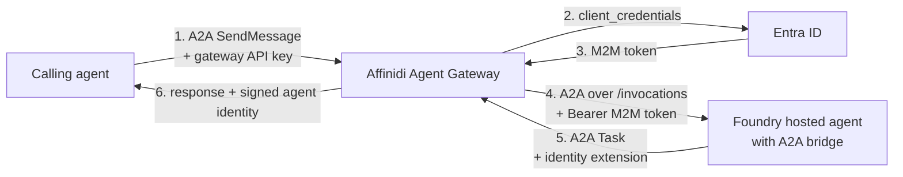
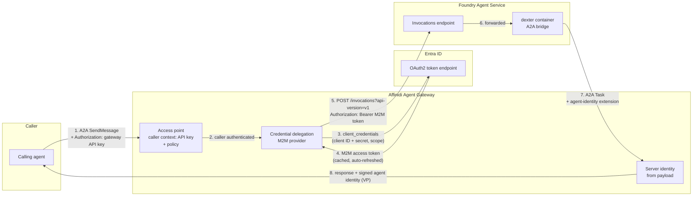

# Microsoft Foundry Hosted Agent + A2A Bridge + Affinidi Agent Gateway

Run a code-based (hosted) Microsoft Foundry agent as an A2A agent, call it with a machine-to-machine (M2M) token, and expose it safely through Affinidi Agent Gateway, so callers hold only a gateway API key and never an Entra secret.

> Examples use the agent name `dexter`. Replace every `<placeholder>` with your own values. No real resource names, IDs or credentials appear in this guide.

## The end result



Three things make this work:

| Piece                            | What it does                                                                                                  | Section                                                                                        |
| -------------------------------- | ------------------------------------------------------------------------------------------------------------- | ---------------------------------------------------------------------------------------------- |
| **A2A bridge in the agent**      | Custom code that accepts A2A on Foundry's Invocations path and adds the agent identity extension to responses | [2](#2-make-the-hosted-agent-speak-a2a), [3](#3-add-the-agent-identity-extension-to-responses) |
| **Entra app registration (M2M)** | An app identity with the right Foundry role, so a token can be fetched without a user                         | [4](#4-set-up-machine-to-machine-m2m-access)                                                   |
| **Agent Gateway surface**        | API key for callers, credential delegation for the M2M token, agent identity from the response                | [5](#5-configure-affinidi-agent-gateway)                                                       |

### What gets called, and how

You'll test in three stages, each proving one more piece:

| Test  | Caller          | Calls                           | Authenticates with                                        | Proves                                  |
| ----- | --------------- | ------------------------------- | --------------------------------------------------------- | --------------------------------------- |
| **A** | You (developer) | Foundry agent endpoint directly | Your Entra **user token** (`az account get-access-token`) | The agent and bridge work               |
| **B** | Service / app   | Foundry agent endpoint directly | Entra **M2M token** (client credentials)                  | App-only access and the role assignment |
| **C** | Calling agent   | Agent Gateway **access point**  | Gateway **API key**; the gateway adds the M2M token       | The production path                     |

## Contents

1. [Create the hosted agent](#1-create-the-hosted-agent)
2. [Make the hosted agent speak A2A](#2-make-the-hosted-agent-speak-a2a)
3. [Add the agent identity extension to responses](#3-add-the-agent-identity-extension-to-responses)
4. [Set up machine-to-machine (M2M) access](#4-set-up-machine-to-machine-m2m-access)
5. [Configure Affinidi Agent Gateway](#5-configure-affinidi-agent-gateway)
6. [Test calls: user token, M2M token, gateway](#6-test-calls-user-token-m2m-token-gateway)
7. [Appendix: limitations, comparisons and sources](#7-appendix-limitations-comparisons-and-sources)

### What's in this folder

This folder holds a tested reference implementation. It isn't meant to be deployed as-is: `azd` needs your own environment (the `.azure/` folder, subscription, Foundry project and model deployment), which this folder doesn't include. Create your own project in [Section 1](#1-create-the-hosted-agent), then copy in the files you need in [Section 2](#add-the-bridge-to-your-project).

| File                                                                     | What it is                                                                            | Copy it?                                                  |
| ------------------------------------------------------------------------ | ------------------------------------------------------------------------------------- | --------------------------------------------------------- |
| `src/agent-framework-agent-basic-responses/a2a_bridge.py`                | The A2A bridge: `SendMessage` on `/invocations`, identity extension, self-hosted card | ✅ Copy as-is                                             |
| `src/agent-framework-agent-basic-responses/main.py`                      | The sample's `main.py` with the bridge wired in                                       | Use as a reference for the two-line change                |
| `azure.yaml`                                                             | Agent definition with the Invocations protocol, A2A endpoint and agent card           | Use as a reference; merge the agent section into your own |
| `src/agent-framework-agent-basic-responses/.env.example`                 | Environment variable names for local runs                                             | Optional                                                  |
| Everything else (`Dockerfile`, `pyproject.toml`, `uv.lock`, `AGENTS.md`) | Unchanged from Microsoft's sample                                                     | No: `azd ai agent init` creates these for you             |

---

## 1. Create the hosted agent

These steps follow Microsoft's quickstart: [Deploy and invoke a hosted agent](https://learn.microsoft.com/en-us/azure/foundry/agents/quickstarts/quickstart-hosted-agent).

### Prerequisites

| Requirement                 | Detail                                                                                                                                                                                                                                                                  |
| --------------------------- | ----------------------------------------------------------------------------------------------------------------------------------------------------------------------------------------------------------------------------------------------------------------------- |
| **Azure subscription**      | [Create one for free](https://azure.microsoft.com/pricing/purchase-options/azure-account) if needed                                                                                                                                                                     |
| **Roles**                   | **Foundry Project Manager** at project scope for an existing project, or **Owner** at resource group scope to create a new project. See [Hosted agent permissions reference](https://learn.microsoft.com/en-us/azure/foundry/agents/concepts/hosted-agent-permissions). |
| **Tools**                   | [Foundry Dev Pack](https://learn.microsoft.com/en-us/azure/foundry/how-to/develop/install-cli-sdk#install-foundry-devpack), which installs Azure Developer CLI (`azd >= 1.27.1`) and the Foundry extensions                                                             |
| **Signed-in `azd` session** | `azd auth login`                                                                                                                                                                                                                                                        |

> If you use a coding agent such as GitHub Copilot, the [Microsoft Foundry Skill](https://learn.microsoft.com/en-us/azure/foundry/how-to/develop/use-microsoft-foundry-skill) can guide setup, deployment and invocation.

### Step 1 — Initialize the sample agent

In an empty directory, initialize a hosted agent from the basic Agent Framework sample ([source](https://github.com/microsoft-foundry/foundry-samples/blob/main/samples/python/hosted-agents/agent-framework/responses/01-basic)):

```bash
azd auth login
azd ai agent init -t "https://github.com/microsoft-foundry/foundry-samples/blob/main/samples/python/hosted-agents/agent-framework/responses/01-basic/azure.yaml" --deploy-mode code
```

The interactive flow asks for:

| Prompt                    | What to choose                                                                                     |
| ------------------------- | -------------------------------------------------------------------------------------------------- |
| **Agent name**            | Accept the default (`agent-framework-agent-basic-responses`) or enter your own, e.g. `dexter`      |
| **Foundry project**       | Create a new project or use an existing one                                                        |
| **Tenant / Subscription** | Your Azure tenant and subscription                                                                 |
| **Location**              | Your Azure region                                                                                  |
| **Model**                 | The default (`gpt-5.4-mini`) or another model you can access. The example below uses `gpt-5-mini`. |
| **Model version**         | The default                                                                                        |
| **Model SKU**             | One with available quota that isn't Batch, usually Standard or GlobalStandard                      |
| **Deployment capacity**   | The default (10)                                                                                   |
| **Deployment name**       | The default                                                                                        |

When it finishes you see `AI agent definition added to your azd project successfully!`. Change into the new folder:

```bash
cd agent-framework-agent-basic-responses
```

### Step 2 — Provision Azure resources

```bash
azd provision
```

### Step 3 — Test locally

```bash
azd ai agent run                    # opens the agent inspector in your browser
azd ai agent run --no-inspector     # or: run on http://localhost:8088 without the inspector
```

This creates a virtual environment, installs dependencies and starts the agent using the `startupCommand` in `azure.yaml`.

### Step 4 — Deploy to Foundry Agent Service

```bash
azd deploy                          # or: azd deploy <agent-name>
```

`azd` packages the source as a ZIP and uploads it; Foundry resolves dependencies, builds the hosted agent remotely and deploys it.

This gives a working **Responses protocol** endpoint:

```
{project_endpoint}/agents/<agent-name>/endpoint/protocols/openai/responses?api-version=v1
```

### What `init` generated

`azd ai agent init` creates `azure.yaml` and the agent code. With the agent renamed to `dexter`, they look like this.

**`azure.yaml`**

```yaml
name: agent-framework-agent-basic-responses
services:
  dexter:
    project: src/agent-framework-agent-basic-responses
    host: azure.ai.agent
    language: python
    uses:
      - ai-project
    codeConfiguration:
      entryPoint: main.py
      runtime: python_3_13
    kind: hosted
    protocols:
      - protocol: responses
        version: 2.0.0
  ai-project:
    host: azure.ai.project
    deployments:
      - model:
          format: OpenAI
          name: gpt-5-mini
          version: "2026-03-17"
        name: gpt-5-mini
        sku:
          capacity: 10
          name: GlobalStandard
infra:
  provider: microsoft.foundry
```

**`main.py`**

```python
import os

from agent_framework import Agent
from agent_framework.foundry import FoundryChatClient
from agent_framework_foundry_hosting import ResponsesHostServer
from azure.identity import DefaultAzureCredential

client = FoundryChatClient(
    project_endpoint=os.environ["FOUNDRY_PROJECT_ENDPOINT"],
    model=os.environ["AZURE_AI_MODEL_DEPLOYMENT_NAME"],
    credential=DefaultAzureCredential(),
)
agent = Agent(client=client, name="dexter", instructions="You are a friendly assistant.")

server = ResponsesHostServer(agent)
server.run()
```

You now have a working agent that speaks Foundry's Responses protocol. Next, teach it A2A.

---

## 2. Make the hosted agent speak A2A

### Why we start from the Responses template

We keep the Responses template because it gives us a standard, deployable hosted agent and a server (`ResponsesHostServer`) we can extend with our own routes. The plan is to keep the agent exactly as it is and add an A2A front door next to it.

### First attempt: Foundry's native A2A endpoint

Declaring A2A support looks straightforward. Add this to the agent's service in `azure.yaml`:

```yaml
agentEndpoint:
  protocols:
    - responses
    - a2a
agentCard:
  description: ...
  version: 1.0.0
  skills: [...]
```

This **publishes a valid agent card**, readable with a user or M2M Entra token:

```
GET {project_endpoint}/agents/dexter/endpoint/protocols/a2a/agentCard/v1.0
```

But `SendMessage` on the native A2A endpoint fails for **hosted agents**:

```json
{
  "error": {
    "code": -32099,
    "message": "The requested A2A operation is not supported for this hosted-agent target.",
    "data": [
      {
        "reason": "HOSTED_AGENT_NOT_SUPPORTED",
        "detail": "Use a prompt agent as the A2A target."
      }
    ]
  }
}
```

Foundry's native A2A endpoint only delivers messages to prompt agents. (We tested every version and transport combination; details in [Appendix 7.1](#71-a2a-on-hosted-agents).)

### Second attempt: our own route in the container

The next instinct is to add a Starlette route inside the container, such as `/a2a`, and call it directly. That doesn't work either: **the Foundry Agent Service dedicated endpoint only routes supported protocol paths to the container**.

| Path under `/endpoint/protocols/`               | Forwarded to container?                                                                                |
| ----------------------------------------------- | ------------------------------------------------------------------------------------------------------ |
| `openai/responses`                              | ✅ Yes                                                                                                 |
| `invocations`                                   | ✅ Yes                                                                                                 |
| `invocations_ws` (WebSocket)                    | ✅ Yes (untested here)                                                                                 |
| `a2a`                                           | ❌ No — handled entirely by the platform                                                               |
| anything else (custom paths, `.well-known/...`) | ❌ No — 404 from the Foundry Agent Service dedicated endpoint; the request never reaches the container |

So a route like `POST /a2a` inside our own code is real and works locally, but **is unreachable through the Foundry Agent Service dedicated endpoint**.

### The fix: carry A2A over the Invocations path

`/invocations` is Foundry Agent Service's "bring your own payload" channel. Microsoft describes it as a pass-through protocol for callers whose protocol doesn't match Responses, and it's one of the paths Foundry forwards to the container. So we implement the A2A `SendMessage` handler there.

```mermaid
flowchart LR
    subgraph Caller
        C[Client]
    end

    subgraph EntraID["Entra ID"]
        AAD[OAuth2 token endpoint]
    end

    subgraph Foundry["Foundry Agent Service"]
        FE{{Foundry agent endpoint<br/>/endpoint/protocols/*}}
        NativeA2A["Native A2A handler<br/>/protocols/a2a<br/>❌ SendMessage rejected<br/>for hosted agents"]
    end

    subgraph Container["dexter container"]
        RHS[ResponsesHostServer<br/>Starlette app]
        Bridge["a2a_bridge.py<br/>send_message()"]
        Agent[Agent Framework<br/>Agent.run&#40;&#41;]
    end

    C -- "1. client_credentials" --> AAD
    AAD -- "2. access_token" --> C
    C -- "3. POST /endpoint/protocols/invocations<br/>JSON-RPC SendMessage" --> FE
    FE -. "not used for hosted agents" .-> NativeA2A
    FE -- "4. forwarded (supported protocol path)" --> RHS
    RHS --> Bridge
    Bridge -- "5. agent.run(text)" --> Agent
    Agent -- "6. model response" --> Bridge
    Bridge -- "7. A2A v1.0 Task in JSON-RPC response" --> C
```



### Add the bridge to your project

Do this in the project you created with `azd ai agent init` in Section 1. Paths below use the sample's folder name; use your own if you changed it.

**1. Copy the bridge.** Copy `a2a_bridge.py` from this folder into your agent folder, next to `main.py`:

```
src/agent-framework-agent-basic-responses/a2a_bridge.py
```

**2. Wire it into `main.py`.** Two changes: import the routes, and pass them to the server.

```python
from a2a_bridge import create_a2a_routes

# ...existing agent setup...

server = ResponsesHostServer(agent, routes=create_a2a_routes(agent))
server.run()
```

**3. Update `azure.yaml`.** In your agent's service, add the **Invocations** protocol (this is what makes Foundry forward `/invocations` to your container) and the A2A endpoint and card:

```yaml
protocols:
  - protocol: responses
    version: 2.0.0
  - protocol: invocations # required for the bridge
    version: 2.0.0
agentEndpoint:
  protocols:
    - responses
    - invocations
    - a2a # publishes Foundry's native agent card
agentCard:
  description: <what your agent does>
  version: 1.0.0
  skills:
    - id: <skill-id>
      name: <skill name>
      description: <skill description>
      tags: [<tag>]
      examples:
        - <example prompt>
```

This folder's `azure.yaml` also declares `capabilities.extensions` under `agentCard`. Foundry accepts it but doesn't publish it ([Appendix 7.2](#72-agent-card)); it's harmless and documents intent.

**4. Run locally, then deploy.**

```bash
azd ai agent run --no-inspector

# in another terminal: SendMessage against the local container
curl -s -X POST http://localhost:8088/invocations -H "Content-Type: application/json" \
  -d '{"jsonrpc":"2.0","id":1,"method":"SendMessage","params":{"message":{"messageId":"m1","role":"ROLE_USER","parts":[{"text":"hi"}]}}}' | jq

azd deploy
```

### What the bridge does (`a2a_bridge.py`)

**1. `create_a2a_routes(agent)`** builds Starlette routes bound to the agent:

| Route in the container             | Purpose                                          | Reachable from outside?                                                                                        |
| ---------------------------------- | ------------------------------------------------ | -------------------------------------------------------------------------------------------------------------- |
| `POST /invocations`                | `SendMessage` handler — **production route**     | ✅ Yes, as `.../endpoint/protocols/invocations` with a user or M2M token                                       |
| `POST /a2a`                        | Same handler, for local testing                  | ❌ Local only                                                                                                  |
| `GET /a2a/agentCard/v1.0`          | Self-hosted card, including the custom extension | ❌ Local only (Foundry's own card at `.../protocols/a2a/agentCard/v1.0` is reachable with a user or M2M token) |
| `GET /.well-known/agent-card.json` | Self-hosted card                                 | ❌ Local only                                                                                                  |

The self-hosted card routes are conveniences for local testing (for example `azd ai agent run` on `localhost:8088`).

> **Note on `.well-known/agent-card.json`:** this path is GET-only by convention; it's the standard A2A discovery URI and is never used for RPC calls. Even if Foundry forwarded it, it couldn't carry a POST-based JSON-RPC call. The only POST path that is both externally reachable and able to carry JSON-RPC is `/invocations`, and only `SendMessage` is implemented there today (there is no `GetAgentCard` method).

**2. `main.py`** adds the routes to the existing server:

```python
server = ResponsesHostServer(agent, routes=create_a2a_routes(agent))
```

This works because `ResponsesHostServer` → `ResponsesAgentServerHost` → `AgentServerHost` is ultimately a plain Starlette subclass that merges any `routes=` argument with its own routes, so no fork of the hosting library is needed. The Responses endpoint keeps working alongside.

**3. `send_message(request)`**, bound to both `/a2a` and `/invocations`:

1. Parses the JSON-RPC envelope and dispatches on `method`.
2. Extracts the text part from the incoming `Message.parts`.
3. Calls `await agent.run(text)`, the same Agent Framework agent used by the Responses protocol.
4. Wraps the result in an A2A v1.0 `Task` (`id`, `contextId`, `status.state: TASK_STATE_COMPLETED`, `status.message`, `history: []`).
5. Returns it in the JSON-RPC envelope: `{"jsonrpc": "2.0", "id": ..., "result": {"task": {...}}}`.

What the bridge deliberately doesn't do (streaming, task persistence) is listed in [Appendix 7.1](#71-a2a-on-hosted-agents).

---

## 3. Add the agent identity extension to responses

Because the bridge builds the A2A response itself, it can carry metadata that Foundry's native card and prompt agents can't (see [Appendix 7.2](#72-agent-card)). That's how the gateway learns who the agent is.

A2A lets agents declare custom **extensions**: vendor-specific capabilities advertised in the agent card and attached to messages. Under the A2A "Message Extensions" pattern, extension data goes on the `Message` object. The bridge adds the `agent-identity/v1` extension to the **status message of the returned Task** (`result.task.status.message`):

```json
{
  "role": "ROLE_AGENT",
  "parts": [{ "text": "..." }],
  "extensions": ["https://fabric.affinidi.io/extensions/agent-identity/v1"],
  "metadata": {
    "https://fabric.affinidi.io/extensions/agent-identity/v1": {
      "name": "<agent-display-name>",
      "model": "<model>",
      "role": "<role>",
      "version": "<version>"
    }
  }
}
```

**Where to set the values:** in `a2a_bridge.py`, the `reply` built in `send_message()` holds the identity block under `metadata[IDENTITY_EXTENSION_URI]`. Replace the example values (`name`, `model`, `role`, `version`) with your agent's own, and ideally read them from environment variables so each deployment can set its own.

Rules learned the hard way:

| Rule                                                                           | Why                                                                                                                                                                                                                                                                                                                                                             |
| ------------------------------------------------------------------------------ | --------------------------------------------------------------------------------------------------------------------------------------------------------------------------------------------------------------------------------------------------------------------------------------------------------------------------------------------------------------- |
| **Put `extensions` and `metadata` on `result.task.status.message`**            | The gateway reads the status message first, then `artifacts[]`, and never `history[]`                                                                                                                                                                                                                                                                           |
| **Key `metadata` by the extension URI**, with a flat object underneath         | An extra wrapper key (e.g. `agentIdentity`) is a common cause of "it just doesn't parse"                                                                                                                                                                                                                                                                        |
| **Use one URI per extension**                                                  | Reusing a URI for two payloads makes one silently overwrite the other                                                                                                                                                                                                                                                                                           |
| **Keep the identity fields stable**                                            | The gateway hashes the fields configured as identity fields on the surface ([Section 5, step 8](#step-8--server-managed-agent-identity)) into the agent's DID. You choose which fields, one or several, depending on what the agent sends. Changing the value of any configured identity field creates a new DID, and the Trust Registry entry must be updated. |
| **Never echo caller content into the status message**                          | Build identity metadata from the agent's own configuration. Otherwise a caller could plant an identity that the gateway attributes to this agent.                                                                                                                                                                                                               |
| **Declare the extension in `capabilities.extensions` of the self-hosted card** | Foundry's native card can't carry it ([Appendix 7.2](#72-agent-card))                                                                                                                                                                                                                                                                                           |

---

## 4. Set up machine-to-machine (M2M) access

An external application (not a person) needs an Entra ID app registration with a credential, and an Azure role on the agent. Portal and CLI give the same result. The gateway will use this same app in [Section 5](#5-configure-affinidi-agent-gateway).

### Step 1 — Register the application in Entra ID

**CLI**

```bash
az ad app create --display-name "<caller-app-name>"
# Note "appId" in the output: this is your client ID
```

**Portal**

1. Go to **portal.azure.com** → search **App registrations** → **+ New registration**.
2. Name it (e.g. `<caller-app-name>`), keep the default single-tenant option → **Register**.
3. Copy the **Application (client) ID** from the Overview page.

### Step 2 — Create a service principal for the app

**CLI**

```bash
az ad sp create --id <appId>
# Note "id" (object ID) in the output: needed for the role assignment
```

**Portal**

Registering the app (Step 1) creates the service principal automatically. Find its object ID under **Enterprise applications** → search your app → **Overview** → **Object ID**.

### Step 3 — Create a client secret

**CLI**

```bash
az ad app credential reset --id <appId> --display-name "<secret-name>" --years 1
# "password" in the output is the client secret, shown only once. Store it securely.
```

**Portal**

1. **App registrations** → your app → **Certificates & secrets** → **+ New client secret**.
2. Add a description and expiry → **Add**.
3. Copy the secret **Value** immediately; it's hidden once you leave the page.

> For production, prefer a **certificate** over a client secret (`az ad app credential reset --cert ...`, or upload a certificate in the Portal's Certificates tab).

### Step 4 — Grant the app a role on the Foundry agent

The role must include the `Microsoft.CognitiveServices/accounts/AIServices/agents/writeactions` data action, which `/invocations` needs. Only the wildcard `Microsoft.CognitiveServices/*` set includes it.

| Role                        | Use it?                                                                              |
| --------------------------- | ------------------------------------------------------------------------------------ |
| **Foundry User**            | ✅ Preferred, scoped to the agent                                                    |
| **Cognitive Services User** | ✅ Works, but grants broader access across the account, including direct model calls |
| **Foundry Agent Consumer**  | ❌ Not enough for Invocations ([Appendix 7.4](#74-rbac-for-invocations))             |

Assign the role to the service principal's **object ID**, not the client ID.

**CLI** (scoped to the agent — least privilege)

```bash
az role assignment create \
  --assignee-object-id "<servicePrincipalObjectId>" \
  --assignee-principal-type ServicePrincipal \
  --role "Foundry User" \
  --scope "/subscriptions/<subscription-id>/resourceGroups/<resource-group>/providers/Microsoft.CognitiveServices/accounts/<foundry-account>/projects/<project>/agents/<agent-name>"
```

**Portal** (assigns at account scope; the Portal IAM screen can't target agent scope)

1. Go to **portal.azure.com** → open your Foundry resource (`<foundry-account>`).
2. **Access control (IAM)** → **+ Add** → **Add role assignment**.
3. **Role** tab → search **Foundry User** (or **Cognitive Services User**) → select → **Next**.
4. **Members** tab → **User, group, or service principal** → **+ Select members** → search your app's display name → select → **Select**.
5. **Review + assign**.

> **Known pitfall:** if your own account is subject to an **ABAC (condition-based) restriction**, Azure blocks you from granting a wildcard-data-action role (`AuthorizationFailed ... ABAC condition ...`), even though the scope and role are valid. Retrying won't help; an account not subject to that condition must make the assignment.

### Step 5 — Get an M2M token and call the agent

Run [Test B](#test-b--m2m-token-direct-to-foundry) now. If it passes, the app and role are right and the gateway setup will work with the same values.

### Notes

- Deleting or rotating the client secret does **not** revoke tokens already issued; they stay valid until expiry (typically about an hour). To cut off access immediately, **remove the role assignment**. Azure RBAC is checked on every request, not baked into the token.
- Treat the client secret as a credential: never paste it into chat or shared documents, or commit it to source control. Rotate it if it's ever exposed.

---

## 5. Configure Affinidi Agent Gateway

With credential delegation, the **gateway** becomes the OAuth client: it holds the Entra client ID and secret, fetches and refreshes the M2M token, and injects it into each call. The calling app holds only a gateway API key. The agent sees a valid Entra token either way and doesn't know which route the request took.

> **Want the full picture first?** The [A2A credential delegation lab](https://github.com/affinidi/affinidi-labs-tgw-get-started/tree/main/a2a-credential-delegation) walks through the same pattern step by step with screenshots, including a user-consent (3-legged) variant. This section is its M2M flow, adapted to Foundry. Two differences from the lab: the **scope** here is `https://ai.azure.com/.default` (Foundry's audience, not your own `api://<client-id>`), and the **target** is Foundry's Invocations path.



Prerequisites: Sections 1–4 completed and Test B passing. You need the tenant ID, client ID, client secret and the agent's Invocations URL.

Useful references: [Credentials concept](https://docs.affinidi.com/products/affinidi-trust-fabric/agent-gateway/concepts/credentials/) · [Configure per-caller credential delegation](https://docs.affinidi.com/products/affinidi-trust-fabric/agent-gateway/how-to-guides/setup/configure-per-caller-credential-delegation/) · [Caller context binding](https://docs.affinidi.com/products/affinidi-trust-fabric/agent-gateway/concepts/caller-context-binding/) · [Surfaces](https://docs.affinidi.com/products/affinidi-trust-fabric/agent-gateway/concepts/surfaces/) · [Surface reference](https://docs.affinidi.com/products/affinidi-trust-fabric/agent-gateway/reference/surfaces/surface-reference/)

### Gateway configuration at a glance

| #   | Component                       | Setting                                                                 | Value                                                                       |
| --- | ------------------------------- | ----------------------------------------------------------------------- | --------------------------------------------------------------------------- |
| 1   | Secrets                         | Entra client ID and client secret (plus caller API key if secret-based) | `entra_client_id`, `entra_client_secret`, `<caller-api-key-secret>`         |
| 2   | Credential provider             | Type                                                                    | OAuth 2.0 Client Credentials (2-legged, M2M)                                |
| 3   | Policy                          | Caller authentication                                                   | Deny callers whose API key failed                                           |
| 4   | Surface → Managed agent         | Endpoint                                                                | Foundry Invocations URL with `?api-version=v1`                              |
| 5   | Surface → Managed agent         | Target authentication                                                   | **None**                                                                    |
| 6   | Surface → Access point          | Agent card location                                                     | Override to Foundry's card path (differs from the Invocations path)         |
| 7   | Surface → Caller context        | Caller authentication                                                   | API key (`Authorization` header, no `Bearer` prefix)                        |
| 8   | Surface → Credential delegation | Binding                                                                 | M2M provider, required for `all`, `on_demand`, bearer header                |
| 9   | Surface → Identity              | Server (managed agent) identity                                         | From payload; meta field and identity fields configurable (example: `name`) |

### Step 1 — Create the gateway secrets

**Secrets → Add secret.**

| Secret name               | Holds                                                                               | Used by                       |
| ------------------------- | ----------------------------------------------------------------------------------- | ----------------------------- |
| `entra_client_id`         | Application (client) ID from Section 4, step 1                                      | Credential provider           |
| `entra_client_secret`     | Client secret value from Section 4, step 3                                          | Credential provider           |
| `<caller-api-key-secret>` | The API key callers must present (only if you use a secret-based API key in step 6) | Caller context on the surface |

Secrets are referenced by name; their values never go into surface configuration.

### Step 2 — Create the credential provider (M2M)

**Credentials → Credential providers → New.**

| Field                | Value                                                             |
| -------------------- | ----------------------------------------------------------------- |
| **Name**             | e.g. `Foundry M2M`                                                |
| **Provider type**    | OAuth 2.0, Client Credentials (2-legged, machine-to-machine)      |
| **Token endpoint**   | `https://login.microsoftonline.com/<tenant-id>/oauth2/v2.0/token` |
| **Client ID secret** | `entra_client_id`                                                 |
| **Client secret**    | `entra_client_secret`                                             |
| **Default scopes**   | `https://ai.azure.com/.default`                                   |

No authorization endpoint and no callback URL: there's no user to redirect. The gateway fetches the token when needed, caches it for all callers of the surface, and fetches a new one when it expires.

> With client credentials, Entra only accepts a `/.default` scope. Requesting an individual scope returns `AADSTS1002012`.

### Step 3 — Create the caller authentication policy

**Policies → New policy.** This allows only callers whose API key verified, and returns the gateway's own reason when it didn't:

```rego
package surface.policy

import rego.v1

default allow := false

# Allow only successfully authenticated callers
allow if {
  input.source_auth.method != "failed"
}

# Return the authentication error from the source
deny_reason := reason if {
  input.source_auth.method == "failed"

  reason := object.get(
    input.source_auth,
    "reason",
    "Caller authentication failed"
  )

  is_string(reason)
  reason != ""
} else := "Caller authentication failed" if {
  input.source_auth.method == "failed"
}
```

Without this policy, a request with a missing or wrong API key isn't rejected by the gateway; it continues with no caller identity, and the delegated token isn't attached.

### Step 4 — Create the surface and the managed agent

**Surfaces → New surface** (protocol **A2A**), then build the canvas left to right. Set the route on the access point, e.g. `<route>`.

On the **Managed Agent**:

| Setting                               | Value                                                                                                                                      |
| ------------------------------------- | ------------------------------------------------------------------------------------------------------------------------------------------ |
| **Endpoint type**                     | Direct URL                                                                                                                                 |
| **Endpoint**                          | `https://<foundry-account>.services.ai.azure.com/api/projects/<project>/agents/<agent-name>/endpoint/protocols/invocations?api-version=v1` |
| **Target authentication**             | None. The token comes from credential delegation; setting both would write two `Authorization` headers.                                    |
| **Send signed identity VP to target** | On. The gateway attaches the caller's identity presentation to the request.                                                                |

### Step 5 — Override the agent card location

The target endpoint is Foundry's **Invocations** path, which carries the A2A messages. Foundry serves the agent card on a **different** path (under `/protocols/a2a/`), so the card location must be overridden separately; the target endpoint stays on Invocations.

On the **access point**, tick **Override agent card location** and set the card path relative to the target's origin (no leading slash):

```
api/projects/<project>/agents/<agent-name>/endpoint/protocols/a2a/agentCard/v1.0
```

The gateway fetches the card from there and re-serves it on the standard well-known path.

> **Current limitation:** the gateway's card fetch uses Target Authentication, which only supports a static secret. Foundry's card needs an Entra token, so the card isn't served through the gateway yet. Messages are unaffected. A feedback item to support OAuth for the card fetch has been raised.

### Step 6 — Caller context (API key) and policy

Between the access point and the managed agent, add **Caller Context**:

| Setting               | Value                                                                                                                                                                                   |
| --------------------- | --------------------------------------------------------------------------------------------------------------------------------------------------------------------------------------- |
| **Method**            | API key: either a secret-based key (`<caller-api-key-secret>` from step 1, as in the lab) or a key issued by the gateway's **API key provider** (as in the example configuration below) |
| **Extraction source** | HTTP header                                                                                                                                                                             |
| **Header**            | `Authorization`                                                                                                                                                                         |

Then attach the **policy** from step 3.

The caller sends the key as the raw `Authorization` header value, **without** a `Bearer` prefix. This authenticates _the caller to the gateway_; it's separate from the Entra token the gateway fetches afterwards.

Credential delegation only attaches the M2M token when the caller is authenticated. A call from a peer gateway needs the caller identity to arrive with the request; otherwise no token is attached and Foundry returns 401.

### Step 7 — Credential delegation

Between the managed agent and the external target, add **Credential Delegation**:

| Field                   | Value                    | Why                                                           |
| ----------------------- | ------------------------ | ------------------------------------------------------------- |
| **Credential provider** | The provider from step 2 |                                                               |
| **Required for**        | `all`                    | `tools` applies only to MCP                                   |
| **Consent mode**        | On demand (default)      | Not used for client credentials; there's no user consent step |
| **Inject as**           | Bearer header            | Foundry expects `Authorization: Bearer <token>`               |
| **Scopes**              | Empty                    | Uses the provider default (`https://ai.azure.com/.default`)   |

### Step 8 — Server (managed agent) identity

Between the managed agent and the access point (response side, `protected` slot), add **Identity**:

| Setting             | Value                                                                                                                                                                          |
| ------------------- | ------------------------------------------------------------------------------------------------------------------------------------------------------------------------------ |
| **Type**            | From payload (payload extraction)                                                                                                                                              |
| **Meta field**      | The metadata field that carries the identity (configurable to match the agent's metadata; example: `serverIdentity`)                                                           |
| **Identity fields** | Configurable: one or more of the fields the agent sends (`name`, `model`, `role`, `version`, ...), each marked `x-identity: true` in the schema. The example uses `name` only. |
| **Schema**          | Object describing the identity fields; list the ones that must be present under `required`                                                                                     |

The gateway reads the identity payload from the agent's response ([Section 3](#3-add-the-agent-identity-extension-to-responses)) and hashes the configured identity fields into the agent's DID. Pick fields that stay stable across redeploys: changing the value of any configured identity field produces a new DID.

The gateway attaches a signed identity presentation (VP) to the response. Register the resulting DID in the Trust Registry so trust checks pass. The agent's DID is also part of the key the gateway uses to store delegated credentials per caller ([caller context binding](https://docs.affinidi.com/products/affinidi-trust-fabric/agent-gateway/concepts/caller-context-binding/)).

### Example surface configuration (redacted)

```json
{
  "name": "<surface-name>",
  "access_point": {
    "route": "<route>",
    "protocol": "a2a",
    "agent_card_path": "api/projects/<project>/agents/<agent-name>/endpoint/protocols/a2a/agentCard/v1.0",
    "caller_authentication": {
      "methods": [
        {
          "type": "api_key_provider",
          "extraction": { "source": "http_header", "field": "Authorization" },
          "agent_id": "<surface-id>"
        }
      ]
    }
  },
  "target": {
    "endpoint": "https://<foundry-account>.services.ai.azure.com/api/projects/<project>/agents/<agent-name>/endpoint/protocols/invocations?api-version=v1",
    "identity_injection": { "inject_vp": true }
  },
  "outbound_credentials": [
    {
      "credential_provider_id": "<credential-provider-id>",
      "scopes": [],
      "required_for": "all",
      "consent_mode": "on_demand",
      "inject_as": { "type": "bearer_header" }
    }
  ],
  "identity_slots": {
    "protected": {
      "type": "from_payload",
      "meta_field": "serverIdentity",
      "fields": ["name"],
      "json_schema": {
        "type": "object",
        "properties": { "name": { "type": "string", "x-identity": true } },
        "required": ["name"]
      }
    }
  }
}
```

### Troubleshooting

| Symptom                                                     | Likely cause                                                                                                                                             |
| ----------------------------------------------------------- | -------------------------------------------------------------------------------------------------------------------------------------------------------- |
| **Rejected with "Caller authentication failed"**            | Missing or wrong API key, or a `Bearer` prefix was added (steps 3 and 6)                                                                                 |
| **`403 identity-required` from the gateway**                | No authenticated caller and no policy rejecting it first (steps 3 and 6)                                                                                 |
| **`401` from Foundry**                                      | No M2M token attached: missing caller identity over fabric, or no delegation binding (step 7)                                                            |
| **`403` from Foundry**                                      | Role missing or wrong scope ([Section 4, step 4](#step-4--grant-the-app-a-role-on-the-foundry-agent))                                                    |
| **`client_credentials_failed` in the delegation audit log** | Wrong token endpoint, client ID, secret or scope (step 2)                                                                                                |
| **`AADSTS1002012`**                                         | An individual scope was requested with client credentials; use `https://ai.azure.com/.default`                                                           |
| **Identity not extracted**                                  | Extension missing, not on `status.message`, or a required identity field missing ([Section 3](#3-add-the-agent-identity-extension-to-responses), step 8) |
| **New DID after a redeploy**                                | The value of a configured identity field changed                                                                                                         |
| **Agent card not returned by the gateway**                  | Expected today; see step 5                                                                                                                               |

---

## 6. Test calls: user token, M2M token, gateway

Set these once:

```bash
FOUNDRY="https://<foundry-account>.services.ai.azure.com/api/projects/<project>/agents/<agent-name>/endpoint"
GATEWAY="https://<gateway-host>/<route>"
```

### Test A — User token, direct to Foundry

Quick check with your own signed-in identity. This proves the agent and bridge work; it **doesn't** prove M2M.

```bash
TOKEN=$(az account get-access-token --resource https://ai.azure.com --query accessToken -o tsv)

# Native agent card (platform-served, read-only)
curl -s "$FOUNDRY/protocols/a2a/agentCard/v1.0" -H "Authorization: Bearer $TOKEN" | jq

# SendMessage via the Invocations bridge
curl -s -X POST "$FOUNDRY/protocols/invocations?api-version=v1" \
  -H "Authorization: Bearer $TOKEN" -H "Content-Type: application/json" \
  -d '{"jsonrpc":"2.0","id":1,"method":"SendMessage","params":{"message":{"messageId":"'"$(uuidgen)"'","role":"ROLE_USER","parts":[{"text":"hi"}]}}}' | jq
```

### Test B — M2M token, direct to Foundry

Proves the app registration, secret and role assignment from [Section 4](#4-set-up-machine-to-machine-m2m-access). This is exactly what the gateway does internally.

**1. Get an M2M (client credentials) token**

```bash
TOKEN=$(curl -s -X POST "https://login.microsoftonline.com/<tenant-id>/oauth2/v2.0/token" \
  -d "client_id=<appId>" \
  -d "client_secret=<clientSecret>" \
  -d "scope=https://ai.azure.com/.default" \
  -d "grant_type=client_credentials" | jq -r .access_token)
```

**2. (Optional) Confirm it's an app-only token**

```bash
echo "$TOKEN" | cut -d. -f2 | tr '_-' '/+' | base64 -d 2>/dev/null | jq '{idtyp, scp, roles, appid}'
# App-only (M2M): no "scp" claim; "idtyp": "app" where that claim is emitted
# Delegated user token: "scp" and/or "upn" present
```

**3. Send an A2A message through the bridge**

```bash
curl -s -X POST "$FOUNDRY/protocols/invocations?api-version=v1" \
  -H "Authorization: Bearer $TOKEN" \
  -H "Content-Type: application/json" \
  -d '{"jsonrpc":"2.0","id":1,"method":"SendMessage","params":{"message":{"messageId":"'"$(uuidgen)"'","role":"ROLE_USER","parts":[{"text":"hi"}]}}}' | jq
```

**4. (Optional) Fetch the native agent card**

```bash
curl -s "$FOUNDRY/protocols/a2a/agentCard/v1.0" -H "Authorization: Bearer $TOKEN" | jq
```

**5. (Optional) Confirm a rotated or deleted secret is rejected**

```bash
curl -s -X POST "https://login.microsoftonline.com/<tenant-id>/oauth2/v2.0/token" \
  -d "client_id=<appId>" \
  -d "client_secret=<oldOrDeletedSecret>" \
  -d "scope=https://ai.azure.com/.default" \
  -d "grant_type=client_credentials" | jq
# Expect: {"error":"invalid_client", "error_description":"AADSTS7000215: Invalid client secret..."}
```

There's no Portal UI for getting a client-credentials token; use the token endpoint (curl, Postman, MSAL or your app's HTTP client). The Portal is only for the one-time setup in Section 4.

### Test C — Through the Affinidi Agent Gateway access point

The production path. The caller sends only the gateway API key (raw value, no `Bearer` prefix); the gateway adds the M2M token.

```bash
curl -s -X POST "$GATEWAY" \
  -H "Content-Type: application/json" \
  -H "A2A-Version: 1.0" \
  -H "Authorization: <gateway-api-key>" \
  -d '{"jsonrpc":"2.0","id":1,"method":"SendMessage","params":{"message":{"messageId":"'"$(uuidgen)"'","role":"ROLE_USER","parts":[{"text":"hi"}]}}}' | jq
```

Expected: a JSON-RPC result with a completed Task, the agent's reply in `result.task.status.message`, and the gateway's signed identity presentation in place of the raw identity extension.

### Local only — self-hosted card

```bash
curl -s http://localhost:8088/a2a/agentCard/v1.0 | jq
```

---

## 7. Appendix: limitations, comparisons and sources

### 7.1 A2A on hosted agents

| Limitation                                          | Detail                                                                                                                                                                                                                                                                    |
| --------------------------------------------------- | ------------------------------------------------------------------------------------------------------------------------------------------------------------------------------------------------------------------------------------------------------------------------- |
| **Native A2A operations rejected**                  | `SendMessage`, `SendStreamingMessage`, `GetTask` and others return `HOSTED_AGENT_NOT_SUPPORTED`. Verified across all protocol versions (1.0, 0.3), transports (JSON-RPC, HTTP+JSON) and several message schemas; the hosted target is rejected before payload processing. |
| **Microsoft's documented target is a prompt agent** | The bridge is for cases that need a hosted (code-based) agent.                                                                                                                                                                                                            |
| **No streaming in the bridge**                      | `capabilities.streaming: false`; only synchronous `TASK_STATE_COMPLETED` responses.                                                                                                                                                                                       |
| **No task persistence**                             | Each `SendMessage` creates a new task (a caller-supplied `contextId` is echoed back) and completes immediately. No task store, `GetTask` or `CancelTask`.                                                                                                                 |

### 7.2 Agent card

| Limitation                                          | Detail                                                                                                                                                                                                                                                                                                                |
| --------------------------------------------------- | --------------------------------------------------------------------------------------------------------------------------------------------------------------------------------------------------------------------------------------------------------------------------------------------------------------------- |
| **Fixed `agentCard` schema in `azure.yaml`**        | Only `description`, `version` and `skills[]` are supported. There's no `capabilities`, `extensions`, `provider` or `iconUrl` field. Confirmed by inspecting the `AgentCard`/`AgentCardSkill` SDK models and by deploying a test `capabilities` block, which `azd` accepted but which never appeared in the live card. |
| **Native card can't carry custom extensions**       | A custom extension such as `agent-identity/v1` can't appear in Foundry's card at `/endpoint/protocols/a2a/agentCard/v1.0`, only in the self-hosted card.                                                                                                                                                              |
| **Fixed platform extensions**                       | Foundry adds `https://ai.azure.com/a2a/extensions/citations/v1` and `.../mcp-approval-request/v1` to every A2A-enabled card. Not configurable, no opt-out.                                                                                                                                                            |
| **Card requires Entra**                             | All A2A URLs, including the card, need an Entra token (user or M2M). There's no anonymous or well-known card path.                                                                                                                                                                                                    |
| **Self-hosted card isn't reachable externally**     | `/.well-known/agent-card.json` and `/a2a/agentCard/v1.0` in the container work only when calling it directly. A `GetAgentCard` JSON-RPC method on `/invocations` could expose it, but isn't implemented; only `SendMessage` is.                                                                                       |
| **Gateway can't fetch an Entra-protected card yet** | The gateway's card fetch supports only a static secret ([Section 5, step 5](#step-5--override-the-agent-card-location)).                                                                                                                                                                                              |

### 7.3 Foundry agent endpoint

| Limitation                                   | Detail                                                                                                                                             |
| -------------------------------------------- | -------------------------------------------------------------------------------------------------------------------------------------------------- |
| **Only supported protocol paths are routed** | `openai/responses`, `invocations` and `invocations_ws`. Other paths under `/endpoint/...` return 404 rather than reaching custom container routes. |
| **Native `a2a` path is platform-owned**      | Card `GET` works (generated from `azure.yaml`); `SendMessage` and other operations are rejected for hosted agents.                                 |
| **No custom path passthrough**               | A new Starlette route isn't reachable externally; it must ride one of the supported protocol paths.                                                |

### 7.4 RBAC for Invocations

Observed in testing. This differs from Microsoft's A2A guidance, which recommends Foundry Agent Consumer for native A2A.

| Finding                                 | Detail                                                                                                                                                                              |
| --------------------------------------- | ----------------------------------------------------------------------------------------------------------------------------------------------------------------------------------- |
| **Required data action**                | Calling `/invocations` needs `Microsoft.CognitiveServices/accounts/AIServices/agents/writeactions`.                                                                                 |
| **Roles that grant it**                 | Only the wildcard `Microsoft.CognitiveServices/*` data-action set includes it, granted by roles such as **Foundry User** or **Cognitive Services User**.                            |
| **Foundry Agent Consumer isn't enough** | It grants `endpoints/interact/action` only. That's enough for native A2A and Responses, but not for Invocations.                                                                    |
| **ABAC can block the grant**            | A condition-based restriction on the granting account can block assigning wildcard-data-action roles. This is a tenant guardrail; it needs an account not subject to the condition. |

### 7.5 Prompt agents versus hosted agents

| Capability                            | Prompt agent                                                            | Hosted agent                                                             |
| ------------------------------------- | ----------------------------------------------------------------------- | ------------------------------------------------------------------------ |
| **Native incoming A2A `SendMessage`** | ✅ Supported when Responses, agent card and A2A endpoint are configured | ❌ Not supported by the native dispatcher; use the `/invocations` bridge |
| **Native agent card**                 | ✅ Through Foundry's A2A endpoint                                       | ✅ Through Foundry's A2A endpoint (platform-generated)                   |
| **Custom card extensions**            | ❌ Not in the documented agent-card model                               | ❌ Not in `azure.yaml`; self-hosted card only                            |
| **Custom response metadata**          | ❌ Not available                                                        | ✅ Because the bridge builds the response                                |

Converting `dexter` to a prompt agent would make native A2A work, but it wouldn't add the `agent-identity/v1` metadata to responses. To keep the extension, keep custom code in the bridge, or put a separately controlled A2A service in front of the prompt agent.

> If you use a prompt agent through Foundry's native A2A endpoint, request A2A v1.0 explicitly (`A2A-Version: 1.0` header or `?a2a-version=1.0`). Without it, Foundry serves v0.3 by default. That endpoint is text-only, with no streaming.

### 7.6 Verification and sources

| Claim                                                | Microsoft documentation                                                                                                                                                     | Our verification                                                                          |
| ---------------------------------------------------- | --------------------------------------------------------------------------------------------------------------------------------------------------------------------------- | ----------------------------------------------------------------------------------------- |
| **Prompt agents can be incoming A2A targets**        | [Enable incoming A2A](https://learn.microsoft.com/en-us/azure/foundry/agents/how-to/enable-agent-to-agent-endpoint), "Supported agent types"                                | A test prompt agent with Responses + A2A accepted native `A2A-Version: 1.0` `SendMessage` |
| **Hosted agents support Responses and Invocations**  | [Hosted agents](https://learn.microsoft.com/en-us/azure/foundry/agents/concepts/hosted-agents), "Protocols"                                                                 | The hosted agent responds on `openai/responses` and `invocations`                         |
| **A2A v1.0 uses JSON-RPC; v0.3 is preview**          | [Enable incoming A2A](https://learn.microsoft.com/en-us/azure/foundry/agents/how-to/enable-agent-to-agent-endpoint), "A2A protocol versions" and "Supported A2A transports" | Native v1.0 JSON-RPC tested against both agent types                                      |
| **Native hosted-agent A2A messaging is unavailable** | Prerequisites list only prompt agents; the service returns `HOSTED_AGENT_NOT_SUPPORTED`                                                                                     | Tested v1.0/v0.3, JSON-RPC/HTTP+JSON and several payload shapes                           |
| **Custom card fields aren't available**              | Microsoft's examples expose only `description`, `version` and `skills` in `agent_card`                                                                                      | A `capabilities.extensions` block was deployed but omitted from the native card           |

### References

**Microsoft**

- [Hosted agents in Foundry Agent Service](https://learn.microsoft.com/en-us/azure/foundry/agents/concepts/hosted-agents)
- [Quickstart: deploy and invoke a hosted agent](https://learn.microsoft.com/en-us/azure/foundry/agents/quickstarts/quickstart-hosted-agent)
- [Enable incoming A2A on a Foundry agent](https://learn.microsoft.com/en-us/azure/foundry/agents/how-to/enable-agent-to-agent-endpoint)

**Affinidi Agent Gateway**

- [A2A credential delegation lab](https://github.com/affinidi/affinidi-labs-tgw-get-started/tree/main/a2a-credential-delegation)
- [Credentials concept](https://docs.affinidi.com/products/affinidi-trust-fabric/agent-gateway/concepts/credentials/)
- [Configure per-caller credential delegation](https://docs.affinidi.com/products/affinidi-trust-fabric/agent-gateway/how-to-guides/setup/configure-per-caller-credential-delegation/)
- [Caller context binding](https://docs.affinidi.com/products/affinidi-trust-fabric/agent-gateway/concepts/caller-context-binding/)
- [Surfaces](https://docs.affinidi.com/products/affinidi-trust-fabric/agent-gateway/concepts/surfaces/) · [Surface reference](https://docs.affinidi.com/products/affinidi-trust-fabric/agent-gateway/reference/surfaces/surface-reference/) · [Managed agent reference](https://docs.affinidi.com/products/affinidi-trust-fabric/agent-gateway/reference/surfaces/managed-agent/)

**A2A**

- [A2A protocol specification](https://a2a-protocol.org/latest/specification/)

## License

Apache-2.0 (see the repository root `LICENSE`). Portions derived from Microsoft's Foundry samples are MIT-licensed; see [THIRD-PARTY-NOTICES.md](THIRD-PARTY-NOTICES.md).
