# Credential Delegation with Agent Gateway — an A2A Agent Protected by Microsoft Entra ID

An A2A v1.0 agent that accepts **nothing but a valid Microsoft Entra ID JWT**, and a portal
that reaches it four different ways. Two of those ways obtain the token yourself. The other
two hand that job to Agent Gateway's
[credential delegation](https://docs.affinidi.com/products/affinidi-trust-fabric/agent-gateway/concepts/credentials/),
so the calling app holds only an API key and never sees an OAuth client secret.

## Table of Contents

- [What You Will Build](#what-you-will-build)
- [The Core Idea](#the-core-idea)
- [The Four Flows](#the-four-flows)
- [Why Delegate to the Gateway?](#why-delegate-to-the-gateway)
- [Prerequisites](#prerequisites)
- [Part 1 — Microsoft Entra App Registration](#part-1--microsoft-entra-app-registration)
- [Phase 1 — Run Without the Gateway (flows 1 and 2)](#phase-1--run-without-the-gateway-flows-1-and-2)
- [Phase 2 — Add the Gateway (flows 3 and 4)](#phase-2--add-the-gateway-flows-3-and-4)
- [Observe What the Agent Sees](#observe-what-the-agent-sees)
- [The Consent Handshake](#the-consent-handshake)
- [Environment Variables Reference](#environment-variables-reference)
- [curl Equivalents](#curl-equivalents)
- [Troubleshooting](#troubleshooting)
- [Security Notes for This Lab](#security-notes-for-this-lab)
- [Architecture & References](#architecture--references)

---

## What You Will Build

One echo agent, one portal, four ways in:

| #   | Route                       | What the caller holds | Who runs the OAuth flow          | Agent logs caller as |
| --- | --------------------------- | --------------------- | -------------------------------- | -------------------- |
| 1   | Guest, no gateway           | nothing               | nobody                           | **401 rejected**     |
| 2   | Entra sign-in, no gateway   | user access token     | the portal (confidential client) | `user`               |
| 3   | Gateway, user consent       | gateway API key       | **the gateway** (3-legged)       | `user`               |
| 4   | Gateway, machine to machine | gateway API key       | **the gateway** (2-legged)       | `application`        |

```
                  Phase 1 — no gateway
  ┌─────────┐                                   ┌──────────────────┐
  │ Browser │ ──── 1. no token ───────────────▶ │                  │
  │ (portal)│ ──── 2. Bearer <user JWT> ──────▶ │   Echo Agent     │
  └─────────┘                                   │   :10002         │
                                                │                  │
                  Phase 2 — via gateway         │  validates every │
  ┌─────────┐      ┌───────────────┐            │  JWT against the │
  │ Browser │ ───▶ │ Agent Gateway │ ─ 3. ────▶ │  tenant JWKS     │
  │ or curl │ API  │               │   user JWT │                  │
  │         │ key  │  credential   │ ─ 4. ────▶ │                  │
  └─────────┘      │  delegation   │   app JWT  └──────────────────┘
                   └───────┬───────┘
                           │ client_credentials / authorization_code
                           ▼
                   Microsoft Entra ID
```

## The Core Idea

The agent's rule never changes, in all four flows:

> Present a JWT signed by our Entra tenant, issued for **our** audience, unexpired — or get a 401.

What changes is **who obtains that JWT and who stores it**. In flow 2 your portal is the OAuth
client: it owns the client secret, performs the code exchange, and holds the token. In flows 3
and 4 the gateway is the OAuth client; your app holds only an API key.

That is the whole point of credential delegation. The agent is not aware of, and does not care
about, which of the four routes a request came from — only whether the token is valid.

## The Four Flows

### 1 · Guest — no credential

```
Browser ──▶ POST /  (no Authorization header)
        ◀── 401 { "code": "missing_token" }
```

The agent's auth middleware rejects the call before any A2A handling, and answers with
`WWW-Authenticate` naming the credential it expects. This flow exists so you can watch the
rejection first-hand.

### 2 · Direct Entra sign-in — 3-legged, the portal is the OAuth client

```
You ──▶ Entra ID ──code──▶ Portal backend ──(client secret)──▶ access_token
                                                  │
Browser ◀─── token ───────────────────────────────┘
Browser ──▶ POST /  ·  Bearer <user JWT>  ──▶ Agent    200 OK
```

A human consents, so the token carries their identity (`upn`, `name`, `amr`) and the delegated
scope `agent.access` in `scp`. The agent checks `scp` for this flow.

### 3 · Gateway, user consent — 3-legged, the **gateway** is the OAuth client

```
Caller ──▶ Gateway  (Authorization: <api key>)
       ◀── 401 problem+json  consent_required + authorization_url     ← first call only
You    ──▶ approve in Entra ID ──▶ gateway's own callback ──▶ code exchange
Caller ──▶ Gateway ──▶ POST /  ·  Bearer <user JWT> ──▶ Agent         200 OK
```

Same grant as flow 2, but the gateway owns the code exchange and stores the resulting token
per caller. Your app never handles the authorization code or the client secret.

### 4 · Gateway, machine to machine — 2-legged

```
Caller ──▶ Gateway  (Authorization: <api key>)
                     └─ client_credentials with Entra ──▶ machine JWT
                                   ──▶ POST /  ·  Bearer <app JWT> ──▶ Agent    200 OK
```

No user anywhere. The token has `appid` and **no `scp` and no `upn`** — which is why the agent
checks app roles instead of a delegated scope for this flow.

## Why Delegate to the Gateway?

| Concern             | Without delegation (flow 2)                | With delegation (flows 3 and 4)                               |
| ------------------- | ------------------------------------------ | ------------------------------------------------------------- |
| **Client secret**   | lives in every app that calls the agent    | lives once, in the gateway's secret store                     |
| **Token lifecycle** | each app implements refresh, expiry, retry | gateway handles it centrally                                  |
| **Consent**         | each app builds its own consent UX         | gateway returns `consent_required` + URL; app just renders it |
| **Rotation**        | redeploy every app                         | rotate the secret in one place                                |
| **Audit**           | scattered across apps                      | one place that mints and injects tokens                       |

See the Affinidi docs:
[Credentials concept](https://docs.affinidi.com/products/affinidi-trust-fabric/agent-gateway/concepts/credentials/)
·
[Configure per-caller credential delegation](https://docs.affinidi.com/products/affinidi-trust-fabric/agent-gateway/how-to-guides/setup/configure-per-caller-credential-delegation/)

## Prerequisites

| Requirement                 | Notes                                                                                            |
| --------------------------- | ------------------------------------------------------------------------------------------------ |
| Python 3.10+                | `run.sh` creates the virtualenv for you                                                          |
| A Microsoft Entra ID tenant | you need rights to register an app and expose an API                                             |
| Agent Gateway access        | required for **Phase 2** only — Phase 1 runs standalone                                          |
| A public URL for the agent  | Phase 2 only, so the gateway can reach `localhost:10002` (ngrok, Cloudflare Tunnel, VPC peering) |

> **Phase 1 needs no gateway at all.** Get flows 1 and 2 working first — they prove the agent
> and your Entra app registration are correct before any gateway config enters the picture.

---

## Part 1 — Microsoft Entra App Registration

### Step 1.1 Register the app and expose an API

1. **Entra admin centre → App registrations → New registration.**
2. Under **Expose an API**, set the Application ID URI to `api://<client-id>`.
3. **Add a scope** named `agent.access`, admin + user consent, enabled.
4. Under **Certificates & secrets**, create a client secret. Copy the **value** now.
5. Under **Authentication**, add a Web redirect URI
   `http://localhost:8095/api/auth/callback/microsoft` (for flow 2).

Record these — you'll need them in both phases:

| Value                   | Where it's used                                                        |
| ----------------------- | ---------------------------------------------------------------------- |
| Directory (tenant) ID   | `MICROSOFT_TENANT_ID`, `ENTRA_TENANT_ID`                               |
| Application (client) ID | `MICROSOFT_CLIENT_ID`, and as `ENTRA_AUDIENCE` via `api://<client-id>` |
| Client secret value     | `MICROSOFT_CLIENT_SECRET`, and the gateway's `entra_client_secret`     |
| Application ID URI      | `ENTRA_APP_ID_URI`                                                     |

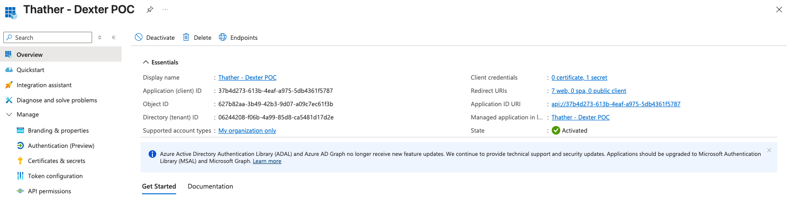

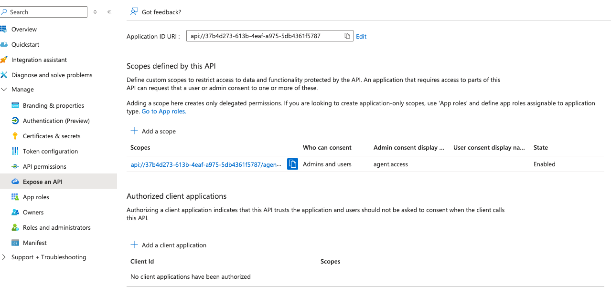

### Step 1.2 2-legged vs 3-legged: what to request

This is the single most common mistake in this lab. **The resource you name in `scope`
determines the token's `aud`.** Ask for the wrong thing and you get a perfectly valid token
that your agent will refuse.

| Flow            | Scope to request                 | Token contains                           | Agent checks |
| --------------- | -------------------------------- | ---------------------------------------- | ------------ |
| 3-legged (user) | `api://<client-id>/agent.access` | `scp: agent.access`, `upn`, `name`       | `scp`        |
| 2-legged (m2m)  | `api://<client-id>/.default`     | `roles` (if assigned), `appid`, no `scp` | app roles    |

Two rules worth internalising:

- **Client credentials cannot name an individual scope.** `agent.access` is a _delegated_
  permission; with no user there is nothing to delegate from. Entra answers
  `AADSTS1002012: ... must have a scope value with /.default suffixed`. `/.default` means
  "every app permission already granted to this client by an admin".
- **Never mix Graph scopes into a 3-legged request for your API.** Adding `User.Read` makes
  Entra issue a _Graph_ token (`aud: 00000003-0000-0000-c000-000000000000`). Those carry a
  `nonce` header and are deliberately unverifiable by anyone but Graph, so your agent cannot
  accept them — see [Troubleshooting](#troubleshooting).

---

## Phase 1 — Run Without the Gateway (flows 1 and 2)

### Step 2.1 Configure `.env`

```bash
cd a2a-credential-delegation
cp .env.example .env
```

Fill in the Entra values from Part 1:

```bash
MICROSOFT_TENANT_ID=<tenant-id>
MICROSOFT_CLIENT_ID=<client-id>
MICROSOFT_CLIENT_SECRET=<secret-value>
ENTRA_APP_ID_URI=api://<client-id>
ENTRA_SCOPE_NAME=agent.access

ENTRA_TENANT_ID=<tenant-id>
ENTRA_AUDIENCE=api://<client-id>
ENTRA_REQUIRED_SCOPE=agent.access
```

Leave `GATEWAY_URL` and `GATEWAY_USER_CONSENT_URL` empty for now — the portal disables flows 3
and 4 when they are unset.

### Step 2.2 Start the lab

```bash
./run.sh
```

This starts the agent on `:10002` and the portal on `:8095`, creating the virtualenv on first
run. The agent **fails closed**: it refuses to start without `ENTRA_TENANT_ID` and
`ENTRA_AUDIENCE`.

Open <http://localhost:8095>. The landing page has one tab per phase, each showing its two
flows — diagram, summary and the button that starts it:

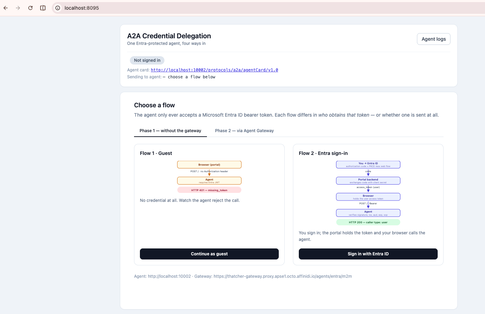

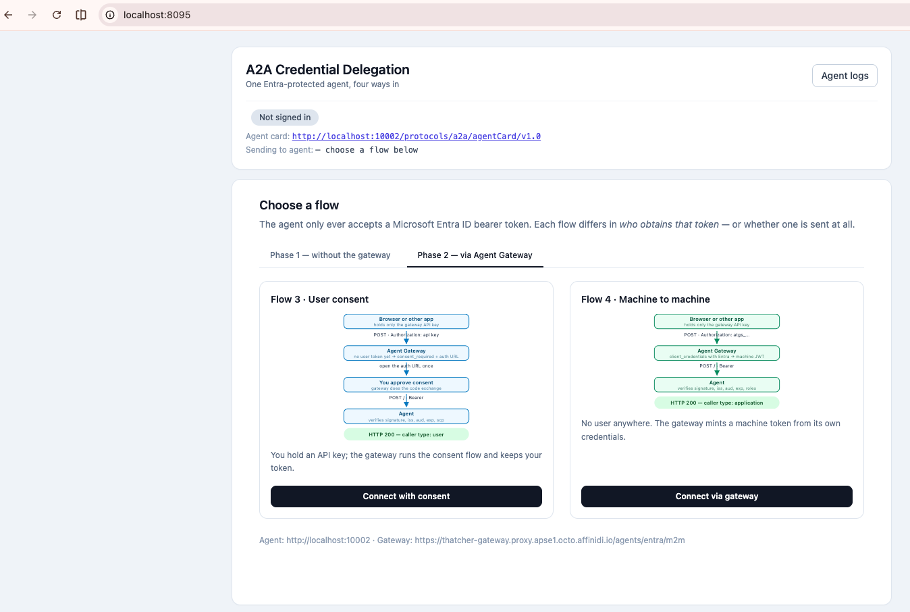

### Step 2.3 Walk flow 1 — guest

Click **Continue as guest** and send a message.

✅ **Expected:** a red response panel showing `HTTP 401` and
`{"code":"missing_token", ...}`. The chat shows the exact request and response bodies.

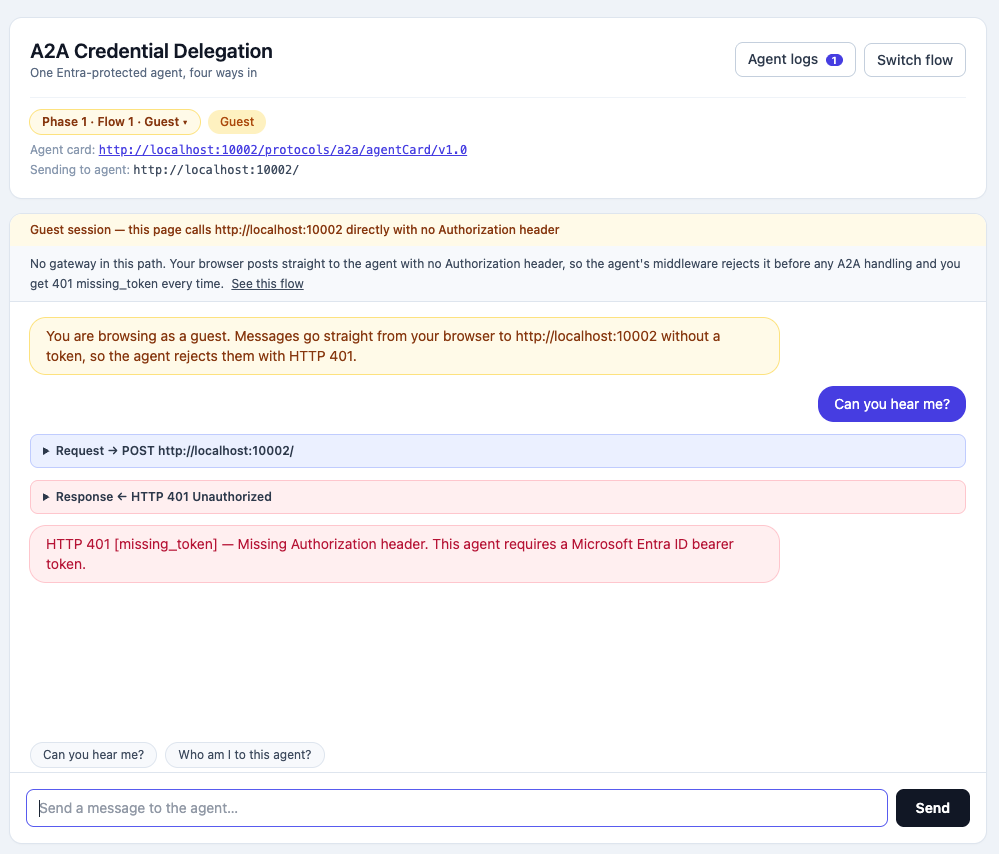

### Step 2.4 Walk flow 2 — Entra sign-in

Click **Sign in with Entra ID** and complete the Microsoft login.

✅ **Expected:** the agent echoes your message back as
`Echo from A2A v1.0 Entra agent (verified user: <your name>): ...`

Expand the violet **Bearer token sent** panel — you should see `"scp": "agent.access"`,
your `upn`, and `"aud": "api://<client-id>"`. If `aud` says anything else, re-read
[Step 1.2](#step-12-2-legged-vs-3-legged-what-to-request).

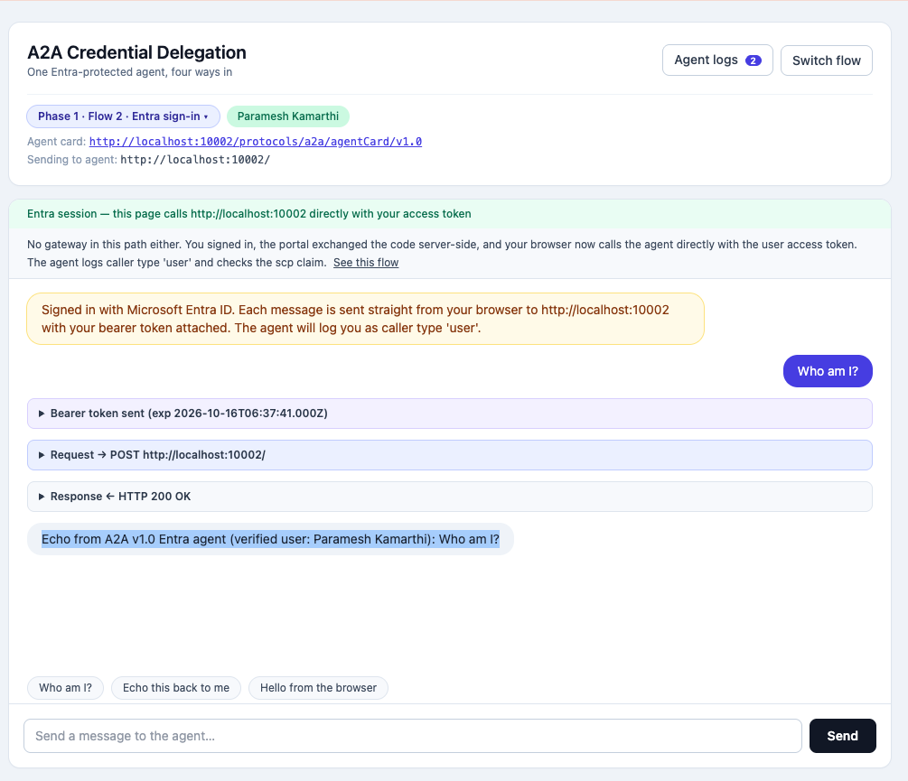

> **Do not continue to Phase 2 until both of these work.** Every Phase 2 failure is easier to
> diagnose once you know the agent and the app registration are sound.

---

## Phase 2 — Add the Gateway (flows 3 and 4)

Everything in this phase happens in the Agent Gateway UI, except the last step.

### Step 3.1 Expose the agent to the gateway

The gateway must be able to reach the agent. For a local lab, tunnel it:

```bash
# any tunnel works; copy the resulting https URL
ngrok http 10002
```

Then set `PUBLIC_BASE_URL` in `.env` to that URL and restart `./run.sh`, so the agent card
advertises an address the gateway can actually call.

### Step 3.2 Create the gateway secrets

**Secrets → Add secret.** You need three:

| Secret name           | Holds                            | Used by                              |
| --------------------- | -------------------------------- | ------------------------------------ |
| `entra_client_id`     | Application (client) ID          | both credential providers            |
| `entra_client_secret` | client secret value              | both credential providers            |
| `my_secret`           | the API key callers must present | both surfaces' caller authentication |

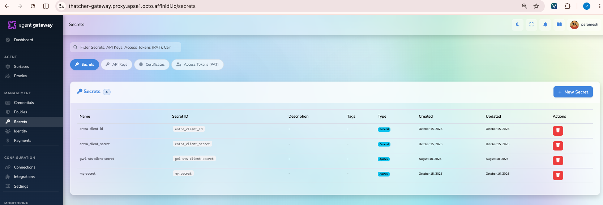

> This lab reuses one `my_secret` for both surfaces. Separate keys per surface are what you'd
> do outside a lab, so a leaked flow-4 key cannot call flow 3.

### Step 3.3 Credential provider — Client Credentials (2-legged)

**Credentials → Credential providers → New.**

| Field            | Value                                                             |
| ---------------- | ----------------------------------------------------------------- |
| Name             | `Entra M2M Flow`                                                  |
| Provider Type    | **OAuth 2.0, Client Credentials (2-legged, machine-to-machine)**  |
| Token Endpoint   | `https://login.microsoftonline.com/<tenant-id>/oauth2/v2.0/token` |
| Client ID Secret | `entra_client_id`                                                 |
| Client Secret    | `entra_client_secret`                                             |
| Default Scopes   | `api://<client-id>/.default`                                      |

No authorization endpoint and no callback URL — there is no user to redirect.

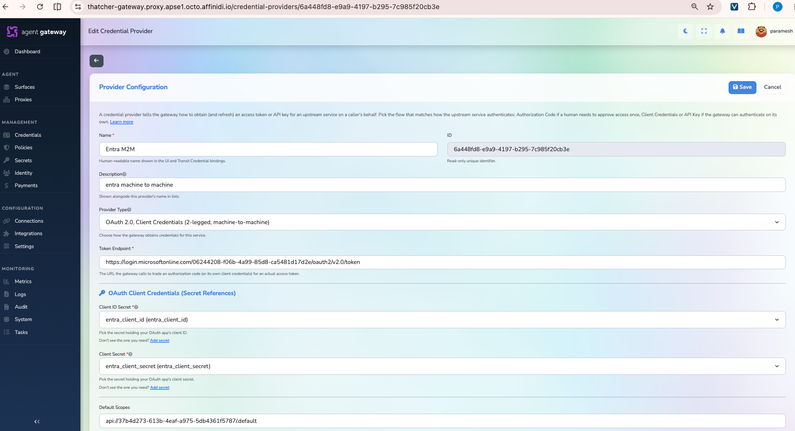

### Step 3.4 Credential provider — Authorization Code (3-legged)

**Credentials → Credential providers → New.**

| Field                  | Value                                                                 |
| ---------------------- | --------------------------------------------------------------------- |
| Name                   | `Entra User Consent Flow`                                             |
| Provider Type          | **OAuth 2.0, Authorization Code (3-legged, user consent)**            |
| Authorization Endpoint | `https://login.microsoftonline.com/<tenant-id>/oauth2/v2.0/authorize` |
| Token Endpoint         | `https://login.microsoftonline.com/<tenant-id>/oauth2/v2.0/token`     |
| Callback URL Host      | your gateway's public address                                         |
| Callback URL Route     | `entra-user-consent-flow` _(immutable after creation)_                |
| Client ID Secret       | `entra_client_id`                                                     |
| Client Secret          | `entra_client_secret`                                                 |
| Default Scopes         | `api://<client-id>/agent.access`                                      |

The resulting callback URL — shown in the UI, e.g.
`https://<your-gateway>/v1/identity/oauth/callback/entra-user-consent-flow` — **must be added
as a Web redirect URI in your Entra app registration**, alongside the portal's own one. The
gateway, not your app, receives the authorization code.

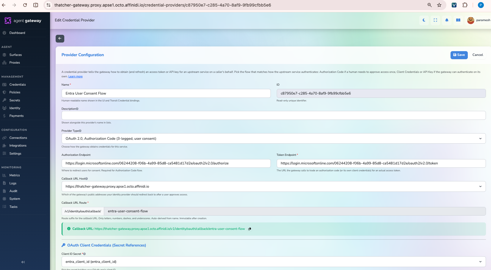

Both providers now appear in the list:

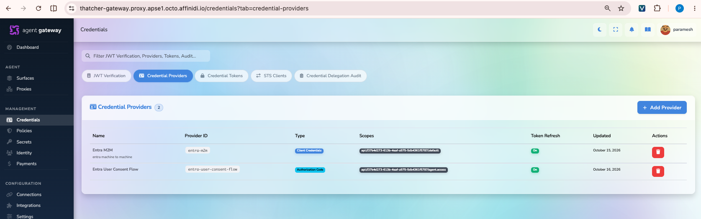

### Step 3.5 Caller authentication policy

**Policies → New policy.** This Rego allows only callers whose API key verified, and surfaces
the gateway's own reason when it did not:

```rego
package surface.policy

import rego.v1

default allow := false

# Allow only successfully authenticated callers
allow if {
  input.source_auth.method != "failed"
}

# Return the authentication error from the source
deny_reason := reason if {
  input.source_auth.method == "failed"

  reason := object.get(
    input.source_auth,
    "reason",
    "Caller authentication failed"
  )

  is_string(reason)
  reason != ""
} else := "Caller authentication failed" if {
  input.source_auth.method == "failed"
}
```

Note the shape of the check: `source_auth` is about **the caller reaching the gateway** (the
API key). It says nothing about the Entra token the gateway will mint afterwards — those are
two separate trust boundaries.

### Step 3.6 Surface A — user consent

**Surfaces → New surface**, then build the canvas left to right. The finished surface looks
like this — access point, caller context, policy, managed agent, identity, and credential
delegation out to the external target:

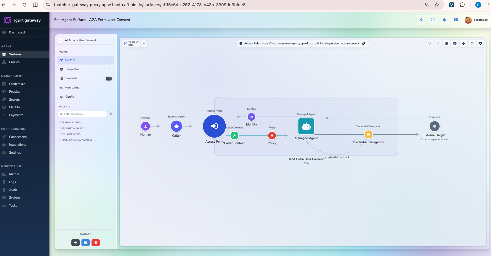

**1 · Access point.** Set the surface prefix and custom path — `entra/user-consent` here,
`entra/m2m` on the other surface. If your agent publishes its card somewhere other than the
well-known path, tick **Override agent card location** and enter the custom path
(`protocols/a2a/agentCard/v1.0`). The gateway fetches the card from there and re-serves it on
the standard well-known path, as the A2A spec expects.

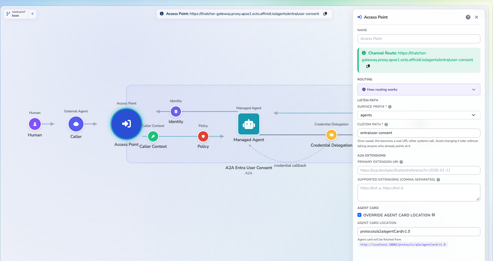

**2 · Managed agent.** Endpoint type **Direct URL**, target endpoint the public URL of your
agent. Leave target authentication **None** — the credential delegation element supplies the
token, not this field.

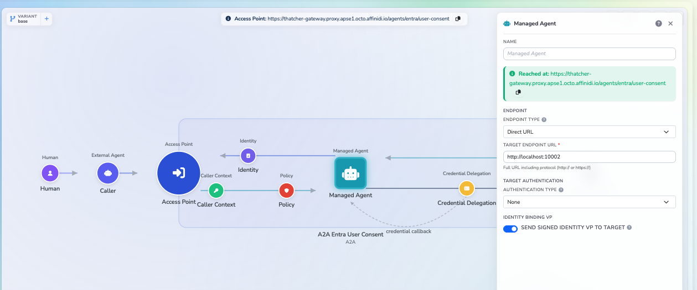

**3 · Caller context.** Between the access point and the managed agent, select the API key
secret from Step 3.2. This is what authenticates _the caller to the gateway_.

**4 · Policy.** Next to it, select the policy from Step 3.5 so a failed source-auth check is
rejected with its own reason.

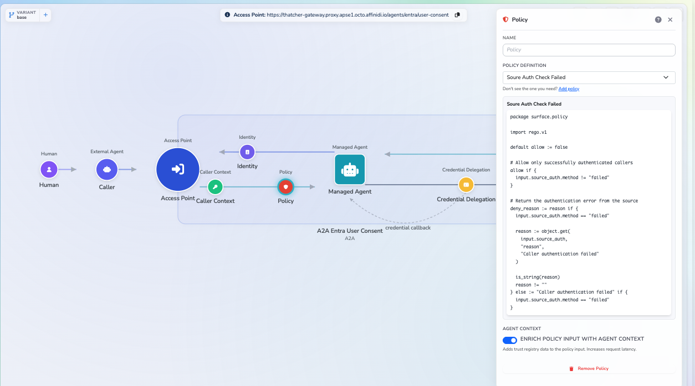

**5 · Identity.** Between the managed agent and the access point, choose payload extraction
and declare the identity-extension fields your agent card returns — `name`, `role`, `model`.

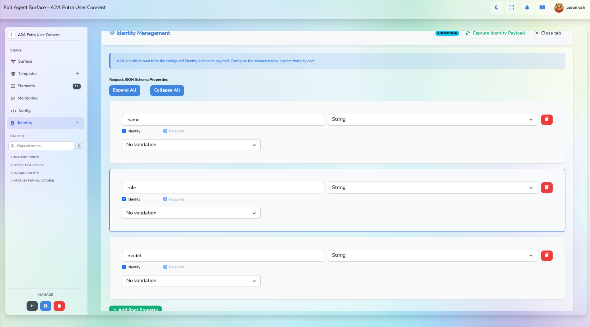

**6 · Credential delegation.** Between the managed agent and the external target, select the
credential provider for this surface — the **user consent** one here. Consent mode **on
demand** is what produces the `consent_required` response; **inject as bearer header** is what
puts the resulting JWT on the call to your agent.

Note the callback URL shown in this panel. Tokens returned to it are stored on the gateway and
re-injected automatically, and _the calling agent never sees the user's credentials_.

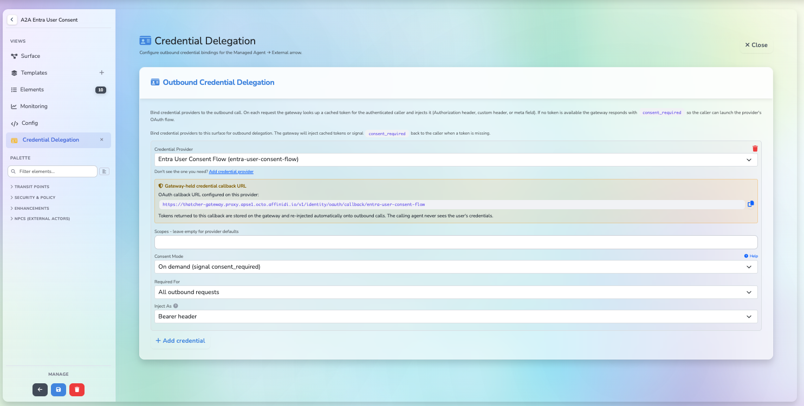

### Step 3.7 Surface B — machine to machine

Repeat Step 3.6. Only three things change:

|                     | Surface A                     | Surface B                     |
| ------------------- | ----------------------------- | ----------------------------- |
| Name                | `A2A Entra User Consent`      | `A2A Entra M2M`               |
| Route               | `/agents/entra/user-consent`  | `/agents/entra/m2m`           |
| Credential provider | authorization code (3-legged) | client credentials (2-legged) |

Optionally give the caller context a **different API key secret**, so each surface has its own
caller credential. This lab reuses one for both.

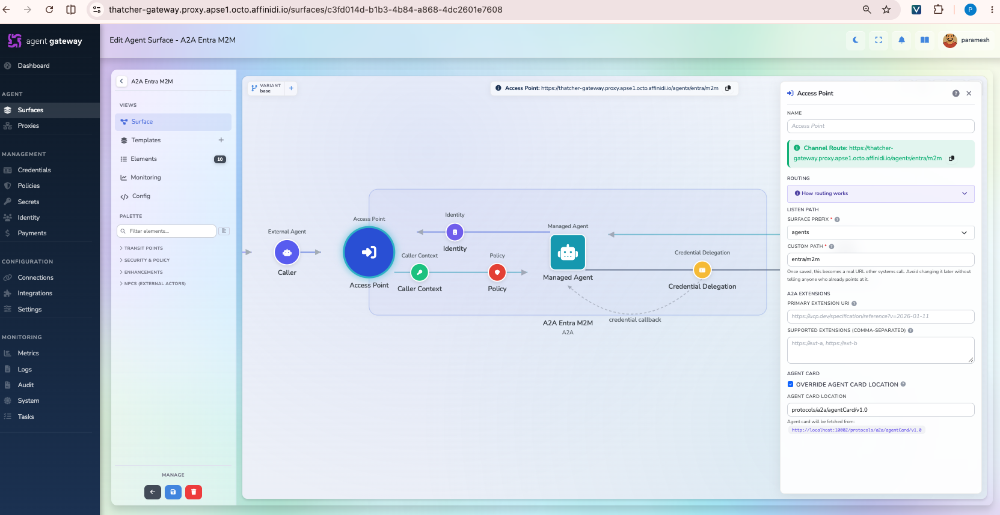

### Step 3.8 Point the portal at both surfaces

Back in `.env`:

```bash
GATEWAY_URL=https://<your-gateway>/agents/entra/m2m
GATEWAY_USER_CONSENT_URL=https://<your-gateway>/agents/entra/user-consent
GATEWAY_API_KEY=<the value stored in my_secret>
```

Restart `./run.sh` and reload the portal. Cards 3 and 4 are now enabled.

### Step 3.9 Walk flow 3 — user consent

Click **Connect with consent** and send a message.

✅ **Expected on the first call:** a blue panel, _"The gateway needs your consent"_, listing
the provider, the requested scope `api://<client-id>/agent.access`, and an **Approve in Entra
ID** button.

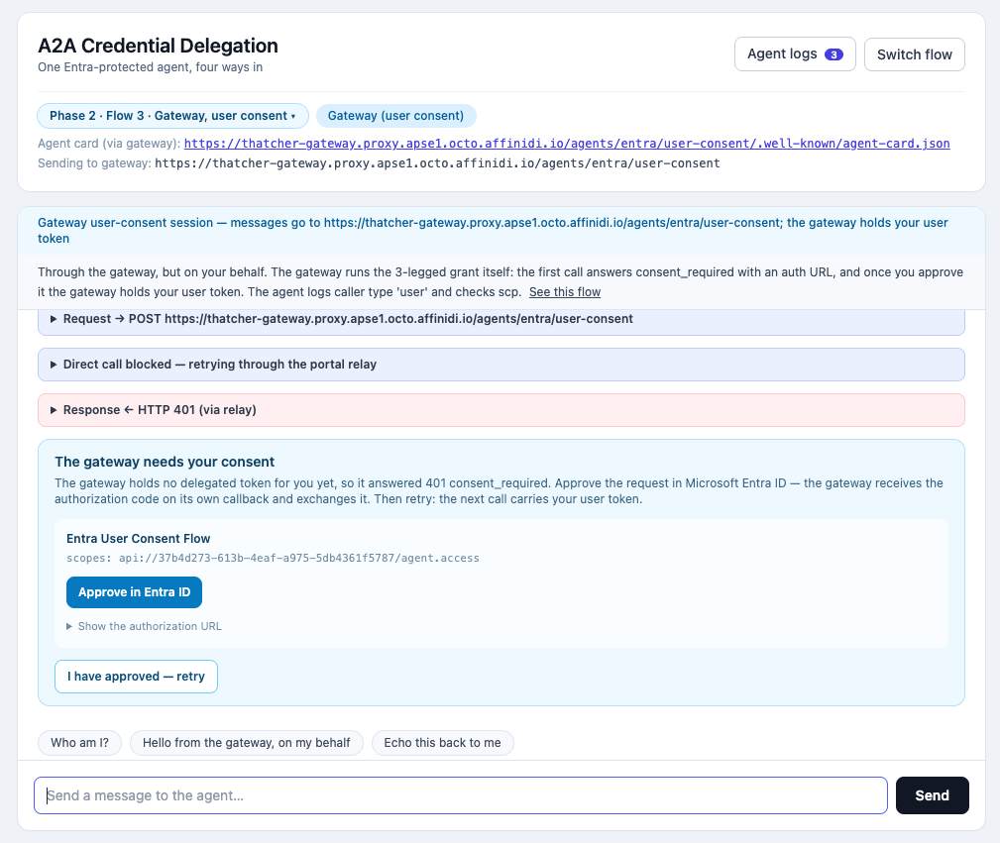

Click it, approve in Microsoft, come back, and press **I have approved — retry**.

✅ **Expected on the second call:** `Echo ... (verified user: <your name>)` — the same caller
type as flow 2, but obtained entirely by the gateway.

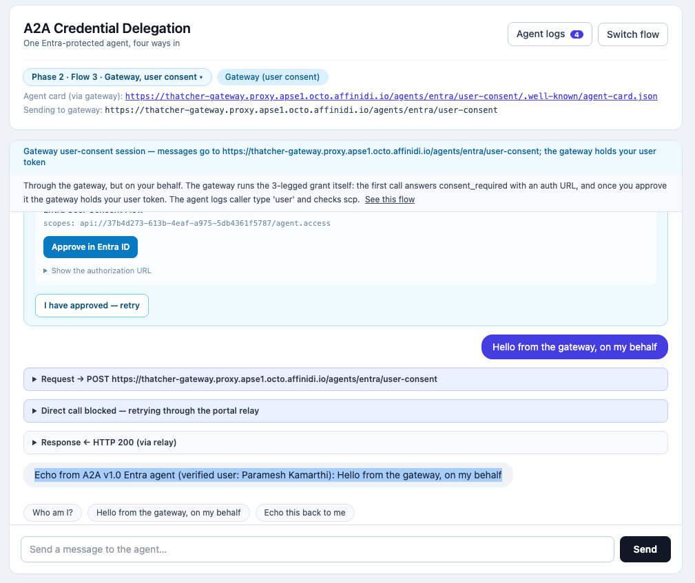

The gateway now holds a token for you, per caller. You can see them listed on its credentials
page — this is the "maintains the token" half of credential delegation:

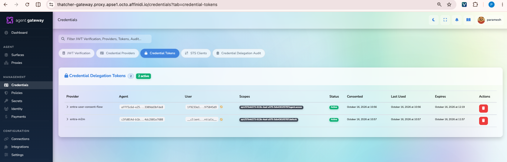

> **If this fails,** skip ahead to flow 4 and come back. Flow 4 has no consent step, so it
> isolates the gateway wiring from the consent handshake — if flow 4 works and flow 3 does
> not, the problem is in the authorization-code provider or its callback URL, not the surface.

### Step 3.10 Walk flow 4 — machine to machine

Click **Connect via gateway** and send a message. No consent prompt appears: there is no user
to ask.

✅ **Expected:** `Echo from A2A v1.0 Entra agent (verified application: app <client-id>): ...`

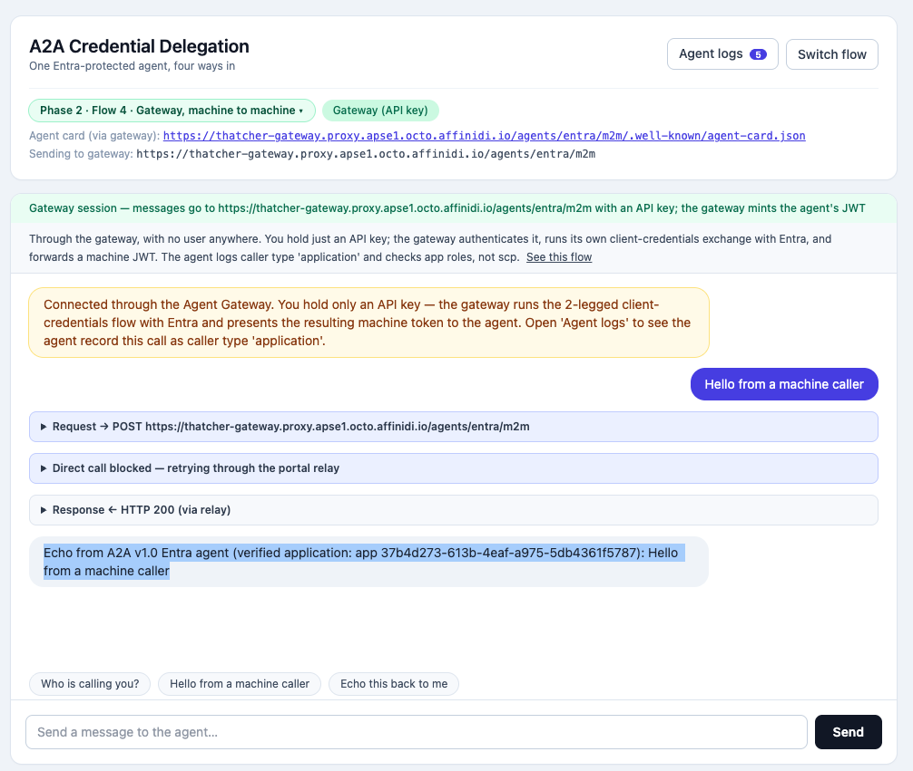

---

## Observe What the Agent Sees

The **Agent logs** button (top right) opens a live drawer fed by the agent's own event log at
`/debug/events`. It records **every** call the agent receives — including ones made by `curl`
or another app, not just the portal.

Each entry expands to request headers, request body, the decoded bearer token, response
headers and response body. Send one message in flow 2, 3 and 4, then compare the token panels:

| Claim                | Flow 2              | Flow 3              | Flow 4              |
| -------------------- | ------------------- | ------------------- | ------------------- |
| `aud`                | `api://<client-id>` | `api://<client-id>` | `api://<client-id>` |
| `scp`                | `agent.access`      | `agent.access`      | _absent_            |
| `upn` / `name`       | present             | present             | _absent_            |
| `appid`              | present             | present             | present             |
| `idtyp`              | —                   | —                   | `app`               |
| agent's `callerType` | `user`              | `user`              | `application`       |

Flows 2 and 3 produce the _same identity_ — the difference is who held the token. That is
credential delegation in one table.

To print the full raw JWT in the agent's stdout log, set `LOG_RAW_TOKEN=true` in `.env`.
Leave it off anywhere logs are retained; a raw access token is a live credential.

## The Consent Handshake

When the gateway has no delegated token for a caller it answers RFC 7807 `problem+json`:

```json
{
  "type": "https://affinidi.com/atg/errors/consent-required",
  "title": "Credential Delegation Consent Required",
  "status": 401,
  "detail": "This channel requires delegated credentials. The user must authorize access via the provided URLs.",
  "consent_required": [
    {
      "provider_name": "Entra User Consent Flow",
      "authorization_url": "https://login.microsoftonline.com/<tenant>/oauth2/v2.0/authorize?response_type=code&client_id=...&redirect_uri=https%3A%2F%2F<gateway>%2Fv1%2Fidentity%2Foauth%2Fcallback%2Fentra-user-consent-flow&scope=api%3A%2F%2F<client-id>%2Fagent.access&state=...&code_challenge=...&code_challenge_method=S256",
      "scopes": ["api://<client-id>/agent.access"]
    }
  ]
}
```

Worth noticing in that URL: `redirect_uri` points at the **gateway's** callback, and
`code_challenge_method=S256` means the gateway is running PKCE on your behalf. Your
application sees none of this — it renders a link.

The portal reads `consent_required[]`, keeps only entries with an `https://`
`authorization_url`, and renders each as a provider name, its scopes, and a button. After you
approve, the gateway completes the exchange on its callback and stores the token against your
caller identity; the retry then succeeds.

## Environment Variables Reference

| Variable                          | Required | Used by | Notes                                                   |
| --------------------------------- | -------- | ------- | ------------------------------------------------------- |
| `MICROSOFT_TENANT_ID`             | Phase 1  | portal  | Directory (tenant) ID                                   |
| `MICROSOFT_CLIENT_ID`             | Phase 1  | portal  | Application (client) ID                                 |
| `MICROSOFT_CLIENT_SECRET`         | Phase 1  | portal  | never reaches the browser                               |
| `ENTRA_APP_ID_URI`                | Phase 1  | portal  | `api://<client-id>`; drives the requested scope         |
| `ENTRA_SCOPE_NAME`                | no       | portal  | defaults to `agent.access`                              |
| `ENTRA_REDIRECT_URI`              | no       | portal  | defaults to `<portal>/api/auth/callback/microsoft`      |
| `ENTRA_TENANT_ID`                 | **yes**  | agent   | agent refuses to start without it                       |
| `ENTRA_AUDIENCE`                  | **yes**  | agent   | comma-separated list of accepted `aud` values           |
| `ENTRA_REQUIRED_SCOPE`            | no       | agent   | checked on **delegated** tokens only                    |
| `ENTRA_REQUIRED_ROLE`             | no       | agent   | checked on **app-only** tokens only; blank accepts any  |
| `ENTRA_ISSUER` / `ENTRA_JWKS_URL` | no       | agent   | override only for a non-standard issuer                 |
| `AGENT_PORT` / `PORTAL_PORT`      | no       | both    | default `10002` / `8095`                                |
| `AGENT_URL`                       | no       | portal  | must be reachable **from the browser**                  |
| `PUBLIC_BASE_URL`                 | Phase 2  | agent   | address the agent advertises; the gateway must reach it |
| `PORTAL_ORIGINS`                  | no       | agent   | CORS allow-list. Never `*`                              |
| `GATEWAY_URL`                     | Phase 2  | portal  | full m2m surface URL                                    |
| `GATEWAY_USER_CONSENT_URL`        | Phase 2  | portal  | full user-consent surface URL                           |
| `GATEWAY_API_KEY`                 | Phase 2  | portal  | the value stored in the gateway secret                  |
| `LOG_RAW_TOKEN`                   | no       | agent   | prints full JWTs to the log. Lab only                   |

## curl Equivalents

Everything the portal does, you can do from a terminal. Replace the placeholders; never commit
a real key.

**Flow 1 — guest (expect 401):**

```bash
curl -s -X POST http://localhost:10002/ \
  -H "Content-Type: application/json" -H "A2A-Version: 1.0" \
  -d '{"jsonrpc":"2.0","id":"1","method":"SendMessage","params":{"message":{"messageId":"m1","role":"ROLE_USER","parts":[{"text":"hello"}]}}}'
```

**Flow 4 — through the gateway, machine to machine:**

```bash
curl -s -X POST "https://<your-gateway>/agents/entra/m2m" \
  -H "Content-Type: application/json" -H "a2a-version: 1.0" \
  -H "Authorization: $GATEWAY_API_KEY" \
  -d '{"jsonrpc":"2.0","id":"1","method":"SendMessage","params":{"message":{"messageId":"m1","role":"ROLE_USER","parts":[{"text":"hello"}]}}}'
```

**Flow 3 — through the gateway, user consent** (same call against
`/agents/entra/user-consent`; the first attempt returns the `consent_required` body above).

**Mint a machine token by hand**, to see what the gateway does internally:

```bash
curl -s -X POST "https://login.microsoftonline.com/<tenant-id>/oauth2/v2.0/token" \
  -H "Content-Type: application/x-www-form-urlencoded" \
  -d "grant_type=client_credentials" \
  -d "client_id=<client-id>" \
  -d "client_secret=<client-secret>" \
  -d "scope=api://<client-id>/.default"
```

## Troubleshooting

| Problem                                                                             | Cause                                                                           | Fix                                                                                                                                  |
| ----------------------------------------------------------------------------------- | ------------------------------------------------------------------------------- | ------------------------------------------------------------------------------------------------------------------------------------ |
| Agent exits with `ENTRA_TENANT_ID is not set`                                       | agent fails closed by design                                                    | fill `ENTRA_TENANT_ID` and `ENTRA_AUDIENCE` in `.env`                                                                                |
| `401 invalid_token` and the token's `aud` is `00000003-0000-0000-c000-000000000000` | the caller requested **Graph** scopes (`User.Read`) instead of your API's scope | request `api://<client-id>/agent.access`. Graph tokens carry a `nonce` header and cannot be validated by anyone else                 |
| `401 insufficient_scope` on the m2m flow                                            | app-only tokens have no `scp`; a delegated scope was being required             | already handled — the agent checks `roles` for app-only tokens. If you set `ENTRA_REQUIRED_ROLE`, assign that app role to the client |
| `AADSTS1002012` from the token endpoint                                             | an individual scope was requested with `grant_type=client_credentials`          | use `api://<client-id>/.default`                                                                                                     |
| `invalid_request` from Entra on sign-in                                             | `/.default` mixed with `openid`/`profile`                                       | request the named scope instead, as the portal does                                                                                  |
| Flow 2 works, flow 3 loops on consent                                               | the gateway's callback URL is not registered in Entra                           | add `https://<gateway>/v1/identity/oauth/callback/<route>` as a Web redirect URI                                                     |
| Portal says _"Direct call blocked — retrying through the portal relay"_             | the gateway sends no CORS headers for `http://localhost:8095`                   | nothing to do; the relay is automatic. The trace panels still show the full exchange                                                 |
| Agent logs drawer stays empty                                                       | the browser cannot reach `AGENT_URL/debug/events`                               | check the agent is running and that your origin is in `PORTAL_ORIGINS`                                                               |
| Gateway returns a target error                                                      | the gateway cannot reach `http://localhost:10002`                               | expose the agent with a tunnel and set `PUBLIC_BASE_URL`                                                                             |
| `401 token_expired`                                                                 | clock skew or a stale cached token                                              | the agent allows 60s leeway; sign out and back in                                                                                    |

## Security Notes for This Lab

Deliberate shortcuts, listed so nobody copies them into production:

- **The access token is handed to the browser.** `/api/auth/token` serves the signed-in
  session's Entra token so the page can call the agent directly and you can watch the wire
  traffic. Any XSS in the portal could steal it. A real portal relays server-side.
- **The gateway API key is handed to the browser** by `/api/gateway/key`, for the same reason.
  This one is worse — it is a long-lived shared secret, not a short-lived token.
- **`/debug/events` is unauthenticated** and exposes presented tokens. It exists so the portal
  can show traffic from any client. Never expose it outside a local lab.
- **One API key for both surfaces.** Use separate keys per surface in reality.
- **`LOG_RAW_TOKEN`** prints live credentials to stdout. Off by default; keep it off anywhere
  logs are shipped or retained.

What is _not_ a shortcut: the agent performs full JWT validation — signature against the
tenant JWKS, issuer, audience, expiry, and `scp`/`roles` — with no bypass flag and no
"accept unsigned" path.

## Architecture & References

```
a2a-credential-delegation/
├── agent.py            A2A v1.0 echo agent; auth middleware, event log, agent card
├── entra_auth.py       JWT validation, flow detection (delegated vs app-only), token inspection
├── portal/
│   ├── server.py       confidential OAuth client; token + gateway key endpoints; CORS relay
│   └── static/
│       └── index.html  the four-flow UI, wire traces, consent prompt, agent log drawer
├── run.sh              starts both, creates the venv, fails closed on missing config
├── .env.example        every knob, documented
└── docs/images/        screenshots referenced above
```

| Endpoint                            | Auth              | Purpose                                        |
| ----------------------------------- | ----------------- | ---------------------------------------------- |
| `POST /` (agent)                    | Entra JWT         | A2A JSON-RPC                                   |
| `GET /protocols/a2a/agentCard/v1.0` | open              | agent card                                     |
| `GET /health`                       | open              | health check                                   |
| `GET /debug/events`                 | open _(lab only)_ | the event log the portal drawer reads          |
| `GET /api/auth/token` (portal)      | session cookie    | hands the Entra token to its own page          |
| `GET /api/gateway/key` (portal)     | same-origin       | hands the gateway API key to its own page      |
| `POST /api/gateway/chat` (portal)   | same-origin       | server-side relay when the gateway blocks CORS |

**Further reading**

- [Agent Gateway — Credentials](https://docs.affinidi.com/products/affinidi-trust-fabric/agent-gateway/concepts/credentials/)
- [Configure per-caller credential delegation](https://docs.affinidi.com/products/affinidi-trust-fabric/agent-gateway/how-to-guides/setup/configure-per-caller-credential-delegation/)
- [Microsoft identity platform — scopes and permissions](https://learn.microsoft.com/entra/identity-platform/scopes-oidc)
- Sibling labs: `auth0-mcp-surface` (MCP + OAuth caller context), `glean-mcp-surface`,
  `use-cases/secure-agent-communication`
