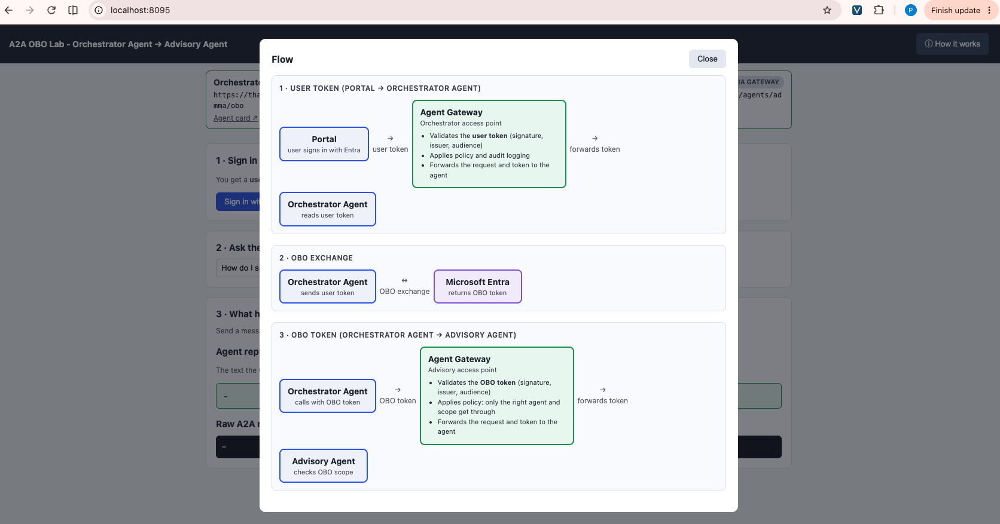
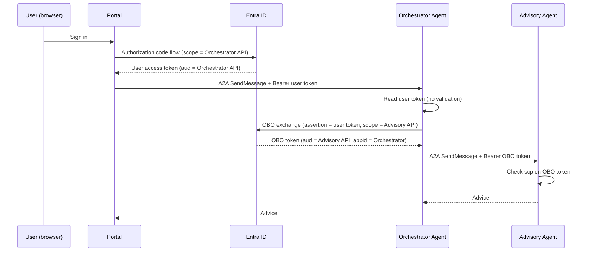
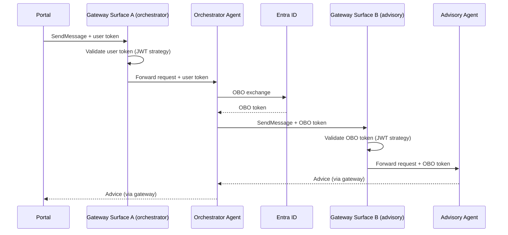
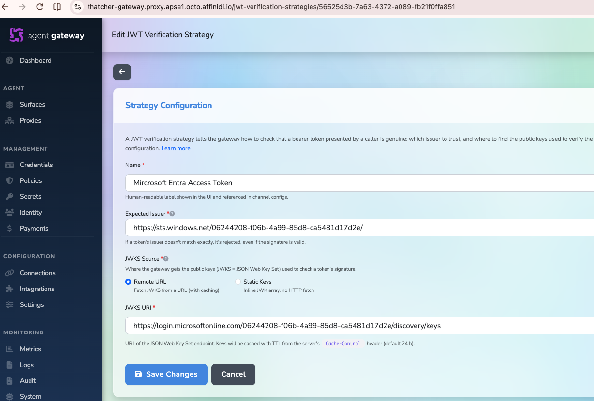
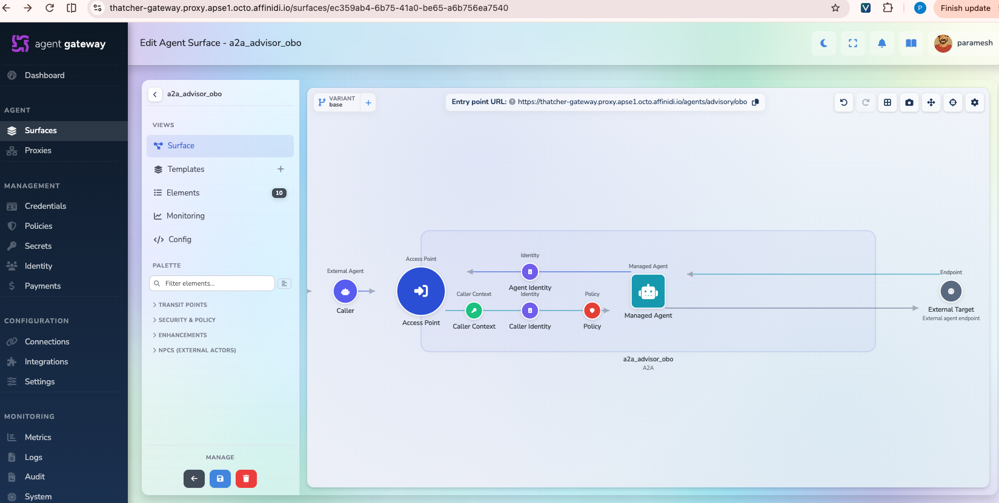
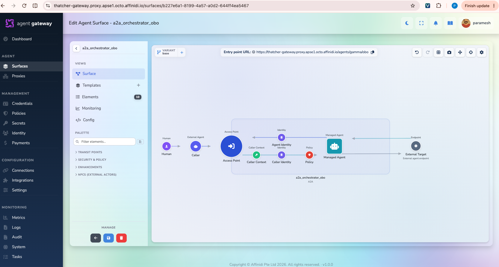
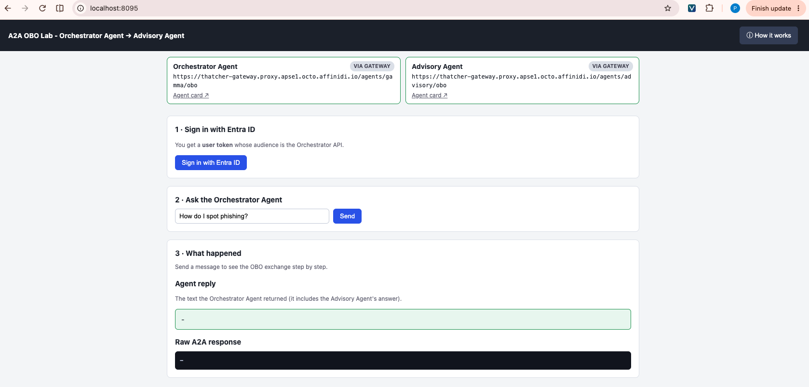
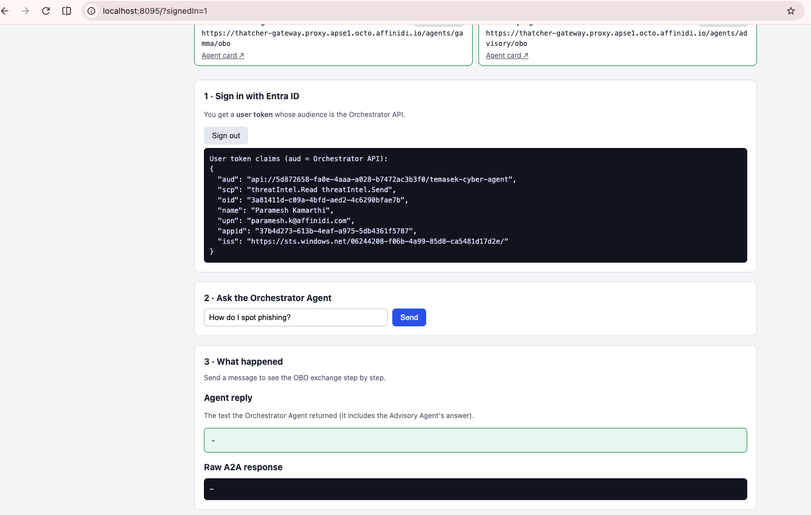
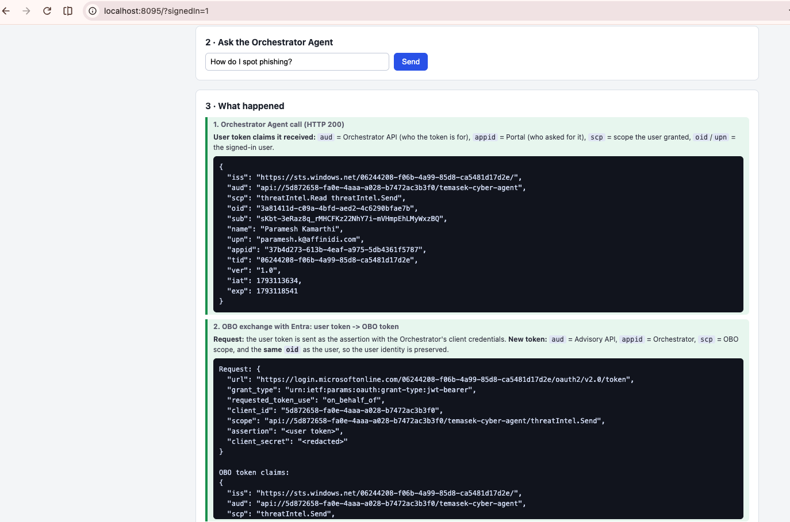
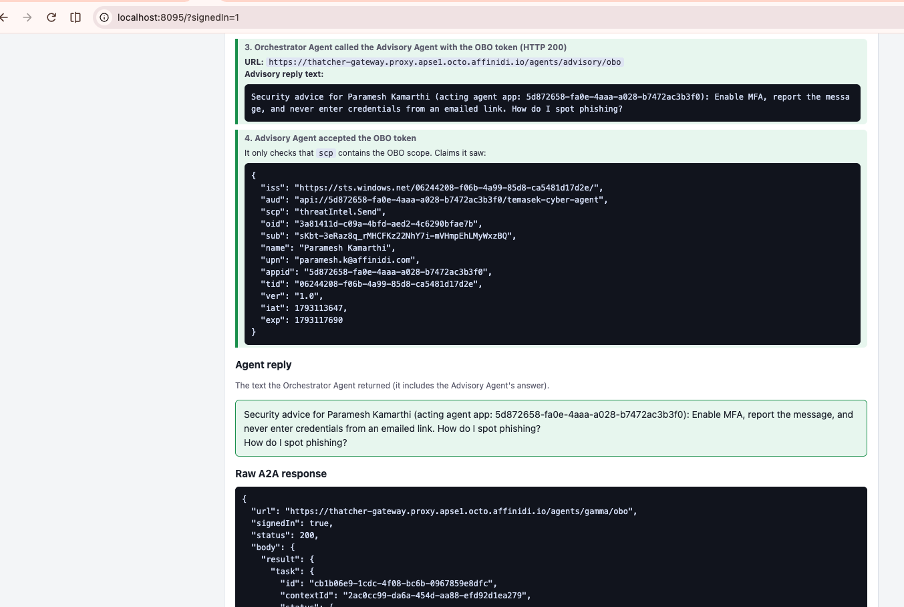

# A2A On-Behalf-Of (OBO) Lab: Entra OBO Token Exchange with the Agent Gateway



A hands-on lab showing how an **orchestrator agent** takes the signed-in user's Entra access token, exchanges it (OAuth 2.0 On-Behalf-Of) for a **new, narrower token**, and uses it to call a second agent, the **Security Advisory Agent**. Everything uses **A2A 1.0** (`a2a-sdk==1.0.1`) and **real Microsoft Entra ID**. No Docker.

You run it twice:

- **Phase 1, no gateway.** The agents call each other directly. Neither agent verifies a token; the Advisory Agent only checks `scp`.
- **Phase 2, with the Affinidi Agent Gateway.** The gateway sits in front of both agents, validates every token, and forwards the request.

## Table of Contents

1. [What You Will Build](#what-you-will-build)
2. [The Core Idea](#the-core-idea)
3. [Prerequisites](#prerequisites)
4. [Part 1: Register the three Entra apps](#part-1-register-the-three-entra-apps)
5. [Phase 1: Run without the gateway](#phase-1-run-without-the-gateway)
6. [Phase 2: Run with the gateway](#phase-2-run-with-the-gateway)
7. [What to Observe](#what-to-observe)
8. [Environment Reference](#environment-reference)
9. [curl Equivalents](#curl-equivalents)
10. [Troubleshooting](#troubleshooting)
11. [Security Notes](#security-notes)

---

## What You Will Build

| Component                                            | Port  | Role                                                                                                                                            |
| ---------------------------------------------------- | ----- | ----------------------------------------------------------------------------------------------------------------------------------------------- |
| Portal (`portal/server.py`)                          | 8095  | User signs in with Entra, sends A2A messages, shows the OBO trace                                                                               |
| Orchestrator Agent (`agents/orchestrator_agent.py`)  | 10003 | Reads the **user token** (no validation; the gateway does that), performs the **OBO exchange**, calls the advisory agent                        |
| Security Advisory Agent (`agents/advisory_agent.py`) | 10002 | Checks only that the OBO token carries the required scope (`OBO_TOKEN_SCOPE`). It does **not** verify the signature, issuer, audience or caller |

### Phase 1: no gateway



### Phase 2: with the gateway



## The Core Idea

|               | User token       | OBO token            |
| ------------- | ---------------- | -------------------- |
| Issued to     | Portal           | Orchestrator         |
| `aud`         | Orchestrator API | **Advisory API**     |
| `appid`       | Portal app       | **Orchestrator app** |
| `oid` / `sub` | the user         | **the same user**    |
| `scp`         | `agent.access`   | `advisory.read`      |

The orchestrator never forwards the user's token. It trades it for a token that is limited to one downstream API and names the orchestrator as the acting party, while the user identity is preserved. The advisory agent can therefore tell **who** the user is and **which agent** is acting for them.

## Prerequisites

- An Entra tenant where you can register apps and grant admin consent
- Python 3.10+
- For Phase 2: an Affinidi Agent Gateway you can configure, and a tunnel tool such as `ngrok`, because the gateway must reach your local agents

## Part 1: Register the three Entra apps

Entra admin center → **App registrations → New registration**. Use single-tenant for all three.

### 1. Advisory API (`obo-advisory-api`)

1. **Expose an API** → set Application ID URI to `api://<advisory-client-id>`.
2. **Add a scope** `advisory.read` (Admins and users, enabled).

### 2. Orchestrator (`obo-orchestrator`)

1. **Expose an API** → Application ID URI `api://<orchestrator-client-id>`; add scope `agent.access`.
2. **Certificates & secrets** → new client secret. Copy the value.
3. **API permissions** → Add → My APIs → `obo-advisory-api` → Delegated → `advisory.read`.
4. **Grant admin consent** for the tenant. Without consent the OBO exchange fails with `AADSTS65001`.
5. **Manifest**: leave `accessTokenAcceptedVersion` as `null` (default). The lab uses Entra **v1 access tokens** (issuer `https://sts.windows.net/<tenant-id>/`, caller in `appid`).

### 3. Portal (`obo-portal`)

1. **Authentication** → Add platform **Web** → redirect URI `http://localhost:8095/api/auth/callback/microsoft`.
2. **Certificates & secrets** → new client secret.
3. **API permissions** → My APIs → `obo-orchestrator` → Delegated → `agent.access`; grant admin consent.
4. On `obo-orchestrator` → **Expose an API → Authorized client applications**, add the Portal client ID with the `agent.access` scope (this avoids consent prompts).

> **Shortcut: reuse one API app.** Entra also lets the orchestrator app exchange for a token to its own API. You can skip the Advisory app and set `OBO_TOKEN_AUDIENCE` to the orchestrator's Application ID URI, with `OBO_TOKEN_SCOPE` set to a different scope than the user token carries (for example the user gets `threatIntel.Read` and the OBO token `threatIntel.Send`). The OBO token still differs by `appid` and `scp`, but `aud` is the same, so a separate Advisory app gives the clearer demo.

### Values to record

| Value                           | Goes into `.env` as                         |
| ------------------------------- | ------------------------------------------- |
| Tenant ID                       | `ENTRA_TENANT_ID`                           |
| Portal client ID / secret       | `PORTAL_CLIENT_ID` / `PORTAL_CLIENT_SECRET` |
| Orchestrator client ID / secret | `ORCH_CLIENT_ID` / `ORCH_CLIENT_SECRET`     |
| Orchestrator Application ID URI | `USER_TOKEN_AUDIENCE`                       |
| Advisory Application ID URI     | `OBO_TOKEN_AUDIENCE`                        |

## Phase 1: Run without the gateway

```bash
cd a2a-obo
./run.sh          # first run creates .env from .env.example and exits
# edit .env with the values above
./run.sh          # creates venv, installs deps, starts all three processes
```

Logs: `logs/portal.log`, `logs/orchestrator.log`, `logs/advisory.log`. Stop with `Ctrl+C` in the run.sh terminal.

1. Open <http://localhost:8095> and click **Sign in with Microsoft**.
2. Enter a question and click **Send**. The portal shows both hops with a **DIRECT (no gateway)** tag.
3. The trace panel shows: user token received → OBO exchange → advisory call → advice.

Expected advice text names the user and the acting app, for example `Security advice for Alice (acting agent app: <orchestrator client id>)`.

Health checks:

```bash
curl localhost:10003/health
curl localhost:10002/.well-known/agent-card.json
```

## Phase 2: Run with the gateway

The gateway sits in front of each agent as a **surface**: Surface A for the Orchestrator Agent, Surface B for the Advisory Agent. Each surface is built on the canvas from left to right:

```
Caller ─▶ Access Point ─▶ Caller Context (JWT) ─▶ Caller Identity ─▶ Policy ─▶ Managed Agent
                                                                                   └─ Agent Identity (on the response)
```

### 2.1 Tunnels

The gateway runs in the cloud, so it cannot reach `localhost` on your machine. Expose each agent with a tunnel:

```bash
ngrok http 10003     # orchestrator, note the https URL
ngrok http 10002     # advisory, note the https URL
```

Set in `.env` (these are also advertised in the agent cards):

```
ORCH_PUBLIC_URL=https://<orch-tunnel>
ADVISORY_PUBLIC_URL=https://<advisory-tunnel>
```

Use these tunnel URLs as the **Managed Agent** endpoint of each surface.

### 2.2 JWT verification strategy (shared by both surfaces)

The user token and the OBO token come from the same Entra tenant, so one strategy serves both surfaces.

In the gateway: **Credentials → JWT Verification → Add strategy**.

| Field           | Value                                                                                                                                              |
| --------------- | -------------------------------------------------------------------------------------------------------------------------------------------------- |
| Name            | `Entra v1` (any label)                                                                                                                             |
| Expected issuer | `https://sts.windows.net/<tenant-id>/`. Must match exactly, **including the trailing slash**. Copy `iss` from the portal's token claims to be sure |
| JWKS source     | **Remote URL** (Entra rotates its keys)                                                                                                            |
| JWKS URI        | `https://login.microsoftonline.com/<tenant-id>/discovery/keys` (v1 keys endpoint)                                                                  |



### 2.3 Policies

A failed JWT check does **not** block the request by itself. The gateway logs
`Source authentication failed (reason=...) — deferring to policy` and lets the policy decide.
Without a policy, an invalid or missing token still reaches the agent. The policy below
returns the real reason to the caller (for example `Invalid credential: Invalid issuer`).

In the gateway: **Policies → Add policy**.

**`Auth Check Policy`** (both surfaces): allow any caller whose authentication succeeded.

```rego
package surface.policy

import rego.v1

default allow := false

allow if {
  caller_authenticated
}

deny_reason := source_auth_failure_reason if {
  not caller_authenticated
}

# Any successful caller authentication (jwt_bearer here); missing source_auth counts as failed
caller_authenticated if {
  method := object.get(object.get(input, "source_auth", {}), "method", "failed")
  method != "failed"
}

default source_auth_failure_reason := "Caller authentication failed"

source_auth_failure_reason := reason if {
  reason := object.get(object.get(input, "source_auth", {}), "reason", "")
  is_string(reason)
  reason != ""
}
```

#### Optional: scope and caller checks for Surface B (`Advisory OBO Policy`)

`Auth Check Policy` only checks that the token is valid. You can go further on Surface B and also
check **claims**, so that only an **OBO token issued to the Orchestrator** with the right scope gets through.
This is useful when the user token and the OBO token share one audience (one Entra app for both, as in this lab):
with only `Auth Check Policy`, the user's own token could call the Advisory Agent directly and skip OBO.
The two tokens differ in `appid` (Portal vs Orchestrator) and `scp`.

To use it, create a second policy named **`Advisory OBO Policy`** with the Rego below and select it on Surface B
instead of `Auth Check Policy`. Set the two values at the top:

- `orchestrator_app_id`: your `ORCH_CLIENT_ID`. Entra puts the client ID of the app that ran the OBO exchange into the OBO token's `appid`, so this is what proves the Orchestrator made the call.
- `required_scopes`: your `OBO_TOKEN_SCOPE` (add more scopes to the set if needed; the token must carry all of them).

```rego
package surface.policy

import rego.v1

# ---- Lab values: set these to your app registration ----
# Client ID of the Orchestrator app (ORCH_CLIENT_ID). OBO tokens carry it in `appid`.
orchestrator_app_id := "<ORCH_CLIENT_ID>"

# Scope(s) the Orchestrator requests in the OBO exchange (OBO_TOKEN_SCOPE).
required_scopes := {"threatIntel.Send"}
# ---------------------------------------------------------

default allow := false

allow if {
  caller_authenticated
  obo_from_orchestrator
}

deny_reason := source_auth_failure_reason if {
  not caller_authenticated
}

deny_reason := "Token is not an OBO token from the Orchestrator Agent" if {
  caller_authenticated
  not obo_from_orchestrator
}

caller_authenticated if {
  method := object.get(object.get(input, "source_auth", {}), "method", "failed")
  method != "failed"
}

# OBO token: issued to the Orchestrator app and carrying every required scope
obo_from_orchestrator if {
  claims := object.get(input.source_auth, "claims", {})
  object.get(claims, "appid", "") == orchestrator_app_id
  token_scopes := {s | some s in split(object.get(claims, "scp", ""), " ")}
  count(required_scopes - token_scopes) == 0
}

default source_auth_failure_reason := "Caller authentication failed"

source_auth_failure_reason := reason if {
  reason := object.get(object.get(input, "source_auth", {}), "reason", "")
  is_string(reason)
  reason != ""
}
```

### 2.4 Surface A: Orchestrator

Create a surface (for example `a2a_orchestrator_obo`) and configure each element on the canvas:

| Element                                | Setting                                                                                                                                                                                                                         |
| -------------------------------------- | ------------------------------------------------------------------------------------------------------------------------------------------------------------------------------------------------------------------------------- |
| **Access Point**                       | Protocol `a2a`, accepted versions `0.3` and `1.0`, validation `envelope`. Route, for example `/agents/<name>/obo`                                                                                                               |
| **Caller Context**                     | Method **JWT Bearer**. Strategy: the one from 2.2. Header `Authorization`, scheme `Bearer`. Accepted audience: `USER_TOKEN_AUDIENCE` (recommended). **Forward header: ON** (see [why](#why-forward-the-authorization-header)) |
| **Caller Identity** (request)          | Type **From JWT claim**. Claim `oid` (the user). Namespace claims `iss`, `tid`, `appid`, `name`. Meta field `agentIdentity`                                                                                                     |
| **Policy** (after caller context)      | **`Auth Check Policy`**. Require agent context: ON                                                                                                                                                                              |
| **Managed Agent** (target)             | Endpoint `https://<orch-tunnel>` (`ORCH_PUBLIC_URL`). Inject VP: ON                                                                                                                                               |
| **Agent Identity** (response)          | Type **From payload**. Meta field `serverIdentity`. Fields `role`, `name`, `model`, with the JSON schema below. The values come from the agent identity extension in the agent's reply |



Then copy the surface URL (listen address + route, for example
`https://<gateway-host>/agents/<name>/obo`) into `ORCH_GATEWAY_URL`.

**Agent Identity JSON schema** (paste into the Agent Identity element):

```json
{
  "type": "object",
  "properties": {
    "role": {
      "type": "string",
      "x-identity": true
    },
    "name": {
      "type": "string",
      "x-identity": true
    },
    "model": {
      "type": "string",
      "x-identity": true
    }
  },
  "required": [
    "role",
    "name",
    "model"
  ]
}
```

Each agent sends these fields in its reply metadata under the agent identity extension
(`https://fabric.affinidi.io/extensions/agent-identity/v1`), for example
`{"name": "Orchestrator Agent", "role": "...", "model": "rule-based", "version": "1.0.0"}`.

The agent itself does no token validation; the gateway (Caller Context + Policy) does it.

### 2.5 Surface B: Advisory

Create a second surface (for example `a2a_advisory_obo`) with the same layout:

| Element                       | Setting                                                                                                                                         |
| ----------------------------- | ----------------------------------------------------------------------------------------------------------------------------------------------- |
| **Access Point**              | Protocol `a2a`, versions `0.3` and `1.0`, validation `envelope`. A different route, for example `/agents/<name>/obo-advisory`                   |
| **Caller Context**            | **JWT Bearer**, same strategy. Accepted audience: `OBO_TOKEN_AUDIENCE` (recommended). **Forward header: ON**                                    |
| **Caller Identity** (request) | **From JWT claim** `oid` (still the user, preserved by OBO). Namespace claims `iss`, `tid`, `appid`, `name`. Here `appid` is the Orchestrator |
| **Policy**                    | **`Auth Check Policy`** (or the optional `Advisory OBO Policy`). Require agent context: ON                                                                                            |
| **Managed Agent** (target)    | Endpoint `https://<advisory-tunnel>` (`ADVISORY_PUBLIC_URL`). Inject VP: ON                                                                  |
| **Agent Identity** (response) | **From payload**, meta field `serverIdentity`, same JSON schema as Surface A |



Copy the surface URL into `ADVISORY_GATEWAY_URL`.

#### Why forward the Authorization header?

By default the gateway validates the caller's token and then **drops** the `Authorization`
header before calling the target. Here the agents need the token itself:

| Surface         | Without forwarding                                                                                                                                                                                                                                                     |
| --------------- | ---------------------------------------------------------------------------------------------------------------------------------------------------------------------------------------------------------------------------------------------------------------------- |
| A: Orchestrator | **Breaks the lab.** The OBO exchange sends the user token to Entra as the `assertion`. With no token the orchestrator still tries the exchange and returns Entra's raw error, e.g. `AADSTS900144: The request body must contain the following parameter: 'assertion'`. |
| B: Advisory     | The Advisory Agent checks that `scp` contains `OBO_TOKEN_SCOPE`, so it rejects the call with `missing_token`. It also reads the claims to say _who_ the advice is for (`name`/`oid`) and _which agent_ asked (`appid`).                                                |

Surface A is the one that really requires it: OBO only works with the original user token.
On Surface B, forwarding is needed only because the Advisory Agent reads the token. If you use
the optional `Advisory OBO Policy`, the gateway already checks the scope, so if the agent stopped
reading the token Surface B could leave forwarding off.

### 2.6 Restart and walk through

Restart with the updated `.env` (`./run.sh`). The screenshots below were taken with the gateway in front of both agents.

1. Open <http://localhost:8095>. The portal shows both agents (tagged **VIA GATEWAY**) and a **Sign in with Microsoft** button.

   

2. Sign in with your Entra account. The portal shows the signed-in user.

   

3. Enter a question and click **Send**. Gateway Surface A accepts the **user token** and forwards it; the Orchestrator Agent exchanges it with Entra for an OBO token (steps 1 and 2 in **What happened**).

   

4. The Orchestrator Agent calls Surface B with the OBO token. The gateway accepts it (`appid` = Orchestrator, `scp` = OBO scope, same user `oid`), and the Advisory Agent checks the scope and answers (steps 3 and 4).

   

Confirm the same in the gateway audit log.

Negative test (with the optional `Advisory OBO Policy`): call Surface B with the **user token** directly. It must be rejected with `Token is not an OBO token from the Orchestrator Agent` (its `appid` is the Portal, not the Orchestrator). With only `Auth Check Policy`, the gateway lets it through, and in this lab the Advisory Agent accepts it too, because the user token also carries `threatIntel.Send`. That gap is what the optional policy closes.

## What to Observe

- Portal trace panel: claims of each token (aud, appid, scp, oid) side by side. Set `LOG_RAW_TOKEN=true` only locally to see raw JWTs.
- `GET localhost:10003/debug/trace` and `localhost:10002/debug/trace`: event stream per agent.
- Advisory agent rejects only a missing or insufficient `scp` (it does no other validation).

## Environment Reference

| Variable                                    | Purpose                                                                                                                                         |
| ------------------------------------------- | ----------------------------------------------------------------------------------------------------------------------------------------------- |
| `ENTRA_TENANT_ID`                           | Entra tenant                                                                                                                                    |
| `PORTAL_CLIENT_ID`, `PORTAL_CLIENT_SECRET`  | Portal login client                                                                                                                             |
| `ORCH_CLIENT_ID`, `ORCH_CLIENT_SECRET`      | Orchestrator app; secret is used for the OBO call                                                                                               |
| `USER_TOKEN_AUDIENCE`, `USER_TOKEN_SCOPE`   | The **user token** (Portal → Orchestrator): API URI and scope. Used by the Portal to request the token; the Orchestrator does not validate it   |
| `OBO_TOKEN_AUDIENCE`, `OBO_TOKEN_SCOPE`     | The **OBO token** (Orchestrator → Advisory): API URI and scope. Used by the Orchestrator to request it and the Advisory agent to validate it    |
| `PORTAL_PORT`, `ORCH_PORT`, `ADVISORY_PORT` | Local ports (8095, 10003, 10002)                                                                                                                |
| `PORTAL_PUBLIC_URL`, `PORTAL_ORIGINS`       | Portal redirect base and CORS                                                                                                                   |
| `ORCH_GATEWAY_URL`                          | Portal → Orchestrator via gateway Surface A (Phase 2). When set, the portal uses it instead of `ORCH_PUBLIC_URL`                                |
| `ADVISORY_GATEWAY_URL`                      | Orchestrator → Advisory via gateway Surface B (Phase 2); overrides `ADVISORY_PUBLIC_URL` when set                                               |
| `ORCH_PUBLIC_URL`, `ADVISORY_PUBLIC_URL`    | Each agent's own address, also shown in its agent card. Phase 1: localhost (used for direct calls). Phase 2: the tunnel URL, used as the surface target |
| `LOG_RAW_TOKEN`                             | Log raw JWTs (local only)                                                                                                                       |

## curl Equivalents

The OBO exchange the orchestrator performs:

```bash
curl -X POST "https://login.microsoftonline.com/$ENTRA_TENANT_ID/oauth2/v2.0/token" \
  -d grant_type=urn:ietf:params:oauth:grant-type:jwt-bearer \
  -d requested_token_use=on_behalf_of \
  -d client_id=$ORCH_CLIENT_ID \
  -d client_secret=$ORCH_CLIENT_SECRET \
  -d assertion=$USER_TOKEN \
  -d scope="$OBO_TOKEN_AUDIENCE/$OBO_TOKEN_SCOPE"
```

An A2A 1.0 message:

```bash
curl -X POST "$ORCH_PUBLIC_URL/" \
  -H "Authorization: Bearer $USER_TOKEN" \
  -H "Content-Type: application/json" -H "A2A-Version: 1.0" \
  -d '{"jsonrpc":"2.0","id":"1","method":"SendMessage","params":{"message":{"messageId":"m1","role":"ROLE_USER","parts":[{"text":"How do I spot phishing?"}]}}}'
```

## Troubleshooting

| Symptom                                                                    | Cause / fix                                                                                                                                                                                |
| -------------------------------------------------------------------------- | ------------------------------------------------------------------------------------------------------------------------------------------------------------------------------------------ |
| `AADSTS65001` on OBO                                                       | Admin consent missing for orchestrator → advisory permission                                                                                                                               |
| `AADSTS50013` / invalid assertion                                          | The user token is an id_token, or its audience is not the orchestrator API                                                                                                                 |
| `AADSTS70011` invalid scope                                                | `OBO_TOKEN_AUDIENCE`/`OBO_TOKEN_SCOPE` do not match the exposed scope                                                                                                                      |
| `AADSTS7000215`                                                            | Wrong or expired orchestrator client secret (use the secret **value**)                                                                                                                     |
| Agent says `invalid_audience`                                              | Token `aud` must equal the `api://…` Application ID URI exactly                                                                                                                            |
| Gateway: `Invalid credential: Invalid issuer`                              | The JWT strategy issuer does not match the token's `iss`. It must be `https://sts.windows.net/<tenant-id>/` **with** the trailing slash, not the `login.microsoftonline.com/.../v2.0` form |
| Gateway logs `deferring to policy` but the request still reaches the agent | No `Auth Check Policy` on the surface; add it after caller context (2.3)                                                                                                                   |
| `missing_token` at the Advisory Agent behind the gateway                   | Gateway is not forwarding the Authorization header; enable the forward option on that surface                                                                                              |
| `unknown_signing_key`                                                      | Tenant ID wrong, or token not from this tenant                                                                                                                                             |
| Gateway cannot reach agent                                                 | Tunnel down, or `*_PUBLIC_URL` not updated                                                                                                                                                 |

## Security Notes

- The orchestrator client secret lives only in `.env` (git-ignored). Use a certificate or managed identity in production.
- Raw JWT logging is off by default; never enable it outside a local lab.
- The portal keeps the user token server-side; the browser never sees it.
- Neither agent verifies signatures, issuers or audiences. The Orchestrator Agent reads the user token without checking it; the Advisory Agent only checks `scp`. In Phase 2 the gateway is what validates tokens.
- If you are not signed in, the portal still sends the request without a token. The UI always shows the raw reply or error from the gateway, the agents and Entra, without rewording it.
- **Neither agent verifies tokens, and the advisory agent does not verify the OBO token's signature, issuer, audience or caller; it only reads `scp`.** Anyone who can reach it directly can send a forged token with the right scope. Keep it reachable only through the gateway (which validates the token in Phase 2). This is a lab simplification; do not deploy it as is.
- Use `0.0.0.0` binding only for the lab; bind to localhost behind a tunnel or gateway in real deployments.
