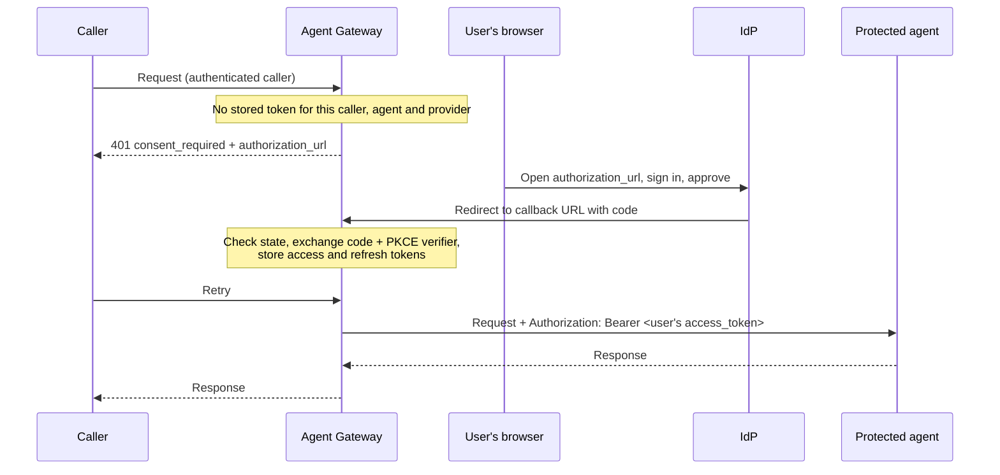

# Authorization Code

**Dashboard label:** OAuth 2.0, Authorization Code (3-legged, user consent)
**Provider type:** `oauth2_authorization_code`

## Overview

The user signs in at the IdP once and approves access. The gateway then holds that user's access token (and refresh token) and injects it into requests made on the user's behalf. The agent receives a token that names the **user**, not a service account, so it can apply per-user permissions.

| Use it for                                                                     | Do not use it for                                                       |
| ------------------------------------------------------------------------------ | ----------------------------------------------------------------------- |
| Agents or APIs that must act as a specific user (mail, calendar, files, CRM)   | Service-to-service calls with no user (use [Client Credentials](./client-credentials.md)) |
| Per-user consent and audit                                                     | Target Authentication; it is not offered there, because no user is present to consent |

This type works only through a **Credential Delegation** binding.

---

## How It Works



- **PKCE** (`S256`) is always used. The `state` parameter is encrypted and single-use, so it cannot be read or replayed.
- The gateway is a **confidential client**: the code exchange sends the client ID and client secret.
- Tokens are stored per caller identity, per agent and per provider. When a token expires, the gateway uses the refresh token if it has one. Otherwise it asks for consent again.

---

## Prerequisites

- An Agent Gateway with permission to manage **Secrets**, **Credentials** and **Surfaces**
- An A2A surface with:
  - **caller authentication** on the Access Point. Tokens are keyed by caller identity. Use a per-user caller credential (for example a JWT, see the [JWT Strategy Guide](../jwt-strategy-guide.md)) when each user must have their own token. All callers sharing one API key share one stored token.
  - an **agent identity** on the surface
- A gateway address the user's **browser** can reach for the callback. It must not resolve to a loopback address (`localhost`, `127.0.0.1`); the gateway rejects those. Microsoft Entra ID and Google also require `https` for non-localhost redirect URIs.
- For the main example: Docker, and the Keycloak realm `agents` with client scope `echo-agent.invoke` from [Client Credentials, Step 1](./client-credentials.md#step-1-configure-the-idp-keycloak)

---

## The Callback URL

Every Authorization Code provider has a callback URL, and it must be registered at the IdP **exactly** as a redirect URI:

```text
<Callback URL Host>/v1/identity/oauth/callback/<Callback URL Route>
```

| Part               | Example                         | Notes                                                                              |
| ------------------ | ------------------------------- | ---------------------------------------------------------------------------------- |
| Callback URL Host  | `https://gateway.example.com`   | The gateway's public origin. Empty means the gateway's configured base URL.        |
| Fixed path         | `/v1/identity/oauth/callback`   | Can differ if the gateway operator changed the callback route.                     |
| Callback URL Route | `keycloak-user`                 | Chosen when the provider is created. It identifies the provider and **cannot be changed later**. |

The provider form shows the full URL. Decide the route first, register the URL at the IdP, then create the provider.

---

## Step 1: Configure the IdP (Keycloak)

The result: a confidential client `gateway-user` that allows the authorization code flow back to the gateway callback, and a test user.

### 1.1 Create the client

**Admin console** (realm `agents`):

1. **Clients → Create client.** Client ID `gateway-user` → **Next**.
2. **Client authentication** On. Authentication flow: **Standard flow** only → **Next**.
3. **Valid redirect URIs:** `https://<gateway-host>/v1/identity/oauth/callback/keycloak-user` → **Save**.
4. **Advanced → Advanced settings → Proof Key for Code Exchange Code Challenge Method:** `S256` → **Save** (optional; makes PKCE mandatory).
5. **Client scopes → Add client scope** → `echo-agent.invoke` → **Add → Optional**.
6. **Credentials** → copy the **Client Secret**.

**CLI (`kcadm.sh`):**

```bash
CLIENT_ID=$(kc create clients -r agents -i -s clientId=gateway-user -s publicClient=false \
  -s standardFlowEnabled=true -s directAccessGrantsEnabled=false -s serviceAccountsEnabled=false \
  -s 'redirectUris=["https://<gateway-host>/v1/identity/oauth/callback/keycloak-user"]' \
  -s 'attributes."pkce.code.challenge.method"=S256')
SCOPE_ID=$(kc get client-scopes -r agents --fields id,name --format csv --noquotes | grep ',echo-agent.invoke$' | cut -d, -f1)
kc update clients/$CLIENT_ID/optional-client-scopes/$SCOPE_ID -r agents
kc get clients/$CLIENT_ID/client-secret -r agents --fields value --format csv --noquotes
```

`kc` is the `kcadm.sh` wrapper defined in [Client Credentials, Step 1.2](./client-credentials.md#12-create-the-realm-scope-and-client).

### 1.2 Create a test user

**Admin console:** **Users → Add user.** Username `alice`, Email, First and Last name, **Email verified** On → **Create**. Then **Credentials → Set password**, **Temporary** Off.

**CLI:**

```bash
kc create users -r agents -s username=alice -s enabled=true -s emailVerified=true \
  -s email=alice@example.com -s firstName=Alice -s lastName=Example
kc set-password -r agents --username alice --new-password '<password>'
```

Keycloak asks the user to complete their profile at first sign-in if email or name is missing.

**Endpoints** for the realm:

| Endpoint      | URL                                                                    |
| ------------- | ---------------------------------------------------------------------- |
| Authorization | `http://<lan-ip>:8180/realms/agents/protocol/openid-connect/auth`      |
| Token         | `http://<lan-ip>:8180/realms/agents/protocol/openid-connect/token`     |

The authorization endpoint is opened by the **browser**; the token endpoint is called by the **gateway**. Both must be reachable from where they are used. Keycloak returns a refresh token for this flow by default.

> **http token endpoints.** From gateway 1.0.5, saving a provider with an `http://` token endpoint is refused (`400 token_endpoint must be an https URL`) unless that exact URL is allowed in the gateway's `config.toml`, followed by a restart:
>
> ```toml
> [credential_policy]
> insecure_token_endpoints = ["http://<lan-ip>:8180/realms/agents/protocol/openid-connect/token"]
> ```
>
> Use this only for a local test IdP. In production, use an `https` token endpoint.

References: [Keycloak OIDC clients](https://www.keycloak.org/docs/latest/server_admin/#_oidc_clients), [Managing users](https://www.keycloak.org/docs/latest/server_admin/#assembly-managing-users_server_administration_guide).

---

## Step 2: Protect the Agent

Use the same JWKS guard as in [Client Credentials, Step 2](./client-credentials.md#step-2-protect-the-agent). The token now identifies a user: read `sub` (and `preferred_username` in Keycloak) from the validated claims to apply per-user rules. Check the issuer, audience and scope exactly as before.

---

## Step 3: Configure the Gateway

### 3.1 Create the secrets

**Secrets → New Secret**, type `General`:

| Secret ID               | Value                        |
| ----------------------- | ---------------------------- |
| `kc_user_client_id`     | `gateway-user`               |
| `kc_user_client_secret` | the client secret from 1.1   |

### 3.2 Create the credential provider

**Credentials → Credential Providers → Add Provider**:

| Field                            | Value                                                                  |
| -------------------------------- | ---------------------------------------------------------------------- |
| Name                             | `keycloak-user`                                                        |
| Provider Type                    | OAuth 2.0, Authorization Code (3-legged, user consent)                 |
| Authorization Endpoint           | `http://<lan-ip>:8180/realms/agents/protocol/openid-connect/auth`      |
| Token Endpoint                   | `http://<lan-ip>:8180/realms/agents/protocol/openid-connect/token`     |
| Callback URL Host                | `https://<gateway-host>`                                               |
| Callback URL Route               | `keycloak-user`                                                        |
| Client ID Secret                 | `kc_user_client_id`                                                    |
| Client Secret                    | `kc_user_client_secret`                                                |
| Default Scopes                   | `openid echo-agent.invoke`                                             |
| Enable automatic token refresh   | On                                                                     |
| Additional Parameters (JSON)     | optional, added to the authorization URL, for example `{"prompt":"consent"}` |

Confirm the callback URL shown in the form matches the redirect URI registered in Step 1.1, character for character.

### 3.3 Add the Credential Delegation binding

In the Surface Builder, add a **Credential Delegation** element and a binding:

| Field               | Value                                          |
| ------------------- | ---------------------------------------------- |
| Credential Provider | `keycloak-user`                                |
| Consent Mode        | On demand                                      |
| Required For        | All outbound requests                          |
| Inject As           | Bearer header                                  |
| Scopes              | empty (uses Default Scopes)                    |

Leave **Target Authentication** on the Managed Agent empty, so only one `Authorization` header is written. Save and deploy.

**Consent modes:**

| Mode          | Behaviour when no token is stored                                                                                     |
| ------------- | --------------------------------------------------------------------------------------------------------------------- |
| On demand     | The request fails with `401` and a `consent_required` body containing the authorization URL. The caller shows it to the user and retries. |
| Pre-authorize | The session is refused until the token already exists. Use it when consent is collected in advance.                    |
| Elicit        | MCP only. The gateway sends an MCP `elicitation/create` request with the URL to clients that support elicitation.       |

---

## Step 4: Verify

**1. First call: consent required.**

```bash
curl -sS https://<gateway-host>/<access-point-route> \
  -H 'Content-Type: application/json' \
  -H 'A2A-Version: 1.0' \
  -H '<caller-auth-header>: <caller-credential>' \
  -d '{"jsonrpc":"2.0","id":"1","method":"SendMessage","params":{"message":{"messageId":"m-1","role":"ROLE_USER","parts":[{"text":"hello"}]}}}'
```

Expected: HTTP `401`, `Content-Type: application/problem+json`:

```json
{
  "type": "https://affinidi.com/atg/errors/consent-required",
  "title": "Credential Delegation Consent Required",
  "status": 401,
  "consent_required": [
    { "provider_name": "keycloak-user", "authorization_url": "http://<lan-ip>:8180/realms/agents/protocol/openid-connect/auth?response_type=code&...", "scopes": ["openid", "echo-agent.invoke"] }
  ]
}
```

Extract the URL with `jq -r '.consent_required[0].authorization_url'`.

**2. Consent.** Open the URL in a browser, sign in as `alice`, and approve. The browser lands on the gateway callback, which confirms the authorization. The URL is valid for 10 minutes.

**3. Retry** the same request with the same caller credential. Expected: the agent's response. **Credentials → Credential Tokens** now lists a token for `keycloak-user`, and **Credential Delegation Audit** shows the consent and the injection.

---

## Other IdPs

### Microsoft Entra ID

**Portal:**

1. **App registrations → New registration.** Under **Redirect URI** choose **Web** and enter the gateway callback URL → **Register**.
2. **Certificates & secrets → New client secret.** Copy the value.
3. **API permissions:** add the delegated permissions the agent needs (for your own API: **Expose an API**, add a scope such as `access_as_user`).

**CLI:**

```bash
APP_ID=$(az ad app create --display-name agent-gateway-user \
  --web-redirect-uris "https://<gateway-host>/v1/identity/oauth/callback/entra-user" \
  --query appId -o tsv)
az ad app credential reset --id $APP_ID --display-name gateway --years 1 --append   # prints the secret
```

| Provider field         | Value                                                                    |
| ---------------------- | ------------------------------------------------------------------------ |
| Authorization Endpoint | `https://login.microsoftonline.com/<tenant-id>/oauth2/v2.0/authorize`    |
| Token Endpoint         | `https://login.microsoftonline.com/<tenant-id>/oauth2/v2.0/token`        |
| Default Scopes         | `api://<api-app-id>/access_as_user offline_access`                       |

`offline_access` is needed for a refresh token. A complete walkthrough with screenshots is in the [A2A credential delegation lab](../../a2a-credential-delegation/README.md). Reference: [Authorization code flow](https://learn.microsoft.com/entra/identity-platform/v2-oauth2-auth-code-flow).

### Google

Google OAuth clients for web applications are created in the console; there is no `gcloud` command for them.

1. **Google Auth Platform → Branding** (or **APIs & Services → OAuth consent screen**): configure the consent screen. While the app is in **Testing**, add your test users under **Audience**.
2. **Clients → Create client** (or **APIs & Services → Credentials → Create credentials → OAuth client ID**). Application type **Web application**; **Authorized redirect URIs**: the gateway callback URL (`https` required). Copy the client ID and secret.
3. Enable the APIs you will call (for example `gcloud services enable gmail.googleapis.com`).

| Provider field               | Value                                                     |
| ---------------------------- | --------------------------------------------------------- |
| Authorization Endpoint       | `https://accounts.google.com/o/oauth2/v2/auth`            |
| Token Endpoint               | `https://oauth2.googleapis.com/token`                     |
| Default Scopes               | the Google API scopes, for example `https://www.googleapis.com/auth/gmail.readonly` |
| Additional Parameters (JSON) | `{"access_type":"offline","prompt":"consent"}` (needed to receive a refresh token) |

Reference: [OAuth 2.0 for web server applications](https://developers.google.com/identity/protocols/oauth2/web-server).

### Okta

Create an **OIDC Web Application** integration: **Applications → Create App Integration → OIDC → Web Application**. Set the **Sign-in redirect URI** to the gateway callback URL, select **Refresh Token** under grant types if you want refresh, and assign the users. Use a custom authorization server for your own APIs:

- Authorization Endpoint `https://<okta-domain>/oauth2/<authorization-server-id>/v1/authorize`
- Token Endpoint `https://<okta-domain>/oauth2/<authorization-server-id>/v1/token`
- Add `offline_access` to Default Scopes for a refresh token.

Okta's default client authentication for web apps is client secret (basic). The gateway sends the secret in the form body (`client_secret_post`); if the token call fails with `invalid_client`, select **Client secret** with **POST** in the app's client authentication settings (option names differ by Okta version). Guide: [Implement the Authorization Code flow](https://developer.okta.com/docs/guides/implement-grant-type/authcode/main/).

### Others

Auth0, Ping, Ory and Cognito all support the authorization code flow for confidential clients. Register the gateway callback URL as the redirect URI and use their `authorize` and `token` endpoints from `/.well-known/openid-configuration`. For Auth0, add `{"audience":"<api-identifier>"}` to **Additional Parameters** to receive a JWT access token for your API.

---

## Troubleshooting

| Symptom                                                  | Cause and fix                                                                                                                    |
| -------------------------------------------------------- | -------------------------------------------------------------------------------------------------------------------------------- |
| `403 identity-required`                                  | The surface has no authenticated caller or no agent identity. Add caller authentication on the Access Point and an identity.      |
| IdP page: `invalid redirect_uri` / `redirect_uri_mismatch` / `AADSTS50011` | The registered redirect URI differs from the provider's callback URL (scheme, host, port, path or trailing slash). |
| Callback page shows an error about the state             | The URL was older than 10 minutes, already used, or issued by a different gateway. Request a new one.                             |
| Callback fails at token exchange                         | Wrong client secret, or the token endpoint is unreachable from the gateway. Retry with the same URL after fixing. |
| Provider save or callback rejected as blocked            | The callback or token endpoint resolves to a loopback or metadata address. Use the gateway's LAN or public name.                  |
| Consent asked again every hour                           | No refresh token. Add `offline_access` (Entra, Okta) or `access_type=offline` + `prompt=consent` (Google), and enable token refresh. |
| Every user gets the same account's data                  | Callers share one identity (one API key). Authenticate callers individually.                                                     |

---

## Security Notes

- Keep the client secret in Secrets only. Rotate it at the IdP, then update the secret value.
- Request the smallest scopes the agent needs; users see and approve them.
- Stored user tokens are sensitive. Ask the gateway operator to enable encryption at rest for the credential vault.
- To revoke a user's access, remove their token in **Credential Tokens** and revoke the grant or session at the IdP.
