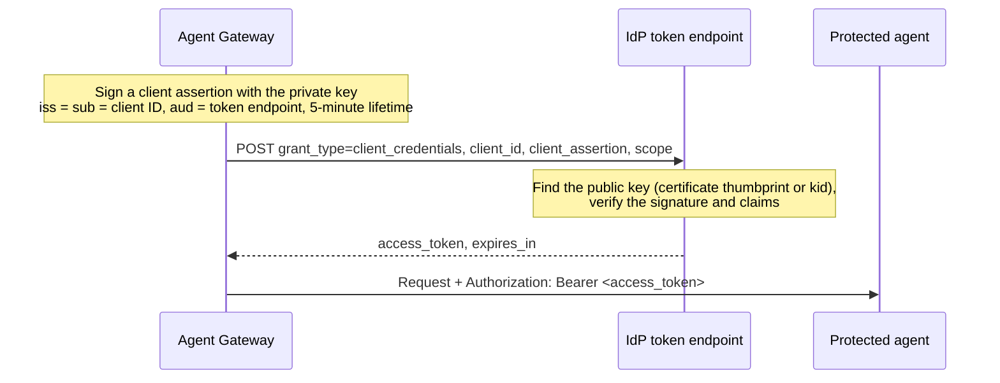

# Client Credentials JWT

**Dashboard label:** OAuth 2.0, Client Credentials JWT (certificate, no client secret)
**Provider type:** `oauth2_client_credentials_jwt_auth`

## Overview

A client credentials flow in which the gateway proves its identity with a **signed JWT** instead of a client secret (`private_key_jwt`, [RFC 7523 §2.2](https://www.rfc-editor.org/rfc/rfc7523#section-2.2)). You generate a key pair, register only the **public** key or certificate with the IdP, and store the **private** key in the gateway. No shared secret exists anywhere.

| Use it for                                                         | Do not use it for                                                        |
| ------------------------------------------------------------------ | ------------------------------------------------------------------------ |
| Entra ID applications with a certificate credential (Azure AI Foundry, Azure APIs, your own APIs) | Google service accounts (use [JWT Bearer](./jwt-bearer.md))    |
| Okta, Keycloak, Ory, Ping clients configured for `private_key_jwt` | Calls that must carry an end user's identity                             |
| Replacing a client secret with a certificate in an existing setup  | IdPs that support only client secrets (for example Amazon Cognito)       |

---

## How It Works



The request the gateway sends:

```http
POST /<tenant-id>/oauth2/v2.0/token
Content-Type: application/x-www-form-urlencoded

grant_type=client_credentials
&client_id=<client-id>
&client_assertion_type=urn:ietf:params:oauth:client-assertion-type:jwt-bearer
&client_assertion=<signed JWT>
&scope=<scopes>
```

The client assertion:

| Part   | Value                                                                                                     |
| ------ | --------------------------------------------------------------------------------------------------------- |
| Header | `alg` PS256 (default) or RS256; `typ` JWT; `x5t#S256` when a certificate is stored; `kid` when a Key ID is set |
| Claims | `iss` and `sub` = client ID; `aud` = token endpoint (or the Audience field); `iat`, `nbf`, `exp` (+5 min); random `jti` |

**How the IdP finds your key.** Entra matches the certificate thumbprint in `x5t#S256`, so store the **certificate** as well as the key. Okta, Ory and most others match `kid`, so set **Key ID**. Keycloak with a single imported certificate needs neither.

**Compared with [JWT Bearer](./jwt-bearer.md).** Both sign a JWT with a private key. Here the JWT only *authenticates the client* inside a normal client credentials request: `iss` is the client ID, the scopes travel in the form body, and a `client_id` is sent. In JWT Bearer the JWT *is* the grant: `iss` is a service account, the scopes are a claim inside the JWT, and no client ID is sent.

---

## Prerequisites

- An Agent Gateway with permission to manage **Secrets**, **Credentials** and **Surfaces**
- An A2A surface with caller authentication on its Access Point
- `openssl` to create the key pair
- For the main example: an Azure subscription with a **Foundry hosted agent** (see [a2a-azure-foundry-hosted-agent](../../a2a-azure-foundry-hosted-agent/README.md)), and permission to create app registrations and role assignments

---

## Step 1: Create the Key Pair

```bash
openssl req -x509 -newkey rsa:2048 -nodes -sha256 -days 365 \
  -subj "/CN=agent-gateway-client" \
  -keyout gateway-client.key.pem -out gateway-client.cert.pem
chmod 600 gateway-client.key.pem
```

| File                       | Goes to                                              | Sensitivity                          |
| -------------------------- | ---------------------------------------------------- | ------------------------------------ |
| `gateway-client.cert.pem`  | the IdP, and a gateway secret (for the thumbprint)    | Public                               |
| `gateway-client.key.pem`   | a gateway secret only                                 | **Private.** Never send it to the IdP. |

The key is PKCS#8 (`BEGIN PRIVATE KEY`), which the gateway accepts. Use a certificate from your PKI instead of a self-signed one if your organisation requires it; the IdP only checks the public key.

---

## Step 2: Configure the IdP (Microsoft Entra ID, calling a Foundry agent)

The result: an app registration whose certificate is trusted, and whose service principal has a role on the Foundry agent.

### 2.1 Register the application and upload the certificate

**Portal:**

1. **Microsoft Entra ID → App registrations → New registration.** Name it (for example `agent-gateway-foundry`), keep single tenant → **Register**.
2. Copy the **Application (client) ID** and **Directory (tenant) ID** from **Overview**.
3. **Certificates & secrets → Certificates → Upload certificate.** Select `gateway-client.cert.pem` → **Add**. Note the **Thumbprint** shown.
4. Registering the app creates the service principal. Find its **Object ID** under **Enterprise applications** → your app → **Overview**.

**CLI:**

```bash
APP_ID=$(az ad app create --display-name agent-gateway-foundry --query appId -o tsv)
SP_OBJECT_ID=$(az ad sp create --id $APP_ID --query id -o tsv)
az ad app credential reset --id $APP_ID --cert @gateway-client.cert.pem --append
az account show --query tenantId -o tsv          # tenant ID
```

`--append` keeps any existing credentials. Without it, the command replaces them.

### 2.2 Grant the service principal access to the agent

The role must allow the Foundry Invocations data action. **Foundry User** scoped to the agent is the least-privilege option.

**CLI:**

```bash
az role assignment create \
  --assignee-object-id $SP_OBJECT_ID --assignee-principal-type ServicePrincipal \
  --role "Foundry User" \
  --scope "/subscriptions/<subscription-id>/resourceGroups/<resource-group>/providers/Microsoft.CognitiveServices/accounts/<foundry-account>/projects/<project>/agents/<agent-name>"
```

**Portal** (account scope only): Foundry resource → **Access control (IAM) → Add role assignment** → **Foundry User** → select the app → **Review + assign**.

See [Section 4 of the Foundry guide](../../a2a-azure-foundry-hosted-agent/README.md#4-set-up-machine-to-machine-m2m-access) for role choices and pitfalls.

### 2.3 Check the certificate login (optional)

```bash
az login --service-principal --username $APP_ID --tenant <tenant-id> \
  --certificate <(cat gateway-client.key.pem gateway-client.cert.pem) --allow-no-subscriptions
az account get-access-token --scope https://ai.azure.com/.default --query expiresOn
az logout
```

A token here confirms that Entra trusts the certificate.

References: [Certificate credentials](https://learn.microsoft.com/entra/identity-platform/certificate-credentials), [Client credentials with a certificate](https://learn.microsoft.com/entra/identity-platform/v2-oauth2-client-creds-grant-flow#second-case-access-token-request-with-a-certificate).

---

## Step 3: Configure the Gateway

### 3.1 Create the secrets

**Secrets → New Secret**, type `General`. Paste PEM values including their `BEGIN`/`END` lines.

| Secret ID                | Value                                   |
| ------------------------ | --------------------------------------- |
| `entra_client_id`        | the Application (client) ID             |
| `entra_client_key`       | contents of `gateway-client.key.pem`    |
| `entra_client_cert`      | contents of `gateway-client.cert.pem`   |

### 3.2 Create the credential provider

**Credentials → Credential Providers → Add Provider**:

| Field             | Value                                                              |
| ----------------- | ------------------------------------------------------------------ |
| Name              | `entra-foundry-cert`                                               |
| Provider Type     | OAuth 2.0, Client Credentials JWT (certificate, no client secret)  |
| Token Endpoint    | `https://login.microsoftonline.com/<tenant-id>/oauth2/v2.0/token`  |
| Client ID Secret  | `entra_client_id`                                                  |
| Default Scopes    | `https://ai.azure.com/.default`                                    |
| **Signed JWT** section |                                                               |
| Signing Key       | `entra_client_key`                                                 |
| Certificate       | `entra_client_cert` (required for Entra)                           |
| Key ID            | leave empty                                                        |
| Signing Algorithm | PS256 (default) or RS256                                           |
| Audience          | leave empty (the token endpoint is used)                           |

There is no Client Secret field for this type. The gateway refuses one, so a misconfiguration cannot fall back to a secret. The key and certificate are checked on save.

> **Entra rules:** use the tenant-specific endpoint, not `common`. Client credentials accept only a `/.default` scope (`AADSTS1002012` otherwise). Do not set a `resource` value (`AADSTS901002`).

### 3.3 Use the provider as Target Authentication

On the surface's **Managed Agent**:

| Field                   | Value                                                                                                                             |
| ----------------------- | --------------------------------------------------------------------------------------------------------------------------------- |
| Endpoint                | `https://<foundry-account>.services.ai.azure.com/api/projects/<project>/agents/<agent-name>/endpoint/protocols/invocations?api-version=v1` |
| Credential Source       | Credential provider                                                                                                               |
| Credential Provider     | `entra-foundry-cert`                                                                                                              |
| Authentication Type     | Bearer                                                                                                                            |
| Header Name / Format    | `Authorization` / `Bearer {value}`                                                                                                |
| Fallback Behavior       | Reject request (502 Bad Gateway)                                                                                                  |

Foundry serves its agent card on a different path from Invocations. On the Access Point, enable **Override agent card location** and set it to `api/projects/<project>/agents/<agent-name>/endpoint/protocols/a2a/agentCard/v1.0`. The gateway's card fetch uses the same Target Authentication token.

Use Target Authentication **or** a Credential Delegation binding for the same header, not both; two bindings would each write an `Authorization` header. Delegation is the right choice only when the token must be stored per caller.

---

## Step 4: Verify

```bash
curl -sS https://<gateway-host>/<access-point-route> \
  -H 'Content-Type: application/json' \
  -H 'A2A-Version: 1.0' \
  -H '<caller-auth-header>: <caller-credential>' \
  -d '{"jsonrpc":"2.0","id":"1","method":"SendMessage","params":{"message":{"messageId":"m-1","role":"ROLE_USER","parts":[{"text":"hello"}]}}}'
```

Expected: the agent's A2A task result, and one token for `entra-foundry-cert` under **Credentials → Credential Tokens**. Entra's sign-in logs show the service principal sign-in with **Client credential type: Client assertion**.

---

## Other IdPs

### Keycloak

Keycloak calls this client authenticator **Signed JWT**. It verifies the assertion with an imported certificate or a JWKS URL.

**Admin console:**

1. **Clients → Create client.** Enable **Client authentication** and **Service accounts roles**; clear **Standard flow** and **Direct access grants**.
2. **Credentials** tab → **Client Authenticator: Signed JWT** → **Save**. Leave **Signature algorithm** empty to accept PS256 and RS256, or pin one.
3. **Keys** tab → set **Use JWKS URL** Off → **Import key** → Archive format **Certificate PEM** → upload `gateway-client.cert.pem`.
4. Add the scopes and audience mapper, and remove default scopes, as in [Client Credentials, Step 1.2](./client-credentials.md#12-create-the-realm-scope-and-client).

**CLI (`kcadm.sh`):**

```bash
CERT_B64=$(openssl x509 -in gateway-client.cert.pem -outform DER | base64 | tr -d '\n')
kc create clients -r agents -s clientId=gateway-m2m-jwt -s publicClient=false \
  -s serviceAccountsEnabled=true -s standardFlowEnabled=false -s directAccessGrantsEnabled=false \
  -s clientAuthenticatorType=client-jwt -s 'attributes."use.jwks.url"=false' \
  -s "attributes.\"jwt.credential.certificate\"=$CERT_B64"
```

Gateway provider: Token Endpoint `https://<keycloak-host>/realms/<realm>/protocol/openid-connect/token`, Client ID `gateway-m2m-jwt`, Signing Key only. Certificate and Key ID are optional with a single imported certificate. Reference: [Keycloak client credentials, Signed JWT](https://www.keycloak.org/docs/latest/server_admin/#_client-credentials).

### Okta

Okta calls this **Public key / Private key** client authentication.

1. **Applications → Create App Integration → API Services** (or open an existing one).
2. **General → Client Credentials → Edit** → **Client authentication: Public key / Private key**.
3. **Add key**, then either:
   - paste your public key as a JWK, or
   - **Generate new key** and copy the private key in **PEM** format. It is shown once; store it as the gateway Signing Key.
4. Copy the key's **KID** and set it as the provider's **Key ID**.
5. If **Require Demonstrating Proof of Possession (DPoP) header in token requests** is selected, clear it. The gateway does not send DPoP proofs.
6. Grant scopes. For Okta management APIs, use **Okta API Scopes** with token endpoint `https://<okta-domain>/oauth2/v1/token`. For your own APIs, use a custom authorization server: `https://<okta-domain>/oauth2/<authorization-server-id>/v1/token`.

Automation: the [Okta Apps API](https://developer.okta.com/docs/api/openapi/okta-management/management/tag/Application/) can create the app with a JWKS. Guide: [Implement OAuth for Okta with a service app](https://developer.okta.com/docs/guides/implement-oauth-for-okta-serviceapp/main/).

### Ory, Ping Identity, Auth0

| IdP   | Notes                                                                                                                                                                    |
| ----- | ------------------------------------------------------------------------------------------------------------------------------------------------------------------------ |
| Ory   | Create the OAuth2 client with `token_endpoint_auth_method: private_key_jwt` and a `jwks` (or `jwks_uri`) containing your public key. Set the provider's **Key ID** to that key's `kid`. |
| Ping  | PingOne and PingFederate support *Private Key JWT* client authentication. Register the public key or JWKS, and set **Key ID**.                                           |
| Auth0 | Enable *Private Key JWT* on the application and upload the public key or certificate. Set the tenant **Default Audience**, because the gateway does not send `audience`. [Docs](https://auth0.com/docs/get-started/authentication-and-authorization-flow/authenticate-with-private-key-jwt) |

---

## Troubleshooting

| Symptom (gateway log or IdP error)                             | Cause and fix                                                                                                         |
| -------------------------------------------------------------- | --------------------------------------------------------------------------------------------------------------------- |
| Provider save fails on the key                                 | The key is not PEM, or not a type the algorithm can use. Use an RSA PKCS#8 or PKCS#1 key.                             |
| `AADSTS700027` (signature or certificate not found)            | The certificate secret is missing, or a different certificate was uploaded to Entra. Compare thumbprints.             |
| `AADSTS700024` (assertion not within its valid time range)     | The gateway host's clock is off. Fix NTP.                                                                             |
| `AADSTS7000222` (certificate expired)                          | Upload a new certificate with `--append`, update both gateway secrets, then remove the old certificate.              |
| `AADSTS1002012` or `AADSTS901002`                              | Use a single `<resource>/.default` scope and no `resource` value.                                                     |
| Okta `invalid_client`, no matching key                         | **Key ID** does not match the KID in Okta, or DPoP is required.                                                        |
| Keycloak `invalid_client`                                      | The client authenticator is not **Signed JWT**, or a different certificate was imported.                              |
| Foundry `401` / `403`                                          | Missing role (**Foundry User**) on the service principal's **object ID**, or wrong scope.                             |

---

## Security Notes

- Generate the key where it will be used, and keep `gateway-client.key.pem` out of source control, chat and tickets. Delete local copies after storing it in the gateway.
- Use a separate key pair per environment and per gateway.
- Rotate before expiry without downtime: add the new certificate at the IdP (`--append`), update the gateway's key and certificate secrets, confirm the new token works, then remove the old certificate. Updating the provider invalidates cached tokens.
- Removing a certificate at the IdP does not revoke tokens already issued. To cut access immediately, remove the role assignment.
