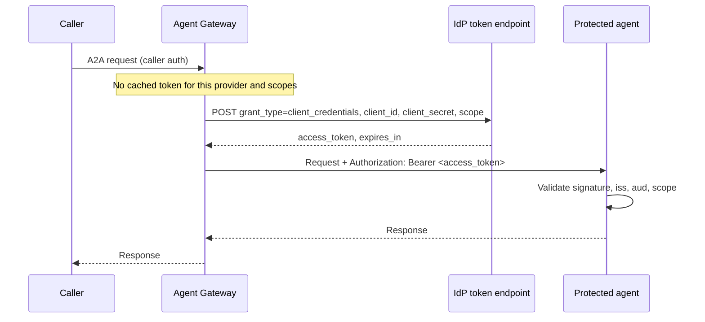

# Client Credentials

**Dashboard label:** OAuth 2.0, Client Credentials (2-legged, machine-to-machine)
**Provider type:** `oauth2_client_credentials`

## Overview

The gateway authenticates to the IdP with a **client ID and client secret** and receives an access token for itself. No user is involved. Use it when a protected agent or API accepts a service token and your IdP issues client secrets.

If your IdP can authenticate the client with a key pair instead (Entra, Okta, Keycloak), prefer [Client Credentials JWT](./client-credentials-jwt.md): it is the same flow without a shared secret.

| Use it for                                                | Do not use it for                                    |
| --------------------------------------------------------- | ---------------------------------------------------- |
| Service-to-service calls to an agent protected by an IdP | Calls that must carry an end user's identity         |
| Target Authentication on a Managed Agent or Transit Point | Google Cloud (no client credentials grant; see [JWT Bearer](./jwt-bearer.md)) |
| Delegation bindings where every caller shares one token  |                                                      |

---

## How It Works



The token request the gateway sends (`client_secret_post`):

```http
POST /realms/agents/protocol/openid-connect/token
Content-Type: application/x-www-form-urlencoded

grant_type=client_credentials&client_id=<client-id>&client_secret=<client-secret>&scope=<scopes>
```

The token is cached until 60 seconds before it expires, so the IdP is called roughly once per token lifetime, not once per request.

---

## Prerequisites

- An Agent Gateway with permission to manage **Secrets**, **Credentials** and **Surfaces**
- An A2A surface with an Access Point and a Managed Agent, and caller authentication on the Access Point (see [Creating an API Key for a Surface](../surface-api-key.md))
- An IdP. This guide uses **Keycloak** in Docker. Entra and Okta are covered under [Other IdPs](#other-idps).
- An agent that validates bearer tokens. A minimal one is shown in [Step 2](#step-2-protect-the-agent).

> **Reachability.** The gateway must reach both the IdP token endpoint and the agent. The gateway refuses a token endpoint that resolves to a loopback address (`localhost`, `127.0.0.1`). For a local IdP, use the machine's LAN address (for example `http://192.0.2.10:8180`) or a hostname that resolves to it. A gateway hosted in the cloud needs a public URL for both, for example through a tunnel.

---

## Step 1: Configure the IdP (Keycloak)

The result of this step is a confidential client `gateway-m2m` whose tokens have audience `echo-agent` and scope `echo-agent.invoke`, and nothing else.

### 1.1 Start Keycloak

```bash
export KC_HOST=<lan-ip>          # an address the gateway and the agent can both reach
docker run -d --name keycloak -p 8180:8080 \
  -e KC_BOOTSTRAP_ADMIN_USERNAME=admin -e KC_BOOTSTRAP_ADMIN_PASSWORD=change-me \
  -e KC_HOSTNAME=http://$KC_HOST:8180 \
  quay.io/keycloak/keycloak:26.6 start-dev
```

`KC_HOSTNAME` fixes the token issuer (`iss`) to `http://<lan-ip>:8180/realms/agents`, whichever address a client uses. Without it the issuer follows the request host, and the agent's issuer check fails when the gateway and the agent reach Keycloak by different names. `start-dev` is for local testing only; use `start` with TLS in production.

### 1.2 Create the realm, scope and client

**Admin console** (`http://<lan-ip>:8180/admin`, sign in as `admin`):

1. **Realm dropdown → Create realm.** Realm name `agents` → **Create**.
2. **Client scopes → Create client scope.**
   - Name `echo-agent.invoke`, Type **None**, **Include in token scope** On → **Save**.
   - **Mappers → Configure a new mapper → Audience.** Name `audience`, **Included Custom Audience** `echo-agent`, **Add to access token** On → **Save**.
3. **Clients → Create client.**
   - Client type **OpenID Connect**, Client ID `gateway-m2m` → **Next**.
   - **Client authentication** On. Under Authentication flow, clear **Standard flow** and **Direct access grants**, and select **Service accounts roles** → **Next** → **Save**.
4. In the client, open **Client scopes**.
   - **Add client scope** → select `echo-agent.invoke` → **Add → Optional**.
   - Remove `profile` and `email` from the assigned scopes. Keycloak would otherwise add them to every token's `scope`, and the gateway requires the issued scopes to match the requested scopes exactly.
5. Open **Credentials** and copy the **Client Secret**.

**Command line** (`kcadm.sh` inside the container):

```bash
kc() { docker exec keycloak /opt/keycloak/bin/kcadm.sh "$@"; }
kc config credentials --server http://localhost:8080 --realm master --user admin --password change-me

kc create realms -s realm=agents -s enabled=true

SCOPE_ID=$(kc create client-scopes -r agents -i -s name=echo-agent.invoke -s protocol=openid-connect \
  -s 'attributes."include.in.token.scope"=true')
kc create client-scopes/$SCOPE_ID/protocol-mappers/models -r agents \
  -s name=audience -s protocol=openid-connect -s protocolMapper=oidc-audience-mapper \
  -s 'config."included.custom.audience"=echo-agent' -s 'config."access.token.claim"=true'

CLIENT_ID=$(kc create clients -r agents -i -s clientId=gateway-m2m -s publicClient=false \
  -s serviceAccountsEnabled=true -s standardFlowEnabled=false -s directAccessGrantsEnabled=false)
kc update clients/$CLIENT_ID/optional-client-scopes/$SCOPE_ID -r agents
for name in profile email; do
  id=$(kc get clients/$CLIENT_ID/default-client-scopes -r agents --fields name,id --format csv --noquotes | grep "^$name," | cut -d, -f2)
  kc delete clients/$CLIENT_ID/default-client-scopes/$id -r agents
done

kc get clients/$CLIENT_ID/client-secret -r agents --fields value --format csv --noquotes
```

### 1.3 Check the token

```bash
curl -s http://$KC_HOST:8180/realms/agents/protocol/openid-connect/token \
  -d grant_type=client_credentials -d client_id=gateway-m2m \
  -d client_secret=<client-secret> -d scope=echo-agent.invoke
```

The response must show `"scope":"echo-agent.invoke"` and `"token_type":"Bearer"`. Decode the `access_token` (for example at [jwt.io](https://jwt.io), or locally) and confirm `aud` contains `echo-agent` and `azp` is `gateway-m2m`.

Keycloak references: [Service accounts](https://www.keycloak.org/docs/latest/server_admin/#_service_accounts), [Client scopes](https://www.keycloak.org/docs/latest/server_admin/#_client_scopes), [Audience mapper](https://www.keycloak.org/docs/latest/server_admin/#_audience_hardcoded), [Admin CLI](https://www.keycloak.org/docs/latest/server_admin/#admin-cli).

---

## Step 2: Protect the Agent

Any agent that validates a JWT against the IdP's JWKS works. It must check the signature, `iss`, `aud`, and the scope or role it needs. A minimal Python (Flask + PyJWT) guard:

```python
# pip install flask "pyjwt[crypto]"
import os, jwt
from flask import Flask, request, jsonify

ISSUER = os.environ["OIDC_ISSUER"]             # http://<lan-ip>:8180/realms/agents
AUDIENCE = os.environ["EXPECTED_AUDIENCE"]     # echo-agent
REQUIRED_SCOPE = os.environ.get("REQUIRED_SCOPE", "echo-agent.invoke")
jwks = jwt.PyJWKClient(f"{ISSUER}/protocol/openid-connect/certs")
app = Flask(__name__)

@app.before_request
def require_bearer():
    if request.path == "/.well-known/agent-card.json":
        return None
    auth = request.headers.get("Authorization", "")
    if not auth.startswith("Bearer "):
        return jsonify(error="missing bearer token"), 401
    try:
        token = auth[7:]
        key = jwks.get_signing_key_from_jwt(token).key
        claims = jwt.decode(token, key, algorithms=["RS256", "PS256", "ES256"],
                            audience=AUDIENCE, issuer=ISSUER)
    except jwt.PyJWTError:
        return jsonify(error="invalid token"), 401
    if REQUIRED_SCOPE not in claims.get("scope", "").split():
        return jsonify(error="insufficient scope"), 403

# ... your existing A2A routes (agent card and JSON-RPC handler) ...
```

The JWKS URL differs per IdP; use the `jwks_uri` from the IdP's `/.well-known/openid-configuration`.

Check the guard before adding the gateway: a call without a token must return `401`, and a call with the token from Step 1.3 must succeed.

---

## Step 3: Configure the Gateway

### 3.1 Create the secrets

**Secrets → New Secret**, type `General`:

| Secret ID              | Value                       |
| ---------------------- | --------------------------- |
| `kc_m2m_client_id`     | `gateway-m2m`               |
| `kc_m2m_client_secret` | the client secret from 1.2  |

### 3.2 Create the credential provider

**Credentials → Credential Providers → Add Provider**:

| Field              | Value                                                                     |
| ------------------ | ------------------------------------------------------------------------- |
| Name               | `keycloak-m2m`                                                            |
| Provider Type      | OAuth 2.0, Client Credentials (2-legged, machine-to-machine)              |
| Token Endpoint     | `http://<lan-ip>:8180/realms/agents/protocol/openid-connect/token`        |
| Client ID Secret   | `kc_m2m_client_id`                                                        |
| Client Secret      | `kc_m2m_client_secret`                                                    |
| Default Scopes     | `echo-agent.invoke`                                                       |

There is no authorization endpoint or callback URL: there is no user to redirect.

### 3.3 Use the provider

**Target Authentication (most common).** In the Surface Builder, open the **Managed Agent**, set its endpoint to the agent's URL, and under **Target Authentication** set:

| Field               | Value                            |
| ------------------- | -------------------------------- |
| Credential Source   | Credential provider              |
| Credential Provider | `keycloak-m2m`                   |
| Authentication Type | Bearer                           |
| Header Name         | `Authorization`                  |
| Header Format       | `Bearer {value}`                 |
| Fallback Behavior   | Reject request (502 Bad Gateway) |

Save and deploy the surface.

**Credential Delegation (alternative).** To inject the token into an agent's *outbound* calls instead, add a **Credential Delegation** element with a binding to `keycloak-m2m`, **Inject As** Bearer header. Consent Mode has no effect for this type. The surface needs an authenticated caller and an agent identity; see [Where a Provider Is Used](./README.md#where-a-provider-is-used).

---

## Step 4: Verify

```bash
curl -sS https://<gateway-host>/<access-point-route> \
  -H 'Content-Type: application/json' \
  -H 'A2A-Version: 1.0' \
  -H 'X-API-Key: <caller-api-key>' \
  -d '{"jsonrpc":"2.0","id":"1","method":"SendMessage","params":{"message":{"messageId":"m-1","role":"ROLE_USER","parts":[{"text":"hello"}]}}}'
```

Expected:

- The agent's normal JSON-RPC result.
- The agent logs a token with `azp=gateway-m2m`.
- **Credentials → Credential Tokens** shows one token for the provider. Repeat calls reuse it until shortly before it expires.

---

## Other IdPs

### Microsoft Entra ID

A complete Entra walkthrough for this provider type (app registration, exposed API, gateway provider and surface) is in [a2a-credential-delegation](../../a2a-credential-delegation/README.md). The essentials:

| Item           | Value                                                                  |
| -------------- | ---------------------------------------------------------------------- |
| Token Endpoint | `https://login.microsoftonline.com/<tenant-id>/oauth2/v2.0/token`      |
| Default Scopes | `<application-id-uri>/.default`, for example `api://<api-app-id>/.default` |
| Secrets        | Application (client) ID and a client secret value                      |

Create the client and secret:

- **Portal:** **Microsoft Entra ID → App registrations → New registration.** Then **Certificates & secrets → Client secrets → New client secret** and copy the **Value** (it is shown once). On the API's app registration, define an **App role** with allowed member type *Applications*. Grant it to the client under **API permissions → Add a permission → My APIs → Application permissions**, then **Grant admin consent**.
- **CLI:**

  ```bash
  APP_ID=$(az ad app create --display-name agent-gateway-m2m --query appId -o tsv)
  az ad sp create --id $APP_ID
  az ad app credential reset --id $APP_ID --display-name gateway --years 1 --append --query password -o tsv
  ```

Do not set a `resource` value for Entra v2.0 (it fails with `AADSTS901002`); the `.default` scope carries the audience. Reference: [Microsoft identity platform client credentials flow](https://learn.microsoft.com/entra/identity-platform/v2-oauth2-client-creds-grant-flow).

### Okta

Okta issues client secrets to **API Services** apps for a **custom authorization server**.

- **Admin Console:**
  - **Applications → Create App Integration → API Services.** Copy the **Client ID** and **Client secret**.
  - **Security → API → Authorization Servers → `default`** (or your own).
    - Add a **Scope** such as `echo-agent.invoke`.
    - Add an **Access Policy** and a **Rule** that allows the *Client Credentials* grant for the app.
- **Automation:** the [Okta Apps API](https://developer.okta.com/docs/api/openapi/okta-management/management/tag/Application/) or the [Okta Terraform provider](https://registry.terraform.io/providers/okta/okta/latest/docs).
- **Token Endpoint:** `https://<okta-domain>/oauth2/<authorization-server-id>/v1/token`. Okta validates `aud` against the authorization server's **Audience** setting.
- If the app's client authentication is set to *Client secret (Basic)*, change it to *Client secret (Post)*: the gateway sends the secret in the form body.

Guide: [Implement the Client Credentials flow (Okta)](https://developer.okta.com/docs/guides/implement-grant-type/clientcreds/main/). For key-pair authentication with Okta, see [Client Credentials JWT](./client-credentials-jwt.md#okta).

### Auth0, Amazon Cognito and others

| IdP            | Notes                                                                                                                                         |
| -------------- | --------------------------------------------------------------------------------------------------------------------------------------------- |
| Auth0          | Create a Machine to Machine application authorized for your API. Set the tenant **Default Audience** to the API identifier, because the gateway does not send `audience`. [Docs](https://auth0.com/docs/get-started/authentication-and-authorization-flow/client-credentials-flow) |
| Amazon Cognito | Create an app client with a client secret and a resource server with custom scopes (`<resource-server-id>/<scope>`). Token endpoint `https://<domain>/oauth2/token`. [Docs](https://docs.aws.amazon.com/cognito/latest/developerguide/token-endpoint.html) |
| Ping, Ory      | Standard confidential client with `client_secret_post` enabled.                                                                                |

---

## Troubleshooting

| Symptom                                                    | Likely cause and fix                                                                                                                                             |
| ---------------------------------------------------------- | ---------------------------------------------------------------------------------------------------------------------------------------------------------------- |
| Provider save fails with an invalid token endpoint         | The endpoint resolves to a loopback address or a cloud metadata address. Use a LAN or public address.                                                            |
| `502 Target authentication failed`                         | The gateway could not get a token. Check the gateway log for the IdP's OAuth `error` (`invalid_client`, `invalid_scope`, `unauthorized_client`).                |
| `502`, log says `issued other scopes than requested`       | The IdP returned extra or fewer scopes than requested (for example `profile email`). Remove default scopes from the client, or clear **Default Scopes**.         |
| `401` from the agent, `invalid token`                      | `iss` or `aud` differ from what the agent expects. Compare the decoded token with `OIDC_ISSUER` and `EXPECTED_AUDIENCE`; for Keycloak, set `KC_HOSTNAME`.       |
| `401` persists after fixing roles at the IdP               | The old token is still cached. Save the provider again, or wait for the token to expire.                                                                         |
| `Unsupported A2A protocol version '0.3'`                   | Add the header `A2A-Version: 1.0`.                                                                                                                               |
| Gateway on macOS cannot reach a LAN address                | Grant the gateway process **Local Network** access (System Settings → Privacy & Security), or use a hostname that resolves to an allowed address.               |

---

## Security Notes

- Give each provider its own client. Do not reuse a client that also signs in users.
- Grant the client only the scopes or roles the agent needs, and have the agent enforce them.
- Rotate the client secret on a schedule. Add the new secret at the IdP, update the gateway secret, then remove the old one at the IdP. Editing the provider invalidates cached tokens.
- Prefer [Client Credentials JWT](./client-credentials-jwt.md) where the IdP supports it, to remove the shared secret entirely.
