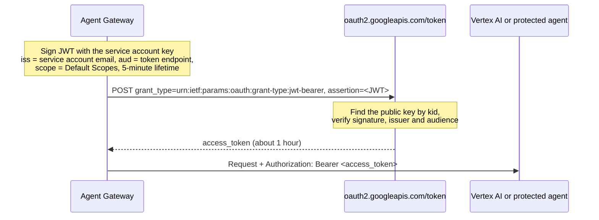

# JWT Bearer

**Dashboard label:** OAuth 2.0, JWT Bearer (service account JWT grant)
**Provider type:** `oauth2_jwt_bearer`

## Overview

The gateway signs a JWT with a service account's private key and exchanges it for an access token ([RFC 7523 §2.1](https://www.rfc-editor.org/rfc/rfc7523#section-2.1)). The signed JWT **is** the grant: there is no client ID and no client secret. This is how Google service accounts obtain OAuth access tokens, and it is the provider type to use for Google Cloud APIs, including Vertex AI.

| Use it for                                                                 | Do not use it for                                                                       |
| -------------------------------------------------------------------------- | --------------------------------------------------------------------------------------- |
| Google Cloud APIs and Vertex AI Agent Engine, as a service account          | Microsoft Entra ID; its `jwt-bearer` grant is On-Behalf-Of and needs a user token        |
| Google Workspace APIs with domain-wide delegation (Subject = a user)        | Okta or Keycloak; their JWT grants also need client authentication (use [Client Credentials JWT](./client-credentials-jwt.md)) |
| Any IdP that accepts a standalone RFC 7523 assertion from a trusted issuer  | Cloud Run or Cloud Functions IAM, which need an OIDC **ID token** (not supported)        |

---

## How It Works



The request the gateway sends:

```http
POST /token
Content-Type: application/x-www-form-urlencoded

grant_type=urn:ietf:params:oauth:grant-type:jwt-bearer
&assertion=<signed JWT>
```

| JWT part | Value                                                                                               |
| -------- | --------------------------------------------------------------------------------------------------- |
| Header   | `alg` RS256 (default) or ES256; `typ` JWT; `kid` = **Key ID**; `x5t#S256` when a certificate is stored |
| Claims   | `iss` = **Issuer**; `aud` = token endpoint (or **Audience**); `scope` = Default Scopes; `sub` = **Subject** if set; `iat`, `exp` (+5 min) |

Scopes travel **inside** the JWT, not in the form body. Compare [Client Credentials JWT](./client-credentials-jwt.md), where a signed JWT only authenticates a client.

---

## Prerequisites

- An Agent Gateway with permission to manage **Secrets**, **Credentials** and **Surfaces**
- An A2A surface with caller authentication on its Access Point
- A Google Cloud project and the [gcloud CLI](https://cloud.google.com/sdk/docs/install) (`gcloud auth login`, `gcloud config set project <project-id>`)
- For the Vertex example: billing enabled and an agent deployed to Vertex AI Agent Engine, as in [a2a-vertex-agent](../../a2a-vertex-agent/README.md). Without billing, follow the [local fallback](#local-fallback-without-vertex-ai) instead; the service account and gateway steps are the same.
- Permission to create service accounts and keys (`roles/iam.serviceAccountAdmin`, `roles/iam.serviceAccountKeyAdmin`) and to grant project roles

---

## Step 1: Create the Service Account

**Console:**

1. **IAM & Admin → Service Accounts → Create service account.** Name `agent-gateway-caller` → **Create and continue**.
2. Grant **Vertex AI User** (`roles/aiplatform.user`) → **Done**. Skip the role for the local fallback.
3. Open the account and copy its **Email** and **Unique ID**.

**CLI:**

```bash
PROJECT_ID=$(gcloud config get-value project)
gcloud iam service-accounts create agent-gateway-caller --display-name "Agent Gateway caller"
SA=agent-gateway-caller@$PROJECT_ID.iam.gserviceaccount.com

gcloud projects add-iam-policy-binding $PROJECT_ID \
  --member "serviceAccount:$SA" --role roles/aiplatform.user --condition=None

gcloud iam service-accounts describe $SA --format='value(email,uniqueId)'
```

Grant the narrowest role that works. `roles/aiplatform.user` is enough to query an Agent Engine.

---

## Step 2: Give the Service Account a Key

Choose one option. Both end with a private key PEM and a key ID.

### Option A: Upload your own certificate (recommended)

You keep the private key; Google stores only the certificate.

```bash
openssl req -x509 -newkey rsa:2048 -nodes -sha256 -days 365 \
  -subj "/CN=agent-gateway-caller" \
  -keyout sa.key.pem -out sa.cert.pem
chmod 600 sa.key.pem
```

**Console:** the service account → **Keys → Add key → Upload existing key** → paste or select `sa.cert.pem` → **Upload**.

**CLI:**

```bash
gcloud iam service-accounts keys upload sa.cert.pem --iam-account $SA
gcloud iam service-accounts keys list --iam-account $SA --managed-by user   # KEY_ID column
```

The certificate must be an RSA X.509 PEM certificate. Its expiry becomes the key's expiry.

### Option B: Let Google generate a key

Google creates the key pair and gives you a JSON file containing the private key.

**Console:** the service account → **Keys → Add key → Create new key → JSON → Create**. The file downloads once.

**CLI:**

```bash
gcloud iam service-accounts keys create sa-key.json --iam-account $SA
jq -r .private_key    sa-key.json > sa.key.pem      # Signing Key
jq -r .private_key_id sa-key.json                   # Key ID
jq -r .client_email   sa-key.json                   # Issuer
chmod 600 sa.key.pem
```

Delete `sa-key.json` after the values are stored in the gateway.

> **Gateway 1.0.5 and later:** you can skip the `jq` steps and store the whole `sa-key.json` content as the **Signing Key** secret. The gateway signs with its `private_key` and uses its `private_key_id` as the key ID, so **Key ID** can be left empty. You still need `client_email` for **Issuer** and **Subject**.

### If key creation or upload is blocked

New Google Cloud organizations enforce these organization policy constraints by default:

| Constraint                                                                                 | Blocks                 |
| ------------------------------------------------------------------------------------------ | ---------------------- |
| `iam.disableServiceAccountKeyCreation` (or `iam.managed.disableServiceAccountKeyCreation`) | Option B               |
| `iam.disableServiceAccountKeyUpload` (or `iam.managed.disableServiceAccountKeyUpload`)     | Option A               |

Keep creation blocked and allow upload only for this project. This needs **Organization Policy Administrator** (`roles/orgpolicy.policyAdmin`) on the organization.

**Console:** **IAM & Admin → Organization Policies** (project selected) → search the constraint → **Manage policy** → **Override parent's policy** → add a rule with **Enforcement Off** → **Set policy**.

**CLI:**

```bash
cat > allow-key-upload.yaml <<EOF
name: projects/$PROJECT_ID/policies/iam.disableServiceAccountKeyUpload
spec:
  rules:
  - enforce: false
EOF
gcloud org-policies set-policy allow-key-upload.yaml
```

Use the constraint name shown in the error message. Changes can take a few minutes to apply. Reference: [Service account key policies](https://cloud.google.com/iam/docs/keys-create-delete#allow-creation).

---

## Step 3: Configure the Gateway

### 3.1 Create the secret

**Secrets → New Secret**, type `General`:

| Secret ID          | Value                                                      |
| ------------------ | ---------------------------------------------------------- |
| `gcp_sa_key`       | contents of `sa.key.pem`, including `BEGIN`/`END` lines    |
| `gcp_sa_cert`      | optional: contents of `sa.cert.pem` (Option A)             |

### 3.2 Create the credential provider

**Credentials → Credential Providers → Add Provider**:

| Field              | Value                                                      |
| ------------------ | ---------------------------------------------------------- |
| Name               | `google-sa`                                                |
| Provider Type      | OAuth 2.0, JWT Bearer (service account JWT grant)          |
| Token Endpoint     | `https://oauth2.googleapis.com/token`                      |
| Default Scopes     | `https://www.googleapis.com/auth/cloud-platform`           |
| **Signed JWT** section |                                                        |
| Issuer             | the service account email                                  |
| Signing Key        | `gcp_sa_key`                                               |
| Key ID             | the key ID from Step 2                                     |
| Certificate        | optional (`gcp_sa_cert`); Google does not need it          |
| Signing Algorithm  | RS256                                                      |
| Audience           | leave empty (the token endpoint is used)                   |
| Subject            | the service account email (same as **Issuer**). For Workspace domain-wide delegation, set it to the user to impersonate instead. |

> **Subject is required in upcoming gateway releases.** Releases after 1.0.5 refuse to save a JWT Bearer provider without a Subject. Google accepts the service account's own email as `sub`, so set it now.

There are no Client ID or Client Secret fields for this type.

### 3.3 Use the provider as Target Authentication

On the surface's **Managed Agent**:

| Field                | Value                                                                                                      |
| -------------------- | ---------------------------------------------------------------------------------------------------------- |
| Endpoint             | `https://<region>-aiplatform.googleapis.com/v1beta1/projects/<project-id>/locations/<region>/reasoningEngines/<engine-id>/a2a`    |
| Credential Source    | Credential provider                                                                                        |
| Credential Provider  | `google-sa`                                                                                                |
| Authentication Type  | Bearer                                                                                                     |
| Header Name / Format | `Authorization` / `Bearer {value}`                                                                         |
| Fallback Behavior    | Reject request (502 Bad Gateway)                                                                           |

The engine ID is the last segment of the resource name printed at deployment (`projects/<number>/locations/<region>/reasoningEngines/<engine-id>`). The endpoint ends in `/a2a`: A2A clients append `/v1/message:send`.

Agent Engine speaks A2A 0.3 over the **HTTP+JSON** binding and serves its card at `<endpoint>/v1/card`. On the **Access Point**:

- **Supported versions:** A2A 0.3.
- **Message validation:** Off. The JSON-RPC validators reject HTTP+JSON requests.
- **Override Agent Card Location:** `v1beta1/projects/<project-number>/locations/<region>/reasoningEngines/<engine-id>/a2a/v1/card`. The path is relative to the endpoint's origin, not to the endpoint path. The card fetch uses the same token.

Save and deploy.

---

## Step 4: Verify

1. **Token check (optional).** Before using the gateway, confirm Google accepts the key with the same grant:

   ```bash
   # pip install "pyjwt[crypto]" requests
   python3 - <<'EOF'
   import time, jwt, requests
   now = int(time.time())
   assertion = jwt.encode(
       {"iss": "<service-account-email>", "aud": "https://oauth2.googleapis.com/token",
        "scope": "https://www.googleapis.com/auth/cloud-platform", "iat": now, "exp": now + 300},
       open("sa.key.pem").read(), algorithm="RS256", headers={"kid": "<key-id>"})
   r = requests.post("https://oauth2.googleapis.com/token", data={
       "grant_type": "urn:ietf:params:oauth:grant-type:jwt-bearer", "assertion": assertion})
   print(r.status_code, r.json().get("error_description") or "token issued")
   EOF
   ```

2. **End to end.** Call the gateway with only the caller credential:

   ```bash
   curl -s -X POST "https://<gateway-host>/<access-point-route>/v1/message:send" \
     -H "X-API-Key: <caller-key>" -H "Content-Type: application/json" \
     -d '{"message":{"messageId":"m-1","role":"ROLE_USER","content":[{"text":"ping"}]}}'
   ```

   The [Vertex agent behind the gateway](../../use-cases/vertex-agent-gateway-auth/README.md) use case deploys a suitable agent and includes an A2A SDK client.

Expected: the agent's reply, and a `google-sa` token under **Credentials → Credential Tokens**. The service account's use appears in **Cloud Logging** (Data Access audit logs, if enabled for Vertex AI).

---

## Local Fallback Without Vertex AI

To test the same provider without billing, protect a local agent with Google's token. A Google access token is opaque, so the agent validates it with Google's **tokeninfo** endpoint and checks which service account it belongs to. In that response, `azp` is the service account's **Unique ID**. There is no `email` claim when only the `cloud-platform` scope is requested.

```python
# pip install flask requests
import os, requests
from flask import Flask, request, jsonify

ALLOWED = set(os.environ["ALLOWED_SA_UNIQUE_IDS"].split(","))   # from Step 1
REQUIRED_SCOPE = "https://www.googleapis.com/auth/cloud-platform"
app = Flask(__name__)

@app.before_request
def require_google_token():
    if request.path == "/.well-known/agent-card.json":
        return None
    auth = request.headers.get("Authorization", "")
    if not auth.startswith("Bearer "):
        return jsonify(error="missing bearer token"), 401
    r = requests.post("https://oauth2.googleapis.com/tokeninfo",
                      data={"access_token": auth[7:]}, timeout=5)
    if r.status_code != 200:
        return jsonify(error="invalid token"), 401
    info = r.json()
    if info.get("azp") not in ALLOWED or REQUIRED_SCOPE not in info.get("scope", "").split():
        return jsonify(error="forbidden"), 403

# ... your existing A2A routes (agent card and JSON-RPC handler) ...
```

Point the Managed Agent's endpoint at the local agent (a `localhost` target is allowed) and keep the same Target Authentication. tokeninfo is rate-limited and adds a network call per request, so cache results by token until `expires_in` in anything beyond a test.

---

## Other IdPs

| IdP                         | Fit                                                                                                                           |
| --------------------------- | ----------------------------------------------------------------------------------------------------------------------------- |
| Google Workspace APIs       | Supported. Enable domain-wide delegation for the service account's Unique ID in the Workspace admin console, set **Subject** to the user, and use Workspace scopes. |
| Microsoft Entra ID          | Not compatible. Use [Client Credentials JWT](./client-credentials-jwt.md) with a certificate.                                  |
| Okta, Keycloak              | Not compatible: their JWT authorization grants also require client authentication. Use [Client Credentials JWT](./client-credentials-jwt.md). |
| Others accepting standalone RFC 7523 assertions | Set **Issuer**, **Key ID** and, if the IdP expects a different `aud`, **Audience** to what the IdP's trust configuration requires. |

---

## Troubleshooting

| Error from Google                              | Cause and fix                                                                                                          |
| ---------------------------------------------- | ---------------------------------------------------------------------------------------------------------------------- |
| `invalid_grant: Invalid JWT Signature`         | The key does not belong to the service account in **Issuer**, or the key was deleted or disabled. Check **Key ID** against `gcloud iam service-accounts keys list`. |
| `invalid_grant: Invalid JWT: Token must be a short-lived token...` | The gateway host's clock is wrong. Fix NTP.                                                                  |
| `invalid_grant: Invalid email or User ID`      | **Issuer** is not the service account email, or the account is deleted or disabled.                                    |
| `unauthorized_client`                          | **Subject** names a user, but domain-wide delegation is not enabled. Set **Subject** to the service account email.     |
| Vertex `403 PERMISSION_DENIED`                 | The service account lacks `roles/aiplatform.user` on the project, or the Vertex AI API is not enabled.                 |
| Vertex `404`                                   | Wrong region, project or engine ID in the endpoint.                                                                    |
| Key upload: `FAILED_PRECONDITION` naming a constraint | An organization policy blocks it. See [If key creation or upload is blocked](#if-key-creation-or-upload-is-blocked). |

---

## Security Notes

- Prefer Option A: the private key never leaves your hands, and the certificate expiry forces rotation.
- Give the service account only the roles the target needs, on the narrowest resource.
- Rotate without downtime: add a new key, update the gateway secret and **Key ID**, confirm a fresh token, then delete the old key (`gcloud iam service-accounts keys delete <key-id> --iam-account $SA`).
- Deleting a key stops new tokens; tokens already issued remain valid until they expire (up to one hour).
- If you relaxed an organization policy only to test, restore it afterwards.
