# Agent Delegated MCP Access

A hands-on lab showing how an AI agent can work inside a user's personal third-party account (GitHub, via the GitHub MCP server) **without ever holding the user's credentials**, using credential delegation in the [Affinidi Agent Gateway](https://docs.affinidi.com/products/affinidi-trust-fabric/agent-gateway/).

You run a **Personal Agent** (A2A 1.0) and a small sign-in portal. First you run them **without a gateway** and see why it fails or becomes unsafe. Then you put the **Agent Gateway** in front and see the same agent work securely.

### Flow Without gateway

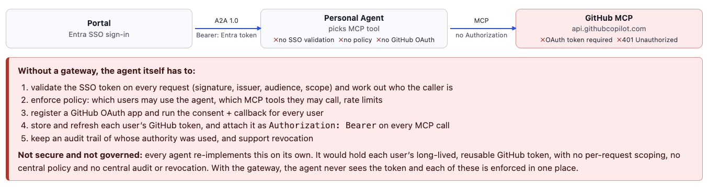

### Flow With gateway

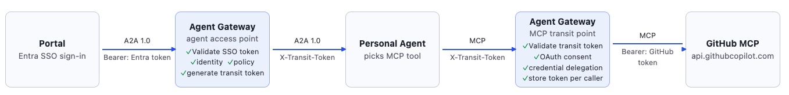

## Table of Contents

- [Without Gateway vs With Gateway](#without-gateway-vs-with-gateway)
- [Prerequisites](#prerequisites)
- [Repository Structure](#repository-structure)
- [Configuration](#configuration)
- [Phase 1 — Run Without Gateway](#phase-1--run-without-gateway)
- [Phase 2 — Run With Gateway](#phase-2--run-with-gateway)
  - [2.1 GitHub OAuth app](#21--create-the-github-oauth-app) · [2.2 Secrets](#22--store-the-oauth-client-in-gateway-secrets) · [2.3 Credential provider](#23--create-the-github-credential-provider) · [2.4 JWT strategy](#24--create-the-jwt-verification-strategy-entra-sso) · [2.5 Surface policy](#25--create-the-surface-policy) · [2.6 Surface](#26--create-the-agent-surface) · [2.7 MCP transit point](#27--add-the-mcp-transit-point-with-credential-delegation) · [2.8 Configure](#28--point-the-lab-at-the-gateway) · [2.9 Try it](#29--try-it)
- [Try These Prompts](#try-these-prompts)
- [Troubleshooting](#troubleshooting)

---

## Without Gateway vs With Gateway

### Without gateway — and its problems

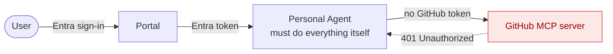

The GitHub MCP server needs the **user's GitHub OAuth token**. With no gateway, the agent would have to build all of this itself:

- ❌ **Validate the SSO token** — otherwise anyone with the agent URL can call it
- ❌ **Enforce policy** — which user may use which tool, with which scopes
- ❌ **Run the GitHub OAuth flow** and collect user consent
- ❌ **Store the GitHub token** — long-lived, reusable, and now sitting in the agent
- ❌ **Audit and revoke** — no record of whose authority was used, no central revoke

Giving the agent the user's GitHub token is **not secure and not governed**. In this lab the agent does none of it, so the call simply returns **HTTP 401**.

### With gateway — and its advantages

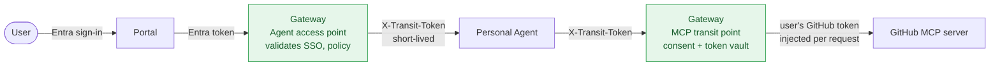

The agent never sees a GitHub token. The gateway does the hard parts:

- ✅ **No reusable credentials in the agent** — the gateway vault holds the GitHub token
- ✅ **Only the asking user's rights apply** — each call carries a signed per-request transit token
- ✅ **No standing access** — transit tokens are short-lived
- ✅ **Limited blast radius** — tool gating, OAuth scopes, and GitHub's own permissions
- ✅ **Clear audit trail** — consent and token use are recorded and revocable
- ✅ **User consent handled by the gateway** — the agent has no OAuth code at all

The agent code is the same in both phases. Only the URLs in `.env` change.

---

## Prerequisites

- **Python 3.11+**
- **Azure Entra ID app registration** for the portal sign-in (see [Entra setup](#entra-id-setup))
- _(Phase 2 only)_ [Affinidi Developer Portal](https://portal.affinidi.com/) account with an Agent Gateway
- _(Phase 2 only)_ A **GitHub OAuth App** (see [step 2.1](#21--create-the-github-oauth-app))
- _(Phase 2 only)_ A public HTTPS URL for the agent (for example via a tunnel)

> **No LLM required.** The agent matches simple intents and calls the MCP server directly, so you can focus on the gateway pattern.

---

## Repository Structure

```
agent-delegated-mcp-access/
├── agents/
│   ├── delegate_agent.py       # Personal Agent (A2A 1.0)
│   ├── mcp_gateway_client.py   # MCP client (sends X-Transit-Token when via gateway)
│   └── agent_common.py         # Shared middleware, trace, CORS
├── portal/
│   ├── server.py               # Entra sign-in, chat relay, trace
│   └── static/index.html       # UI with the flow diagrams
├── docs/images/                # Screenshots used in this README
├── .env.example                # Configuration template
├── requirements.txt
└── run.sh                      # Starts the agent and portal
```

---

## Configuration

```bash
cd use-cases/agent-delegated-mcp-access
cp .env.example .env
```

| Group  | Variable                                                      | Purpose                                                             |
| ------ | ------------------------------------------------------------- | ------------------------------------------------------------------- |
| Portal | `ENTRA_TENANT_ID`, `PORTAL_CLIENT_ID`, `PORTAL_CLIENT_SECRET` | Entra app used for portal sign-in                                   |
| Portal | `PORTAL_URL`, `PORTAL_PORT`                                   | Portal address (local or public — use one)                          |
| Portal | `USER_TOKEN_AUDIENCE`, `USER_TOKEN_SCOPE`                     | Scope the portal requests for the user token                        |
| Agent  | `AGENT_NAME`, `AGENT_PORT`, `AGENT_PUBLIC_URL`                | Agent display name and address                                      |
| Agent  | `AGENT_GATEWAY_URL`                                           | Gateway agent access point. Empty = portal calls the agent directly |
| MCP    | `MCP_URL`                                                     | MCP server called directly (Phase 1)                                |
| MCP    | `MCP_GATEWAY_URL`                                             | Gateway MCP transit point (Phase 2). Wins over `MCP_URL`            |

### Entra ID setup

1. In Azure, create an **App registration** for the portal.
2. Add a **Web** redirect URI: `<PORTAL_URL>/api/auth/callback/microsoft` (for local, `http://localhost:8097/api/auth/callback/microsoft`).
3. Create a **client secret**.
4. Copy the tenant ID, client ID, and secret into `.env`.
5. Expose an API scope and set `USER_TOKEN_AUDIENCE` / `USER_TOKEN_SCOPE` to match.

---

## Phase 1 — Run Without Gateway

Leave `AGENT_GATEWAY_URL` and `MCP_GATEWAY_URL` unset, and set:

```
MCP_URL=https://api.githubcopilot.com/mcp/readonly
```

Start everything:

```bash
./run.sh
```

Open the portal at `http://localhost:8097` and sign in with Entra. The portal shows the **without gateway** diagram.

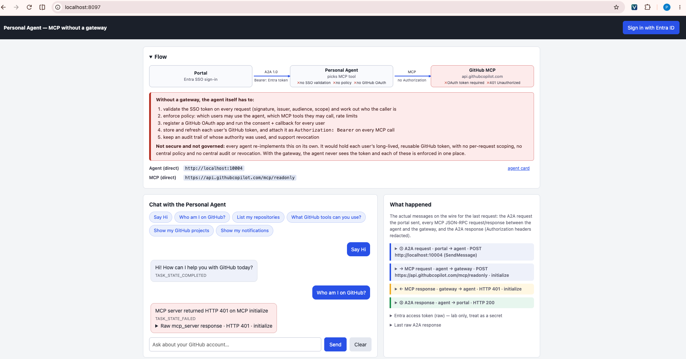

1. Send **Say Hi** — the agent answers. Chatting works.
2. Send **Who am I on GitHub?** — the agent calls the MCP server and gets:

   ```
   MCP server returned HTTP 401 ... No access token was provided in this request
   ```

That 401 is the point. To make it work the agent would need to validate SSO, enforce policy, run GitHub OAuth, and store the user's GitHub token. That is the problem the gateway removes.

---

## Phase 2 — Run With Gateway

Setup order: GitHub OAuth app → gateway secrets → credential provider → JWT strategy → surface policy → agent surface (access point, policy, target, transit point) → point the lab at the gateway.

### 2.1 — Create the GitHub OAuth app

1. GitHub → **Settings → Developer settings → OAuth Apps → New OAuth App**.
2. Set **Authorization callback URL** to the gateway callback you will get in step 2.3:
   `https://<your-gateway>/v1/identity/oauth/callback/github-oauth`
3. Create the app, then **Generate a new client secret**. Copy the client ID and secret.

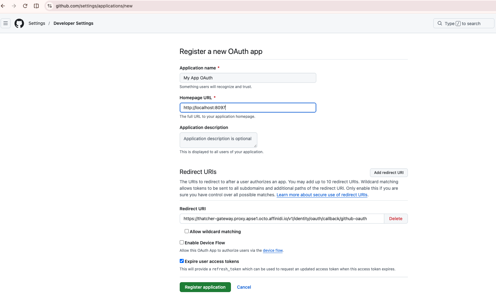
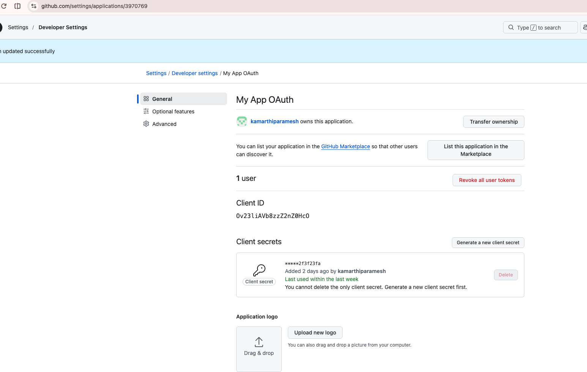

> The GitHub client ID and secret go into the **gateway**, never into this agent.

### 2.2 — Store the OAuth client in gateway secrets

In the gateway, add two secrets: `github-client-id` and `github-client-secret`.

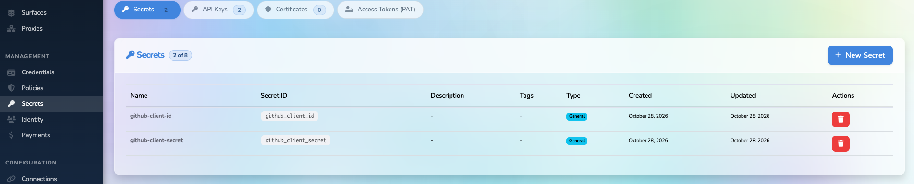

### 2.3 — Create the GitHub credential provider

Gateway → **Credential Providers → New**. A credential provider tells the gateway how to get and refresh an access token for an upstream service on a caller's behalf.

| Field                  | Value                                                                             |
| ---------------------- | --------------------------------------------------------------------------------- |
| Name                   | `github-oauth`                                                                    |
| Provider Type          | OAuth 2.0, Authorization Code (3-legged, user consent)                            |
| Authorization Endpoint | `https://github.com/login/oauth/authorize`                                        |
| Token Endpoint         | `https://github.com/login/oauth/access_token`                                     |
| Callback URL Host      | your gateway public address                                                       |
| Callback URL Route     | `github-oauth` → `https://<your-gateway>/v1/identity/oauth/callback/github-oauth` |
| Client ID Secret       | `github-client-id`                                                                |
| Client Secret          | `github-client-secret`                                                            |
| Default Scopes         | scopes you want to allow, for example `read:user, repo`                           |

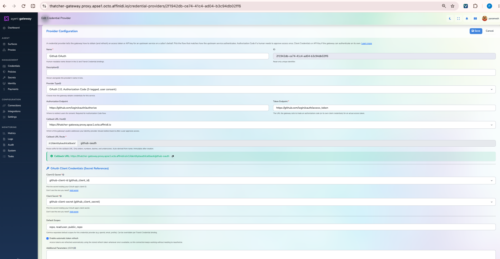

Use the callback URL shown here in the GitHub OAuth app (step 2.1).

### 2.4 — Create the JWT verification strategy (Entra SSO)

Gateway → **JWT Strategies → New**. This validates the user's Entra token at the access point.

| Field           | Value                                                                                       |
| --------------- | ------------------------------------------------------------------------------------------- |
| Name            | `Entra SSO`                                                                                 |
| Expected Issuer | `https://login.microsoftonline.com/<tenant-id>/v2.0` (must match the token's `iss` exactly) |
| JWKS Source     | Remote URL                                                                                  |
| JWKS URI        | `https://login.microsoftonline.com/<tenant-id>/discovery/v2.0/keys`                         |

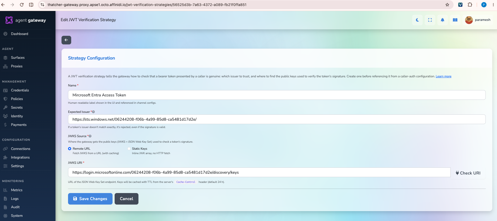

### 2.5 — Create the surface policy

Gateway → **Policies → New surface policy**. Name it `Source Auth Check`, paste the Rego below, and save. You select it on the surface in the next step.

```rego
package surface.policy

import rego.v1

default allow := false

allow if {
  caller_authenticated
}

deny_reason := source_auth_failure_reason if {
  not caller_authenticated
}

caller_authenticated if {
  method := object.get(object.get(input, "source_auth", {}), "method", "failed")
  method != "failed"
}

default source_auth_failure_reason := "Caller authentication failed"

source_auth_failure_reason := reason if {
  reason := object.get(object.get(input, "source_auth", {}), "reason", "")
  is_string(reason)
  reason != ""
}
```

### 2.6 — Create the agent surface

Gateway → **Surfaces → New A2A surface** (example: `Personal Agent Surface`).

**Access point**

- Protocol `a2a`, a route such as `/agents/archive/github`
- This URL becomes `AGENT_GATEWAY_URL`

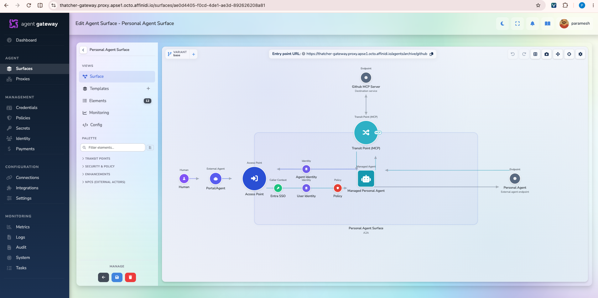

**Caller authentication** — JWT bearer using the `Entra SSO` strategy, header `Authorization`, scheme `Bearer`.

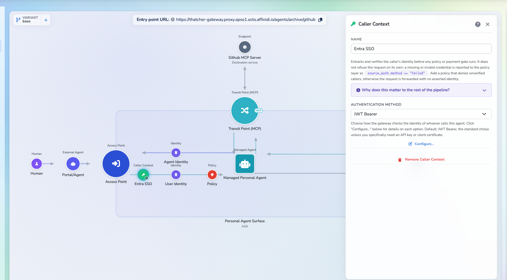
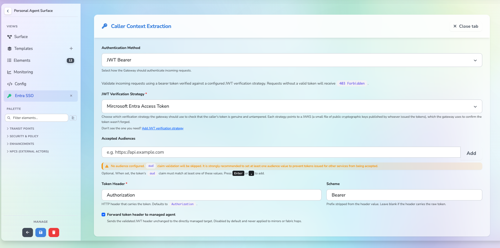

**Caller identity** — taken from the JWT claim `oid`, namespaced with `iss` and `tid`, so each Entra user is a distinct caller. Tokens in the vault are kept per caller.

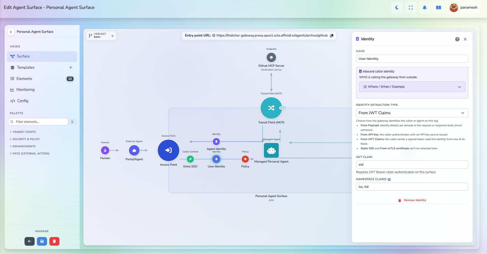

**Policy** — select the `Source Auth Check` surface policy created in step 2.5.
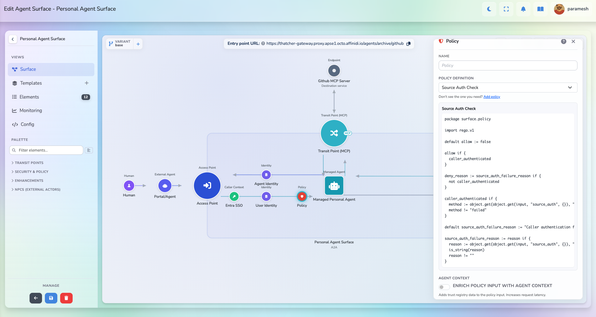

**Target** — select **Managed Agent** and set the target URL to your agent's public URL.

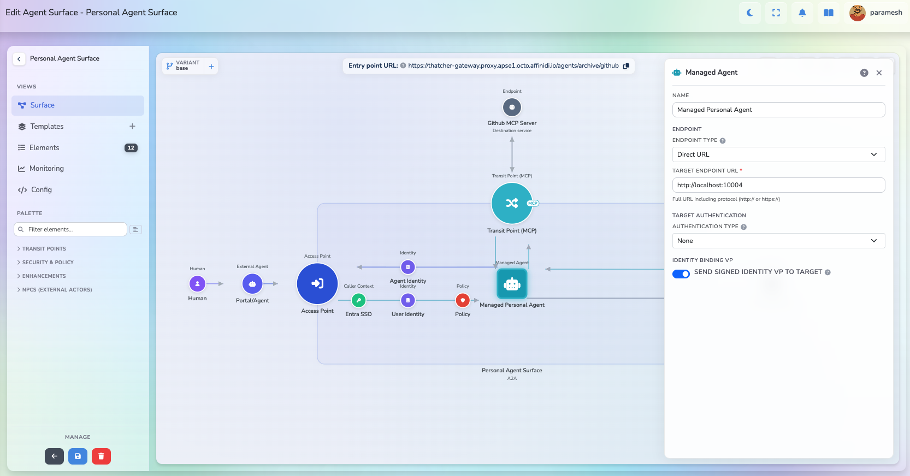

**Agent identity** — metadata the gateway attaches for the agent (`role`, `name`, `model`):

```json
{
  "type": "object",
  "properties": {
    "role": {
      "type": "string",
      "x-identity": true
    },
    "name": {
      "type": "string",
      "x-identity": true
    },
    "model": {
      "type": "string",
      "x-identity": true
    }
  },
  "required": ["role", "name", "model"]
}
```

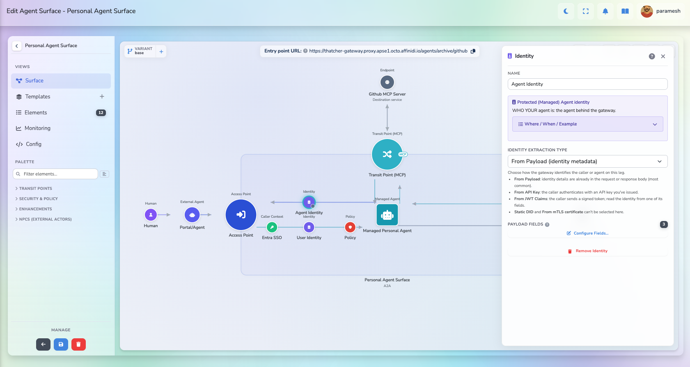

### 2.7 — Add the MCP transit point with credential delegation

On the same surface, add a **Transit Point (MCP)**:

| Field                 | Value                                                              |
| --------------------- | ------------------------------------------------------------------ |
| Target endpoint       | `https://api.githubcopilot.com/mcp/readonly`                       |
| Listen path           | `/outbound/routes/github/mcp` (this URL becomes `MCP_GATEWAY_URL`) |
| Require transit token | on                                                                 |

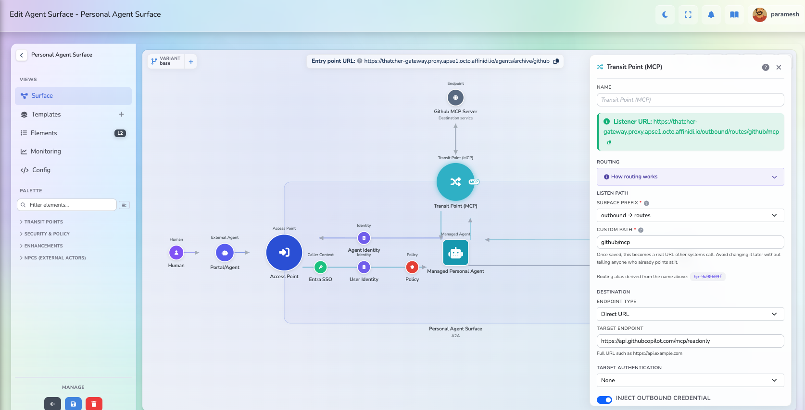

Enable **Inject outbound credential**, pick the `github-oauth` provider, and set:

| Field          | Value         |
| -------------- | ------------- |
| Consent mode   | On demand     |
| Inject as      | Bearer header |
| Elicit timeout | 300 s         |

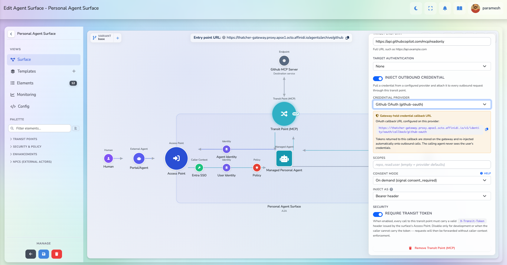

### 2.8 — Point the lab at the gateway

Edit `.env`. Run the agent where the gateway's target URL can reach it (the surface target above):

```
AGENT_GATEWAY_URL=https://<your-gateway>/agents/archive/github
MCP_GATEWAY_URL=https://<your-gateway>/outbound/routes/github/mcp
```

Restart with `./run.sh`. The portal now shows the **with gateway** diagram.

### 2.9 — Try it

1. Send **Hi** (or **Say Hi**). The agent replies on its own. No MCP call is made, so no consent is needed.

   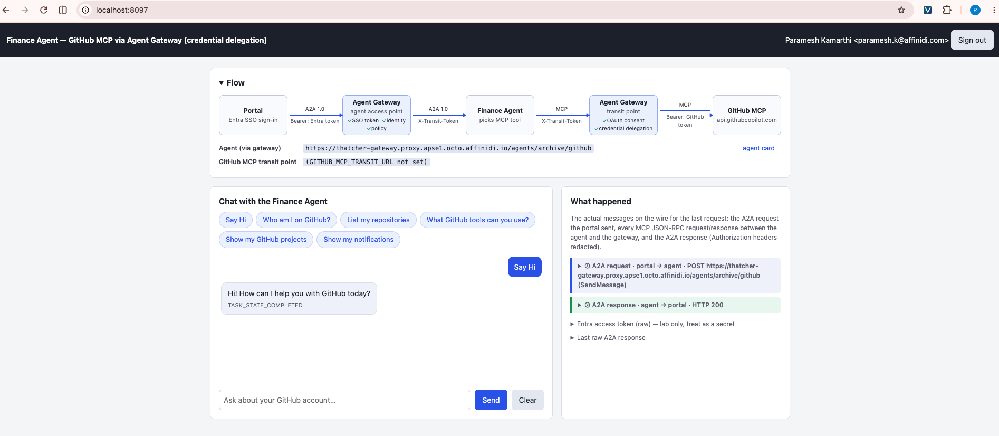

2. Send **Who am I on GitHub?**. This needs the MCP server. The gateway has no GitHub token for you yet, so it answers that **consent is required** and returns a link.

   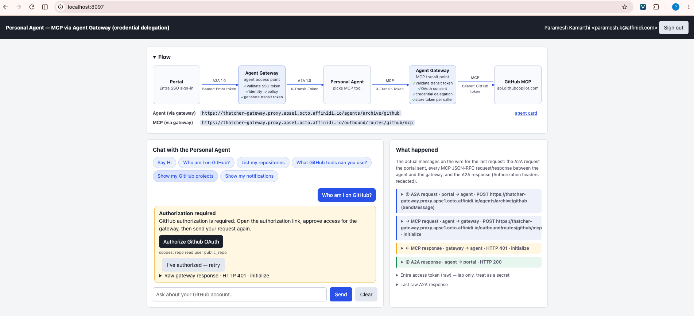

3. Open the link and approve access with your GitHub account.
4. Send the prompt again. The call succeeds and you get your GitHub data, but the agent never held a GitHub token.

   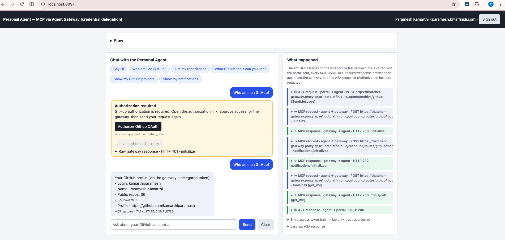

5. Send **What GitHub tools can you use?** (a second MCP call). No consent is requested this time: the gateway keeps the token per caller and refreshes it when needed.

   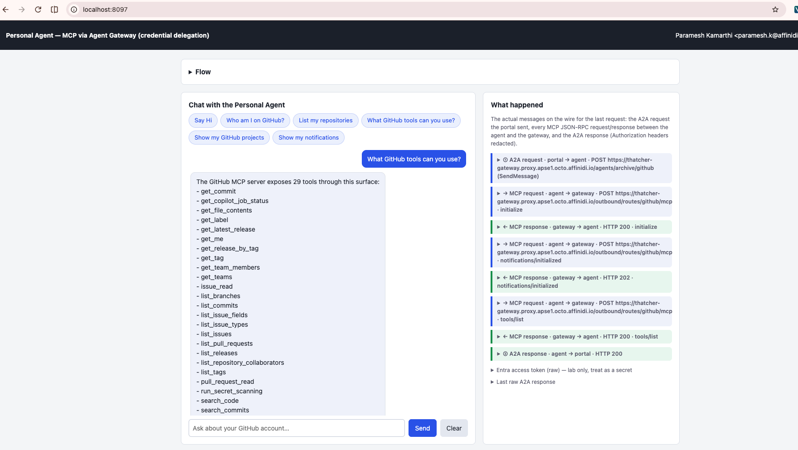

6. In the gateway, the **Credential Tokens** list shows the token held for each caller.

   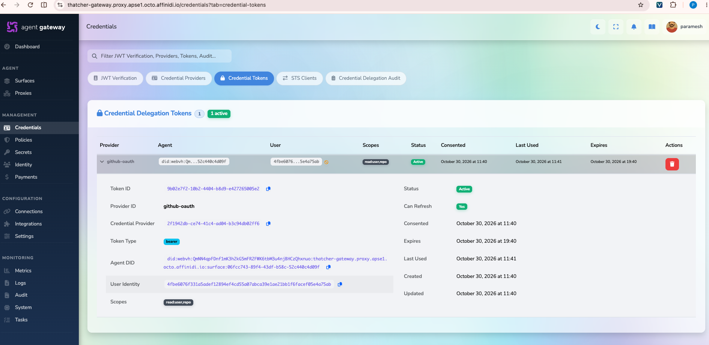

Use the portal's trace panel to see each hop and the headers the agent received.

---

## Try These Prompts

| Prompt                         | Without gateway | With gateway                        |
| ------------------------------ | --------------- | ----------------------------------- |
| Say Hi                         | Works           | Works                               |
| Who am I on GitHub?            | 401             | Consent, then your profile          |
| List my repositories           | 401             | Your repositories                   |
| What GitHub tools can you use? | 401             | Only the tools the gateway allows   |
| Show my GitHub projects        | 401             | Refused if the scope is not granted |
| Show my notifications          | 401             | Refused if the tool is not granted  |

---

## Troubleshooting

| Symptom                                     | Cause / fix                                                             |
| ------------------------------------------- | ----------------------------------------------------------------------- |
| `MCP server returned HTTP 401`              | Expected in Phase 1. In Phase 2 check `MCP_GATEWAY_URL` is set          |
| `Transit token missing or invalid`          | Request did not come through the gateway agent access point             |
| Portal says "Set PORTAL_CLIENT_ID / SECRET" | Fill the Entra values in `.env`                                         |
| Sign-in redirect mismatch                   | Redirect URI must be exactly `<PORTAL_URL>/api/auth/callback/microsoft` |
| Service fails to start                      | See `logs/agent.log` and `logs/portal.log`                              |
| `.env` fails to load                        | Quote values with spaces, for example `AGENT_NAME="Personal Agent"`     |
