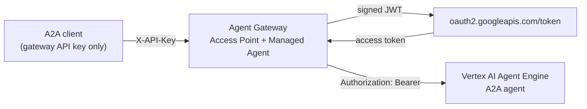

# Vertex AI Agent Behind the Agent Gateway

Deploy an A2A agent to **Vertex AI Agent Engine** and expose it through the **Agent Gateway**. Callers hold only a gateway API key. The gateway authenticates to Google as a service account, using the **JWT Bearer** credential provider, and attaches a short-lived Google access token to each request.



**What you will learn:**

- The minimum Google Cloud setup needed to run an A2A agent on Agent Engine
- How Agent Engine exposes A2A (HTTP+JSON binding, card location, endpoint shape)
- How to front it with the gateway so callers never handle Google credentials
- How to verify each hop, and what each failure looks like

> **Which guide should I use?** The [a2a-vertex-agent](../../a2a-vertex-agent/README.md) lab deploys an ADK + Gemini agent and calls Vertex directly with your own Google credentials. This use case is about **putting the gateway in front of Vertex**. It deploys a smaller agent and calls it only through the gateway.

---

## Contents

- [Cost](#cost)
- [Prerequisites](#prerequisites)
- [Step 1: Prepare Google Cloud](#step-1-prepare-google-cloud)
- [Step 2: Deploy the Agent](#step-2-deploy-the-agent)
- [Step 3: Test Vertex Directly](#step-3-test-vertex-directly)
- [Step 4: Create the Service Account for the Gateway](#step-4-create-the-service-account-for-the-gateway)
- [Step 5: Configure the Gateway](#step-5-configure-the-gateway)
- [Step 6: Test Through the Gateway](#step-6-test-through-the-gateway)
- [How Agent Engine Exposes A2A](#how-agent-engine-exposes-a2a)
- [Troubleshooting](#troubleshooting)
- [Clean Up](#clean-up)

---

## Cost

Agent Engine bills for compute (vCPU and memory) while the agent is deployed, whether or not it receives traffic. See [Vertex AI pricing](https://cloud.google.com/vertex-ai/pricing#vertex-ai-agent-engine). Delete the agent when you finish ([Clean Up](#clean-up)).

The agent has two modes, selected by `AGENT_MODE`:

| Mode              | Behaviour                                                                  | Model cost              |
| ----------------- | -------------------------------------------------------------------------- | ----------------------- |
| `rules` (default) | `ping` → `pong`; `USD to EUR` → live rate from a public FX API; otherwise echo | None                    |
| `gemini`          | One Gemini call per message (`gemini-2.5-flash`, max 256 output tokens)     | Per token, per message  |

Gateway behaviour is identical in both modes. Start with `rules`.

---

## Prerequisites

- A Google Cloud project with **billing enabled**, and permission to enable APIs, create buckets, service accounts and keys, and grant project roles (Owner or Editor on a test project is simplest)
- [gcloud CLI](https://cloud.google.com/sdk/docs/install), signed in:

  ```bash
  gcloud auth login
  gcloud auth application-default login   # used by the Python SDK to deploy
  gcloud config set project <project-id>
  ```

- Python 3.10 to 3.13
- An Agent Gateway with permission to manage **Secrets**, **Credentials** and **Surfaces**

Files in this folder:

| File               | Purpose                                                                 |
| ------------------ | ----------------------------------------------------------------------- |
| `agent.py`         | The A2A agent (agent card + executor). `AGENT_MODE` selects reply logic |
| `deploy.py`        | `deploy`, `update`, `list`, `delete` the agent on Agent Engine          |
| `client.py`        | A2A SDK client that calls the agent **through the gateway**             |
| `.env.example`     | Settings for `deploy.py`                                                |

---

## Step 1: Prepare Google Cloud

### 1.1 Enable the APIs

Only three APIs are needed:

| API                                     | Why                                                                 |
| --------------------------------------- | ------------------------------------------------------------------- |
| `aiplatform.googleapis.com`             | Vertex AI, including Agent Engine and Gemini                        |
| `storage.googleapis.com`                | The SDK uploads the packaged agent to a staging bucket              |
| `cloudresourcemanager.googleapis.com`   | The SDK resolves the project number during deployment               |

**Console:** **APIs & Services → Library**. Search for and **Enable** *Vertex AI API*, *Cloud Storage API* and *Cloud Resource Manager API*.

**CLI:**

```bash
gcloud services enable aiplatform.googleapis.com storage.googleapis.com cloudresourcemanager.googleapis.com
gcloud services list --enabled --filter="name:(aiplatform OR storage OR cloudresourcemanager)"
```

### 1.2 Create a staging bucket

Agent Engine pulls the packaged agent from a Cloud Storage bucket. Create it in the region you will deploy to, private, with uniform access.

**Console:** **Cloud Storage → Buckets → Create**. Name `<project-id>-agent-staging`; **Location type** *Region* and your region (for example `asia-southeast1`); **Access control** *Uniform*; keep **Enforce public access prevention** checked → **Create**.

**CLI:**

```bash
PROJECT_ID=$(gcloud config get-value project)
REGION=asia-southeast1
gcloud storage buckets create gs://$PROJECT_ID-agent-staging \
  --location=$REGION --uniform-bucket-level-access --public-access-prevention
```

Pick any [Agent Engine region](https://cloud.google.com/vertex-ai/generative-ai/docs/agent-engine/locations). Use the same region for the bucket, the agent and the gateway endpoint.

---

## Step 2: Deploy the Agent

```bash
cd use-cases/vertex-agent-gateway-auth
python3 -m venv .venv && source .venv/bin/activate
pip install -r requirements.txt
cp .env.example .env
```

Edit `.env`:

```bash
GOOGLE_CLOUD_PROJECT=<project-id>
GOOGLE_CLOUD_LOCATION=asia-southeast1
STAGING_BUCKET=gs://<project-id>-agent-staging
AGENT_MODE=rules
GEMINI_MODEL=gemini-2.5-flash
```

Deploy (takes a few minutes):

```bash
python deploy.py deploy
```

Output:

```text
Resource name: projects/<project-number>/locations/<region>/reasoningEngines/<engine-id>
A2A endpoint : https://<region>-aiplatform.googleapis.com/v1beta1/projects/<project-number>/locations/<region>/reasoningEngines/<engine-id>/a2a
Agent card   : https://<region>-aiplatform.googleapis.com/v1beta1/projects/<project-number>/locations/<region>/reasoningEngines/<engine-id>/a2a/v1/card
```

Keep both URLs; the gateway needs them. The resource name is also saved to `.deployed_resource_name`.

**Console:** **Vertex AI → Agent Engine** lists the agent (*Gateway Demo Agent*). Open it for deployment status and logs.

### Optional: switch to Gemini mode

Gemini mode uses the Vertex AI API you already enabled. No further setup is needed.

```bash
# in .env
AGENT_MODE=gemini
```

```bash
python deploy.py update     # redeploys code and settings to the same engine; URLs do not change
```

Switch back with `AGENT_MODE=rules` and `python deploy.py update`.

---

## Step 3: Test Vertex Directly

Before adding the gateway, confirm the agent works with your own Google token. This isolates agent problems from gateway problems.

```bash
V=https://<region>-aiplatform.googleapis.com/v1beta1/projects/<project-number>/locations/<region>/reasoningEngines/<engine-id>/a2a
TOKEN=$(gcloud auth print-access-token)

curl -s "$V/v1/card" -H "Authorization: Bearer $TOKEN"

curl -s -X POST "$V/v1/message:send" \
  -H "Authorization: Bearer $TOKEN" -H "Content-Type: application/json" \
  -d '{"message":{"messageId":"m-1","role":"ROLE_USER","content":[{"text":"USD to EUR"}]}}'
```

Expected:

```json
{"message": {"role": "ROLE_AGENT", "content": [{"text": "1 USD = 0.86 EUR"}], "...": "..."}}
```

The card shows `"protocolVersion": "0.3.0"` and `"preferredTransport": "HTTP+JSON"`.

---

## Step 4: Create the Service Account for the Gateway

The gateway calls Vertex as a service account. Follow **Steps 1 and 2** of the [JWT Bearer guide](../../feature-guide/credential-providers/jwt-bearer.md#step-1-create-the-service-account):

1. Create a service account and grant it **Vertex AI User** (`roles/aiplatform.user`) on the project. This allows `aiplatform.reasoningEngines.query` and nothing administrative.
2. Give it a key, preferably by **uploading your own certificate**, and note the **private key PEM**, **service account email** and **key ID**.

IAM changes can take a minute or two to apply. Until then Vertex returns `403 PERMISSION_DENIED`.

---

## Step 5: Configure the Gateway

### 5.1 Credential provider

Create the **JWT Bearer** credential provider as in [JWT Bearer guide, Step 3.1 and 3.2](../../feature-guide/credential-providers/jwt-bearer.md#step-3-configure-the-gateway): a secret holding the private key, then a provider of type *OAuth 2.0, JWT Bearer* with the service account email as **Issuer**, the key ID, token endpoint `https://oauth2.googleapis.com/token` and scope `https://www.googleapis.com/auth/cloud-platform`. This guide calls it `google-sa`.

### 5.2 Caller API key

Callers prove who they are to the gateway with an API key. You choose the key value and store it as a secret; the Access Point compares each caller's `X-API-Key` header against it.

1. Generate a random value and keep it for the test step:

   ```bash
   openssl rand -hex 32
   ```

2. In the gateway, go to **Secrets → New Secret** and fill in:

   | Field       | Value                                              |
   | ----------- | -------------------------------------------------- |
   | Secret Name | `Vertex demo caller key`                           |
   | Secret ID   | `VERTEX_DEMO_CALLER_KEY` (the Access Point refers to this ID) |
   | Description | optional, for example `Caller key for vertex-demo` |
   | Secret Type | `General`                                          |
   | Value       | the value from step 1                              |

3. **Save.** You select this secret on the Access Point in the next step.

Share the value only with the callers that should reach this agent. To rotate it, edit the secret's value and give callers the new one.

### 5.3 Surface

**Surfaces → Add Surface**, protocol **A2A**. Configure the two nodes.

**Access Point:**

| Field                              | Value                                                                                                  |
| ---------------------------------- | ------------------------------------------------------------------------------------------------------ |
| Route                              | for example `/agents/vertex-demo`                                                                      |
| Caller Authentication              | **API Key**, header `X-API-Key`, secret `VERTEX_DEMO_CALLER_KEY`                                        |
| Supported versions                 | **A2A 0.3** (Agent Engine speaks A2A 0.3)                                                              |
| Message validation                 | **Off**                                                                                                |
| Override Agent Card Location       | checked, path `v1beta1/projects/<project-number>/locations/<region>/reasoningEngines/<engine-id>/a2a/v1/card` |

- **Message validation Off** is required. Agent Engine uses the A2A **HTTP+JSON** binding (`POST /v1/message:send`), not JSON-RPC, and the JSON-RPC validators reject it with `400`. The trade-off: policies that match on JSON-RPC method names do not apply to this surface.
- **The card path is relative to the endpoint's origin**, not to the endpoint path. Enter it without a leading `/`. It is the path of the *Agent card* URL printed by `deploy.py`.

**Managed Agent:**

| Field                   | Value                                                                                                                          |
| ----------------------- | ------------------------------------------------------------------------------------------------------------------------------ |
| Endpoint                | the *A2A endpoint* printed by `deploy.py`, ending in `/a2a` (not `/a2a/v1`)                                                     |
| Target Authentication   | enabled                                                                                                                        |
| Credential Source       | Credential provider                                                                                                            |
| Credential Provider     | `google-sa`                                                                                                                    |
| Authentication Type     | Bearer (`Authorization` header)                                                                                                |
| Fallback Behavior       | Reject request                                                                                                                 |

The endpoint ends in `/a2a` because A2A clients append `/v1/message:send` and `/v1/tasks/...` to the agent URL. The gateway rewrites the card's `url` to its own public address, so clients that read the card call the gateway, not Vertex.

**Save and deploy** the surface.

---

## Step 6: Test Through the Gateway

Set two variables:

```bash
G=https://<gateway-host>/agents/vertex-demo     # Access Point address + route
K=<value of VERTEX_DEMO_CALLER_KEY>             # the value you generated in 5.2
```

Agent Engine speaks A2A 0.3 over **HTTP+JSON**, so these calls go to `/v1/...` paths with a plain JSON body. There is no JSON-RPC envelope (`jsonrpc`, `method`) and the message text is under `content`, not `parts`.

**1. Agent card.** The gateway fetches it from Vertex with the service-account token:

```bash
curl -s "$G/v1/card" -H "X-API-Key: $K" | jq '{name, url, protocolVersion, preferredTransport}'
```

```json
{
  "name": "Gateway Demo Agent",
  "url": "https://<gateway-host>/agents/vertex-demo",
  "protocolVersion": "0.3.0",
  "preferredTransport": "HTTP+JSON"
}
```

`url` is the gateway address, not Vertex. Clients that read the card keep calling the gateway.

**2. Send a message:**

```bash
curl -s -X POST "$G/v1/message:send" \
  -H "X-API-Key: $K" \
  -H "Content-Type: application/json" \
  -H "A2A-Version: 0.3" \
  -d '{"message":{"messageId":"m-1","role":"ROLE_USER","content":[{"text":"USD to EUR"}]}}' | jq
```

```json
{
  "message": {
    "role": "ROLE_AGENT",
    "content": [{ "text": "1 USD = 0.86 EUR" }],
    "messageId": "...",
    "contextId": "..."
  }
}
```

Try `"ping"` (reply `pong`) or any other text (echoed back). Use a new `messageId` for each message. The `A2A-Version` header is optional when the Access Point accepts only 0.3.

**3. Missing or wrong key.** The gateway rejects the call before it reaches Google:

```bash
curl -s -o /dev/null -w '%{http_code}\n' -X POST "$G/v1/message:send" \
  -H "Content-Type: application/json" -d '{}'
# 401

curl -s -o /dev/null -w '%{http_code}\n' -X POST "$G/v1/message:send" \
  -H "X-API-Key: wrong" -H "Content-Type: application/json" -d '{}'
# 401
```

If either returns anything other than `401`, caller authentication is not active on the Access Point.

**4. A2A SDK client (optional):**

```bash
GATEWAY_AGENT_URL=$G GATEWAY_API_KEY=$K python client.py "USD to EUR"
```

```text
Agent: Gateway Demo Agent  transport: HTTP+JSON
Agent: 1 USD = 0.86 EUR
```

`client.py` has no Google credentials. It resolves the card through the gateway and uses the HTTP+JSON transport the card advertises.

**In the dashboard:** a `google-sa` token appears under **Credentials → Credential Tokens**. It is reused until shortly before it expires (about one hour).

---

## How Agent Engine Exposes A2A

| Item              | Value                                                                                       |
| ----------------- | ------------------------------------------------------------------------------------------- |
| Agent URL         | `https://<region>-aiplatform.googleapis.com/v1beta1/<resource-name>/a2a`                    |
| Agent card        | `<agent URL>/v1/card` (not `/.well-known/agent-card.json`)                                  |
| Send              | `POST <agent URL>/v1/message:send`                                                          |
| Get task          | `GET <agent URL>/v1/tasks/{id}`                                                             |
| Protocol / binding | A2A 0.3, HTTP+JSON only                                                                    |
| Auth              | Google OAuth access token with `aiplatform.reasoningEngines.query` on the engine            |

**Message or Task.** Agent Engine runs several worker processes per instance, each with its own in-memory task store. A `GET /v1/tasks/{id}` can reach a worker that never saw the task and return `404 Task not found`. This agent therefore answers with a single A2A **Message**, so the reply comes back in the `message:send` response. Agents that need long-running tasks should configure a shared task store (`task_store_builder` on `A2aAgent`).

---

## Troubleshooting

| Symptom                                                           | Cause and fix                                                                                                                                       |
| ----------------------------------------------------------------- | --------------------------------------------------------------------------------------------------------------------------------------------------- |
| Deploy fails: *Cloud Resource Manager API has not been used*      | Enable `cloudresourcemanager.googleapis.com` ([1.1](#11-enable-the-apis)).                                                                           |
| Deploy fails reading the bucket                                   | `STAGING_BUCKET` missing `gs://`, wrong project, or bucket in another region.                                                                      |
| Gateway `401`                                                     | Missing or wrong `X-API-Key`. Expected for unauthenticated calls.                                                                                   |
| Calls **without** a key succeed                                   | Caller Authentication is not set on the Access Point. Add it and redeploy the surface.                                                              |
| Gateway `400` *Invalid JSON-RPC*                                  | Message validation is not **Off**.                                                                                                                  |
| Unsupported A2A protocol version                                  | **Supported versions** does not include A2A 0.3.                                                                                                    |
| Card `404`                                                        | Override Agent Card Location not set, or not the full origin-relative path ending `/a2a/v1/card`.                                                   |
| `404` on `.../a2a/v1/v1/message:send` or `.../a2a/message:send`   | Managed Agent endpoint must end in `/a2a` exactly.                                                                                                  |
| `403 PERMISSION_DENIED` *aiplatform.reasoningEngines.query*       | Service account lacks `roles/aiplatform.user`, or the grant is still propagating (wait a minute).                                                   |
| `502` from the gateway, no Vertex call                            | The provider could not get a token. Check the provider's last error and the [JWT Bearer troubleshooting](../../feature-guide/credential-providers/jwt-bearer.md#troubleshooting). |
| `404 Task not found` when polling                                 | See [Message or Task](#how-agent-engine-exposes-a2a).                                                                                               |
| Reply *The agent could not process the request.*                  | The reply logic raised an error. Check **Vertex AI → Agent Engine → (agent) → Logs**. In Gemini mode, confirm the model is available in your region. |

Agent logs from the CLI:

```bash
gcloud logging read 'resource.type="aiplatform.googleapis.com/ReasoningEngine" AND resource.labels.reasoning_engine_id="<engine-id>"' \
  --freshness=15m --limit=50 --format='value(timestamp,textPayload)'
```

---

## Clean Up

```bash
python deploy.py delete                                # deletes the agent; stops compute billing
gcloud storage rm -r gs://$PROJECT_ID-agent-staging     # optional
gcloud projects remove-iam-policy-binding $PROJECT_ID \
  --member "serviceAccount:<service-account-email>" --role roles/aiplatform.user --condition=None
```

In the gateway, delete the surface, the credential provider and the two secrets if they are no longer needed. To revoke the service account key, delete it under **IAM & Admin → Service Accounts → (account) → Keys**.

---

## Related

- [JWT Bearer credential provider](../../feature-guide/credential-providers/jwt-bearer.md)
- [Credential providers overview](../../feature-guide/credential-providers/README.md)
- [Vertex AI Agent Engine: A2A agents](https://cloud.google.com/vertex-ai/generative-ai/docs/agent-engine/develop/a2a)
